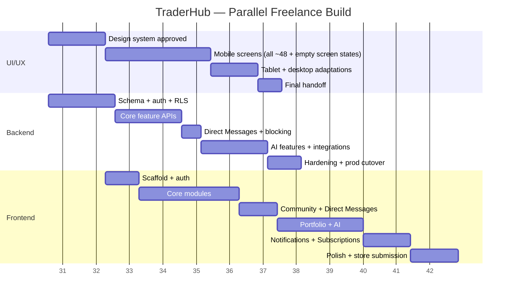

### Timeline
Three separate engagements (`CLIENT_BRIEF_UIUX.md`, `CLIENT_BRIEF_FRONTEND.md`, `CLIENT_BRIEF_BACKEND.md`) running concurrently rather than one person doing everything in sequence:

| Track | Est. duration | Can start |
|---|---|---|
| UI/UX design | 4–6 weeks | Immediately — full screen/design spec already exists (`03-design/`), now including the 3 Direct Messages screens |
| Backend | 5–7 weeks | Immediately — full schema/API spec exists (`02-architecture/`), independent of design; includes `conversations`/`messages`/`blocks` and the `notify_new_message` trigger |
| Frontend | 5–7 weeks | Blocked on the design system milestone (~week 1–2 of the UI/UX track); can build against the documented API contract before the backend finishes, per `06-business/DOC_ACCESS_MAP.md` |

**Critical path: Frontend.** It's blocked at the start by the design system milestone, and it needs the backend meaningfully done before final integration/QA — so it roughly bookends the other two tracks rather than running fully independently of them. Total wall-clock time lands around **8–10 weeks**.
