# Database ER Diagram — TraderHub

Visual companion to [API_DATA_MODEL.md](./API_DATA_MODEL.md), which has the full DDL and RLS policies. This doc is relationships-at-a-glance plus indexing/migration notes for whoever is building against the schema day to day.

### 1. Entity Relationship Diagram

```mermaid
erDiagram
    profiles ||--o{ journal_entries : owns
    profiles ||--o{ strategies : owns
    profiles ||--o{ watchlists : owns
    profiles ||--o{ posts : authors
    profiles ||--o{ comments : authors
    profiles ||--o{ saved_posts : bookmarks
    profiles ||--o{ notifications : receives
    profiles ||--o{ device_tokens : registers
    profiles ||--o{ conversations : "participant A"
    profiles ||--o{ conversations : "participant B"
    conversations ||--o{ messages : contains
    profiles ||--o{ blocks : "blocker"
    profiles ||--o{ blocks : "blocked"
    profiles ||--o{ follows : "follower"
    profiles ||--o{ follows : "followee"
    profiles ||--o{ likes : likes
    profiles ||--|| subscriptions : has

    journal_entries }o--|| strategies : "strategy_used (nullable)"
    journal_entries ||--o{ journal_entry_links : "source"
    journal_entries ||--o{ journal_entry_links : "target"

    strategies ||--o{ strategy_versions : "version history"

    watchlists ||--o{ watchlist_items : contains

    posts ||--o{ comments : has
    posts ||--o{ likes : has
    posts ||--o{ saved_posts : "saved by"

    profiles {
        uuid id PK
        text handle UK
        text experience_level
        text trading_style
        boolean public_journals
        text subscription_tier
    }
    subscriptions {
        uuid user_id PK,FK
        text tier
        text status
        text revenuecat_id UK
        text billing_cycle
        timestamptz expires_at
    }
    device_tokens {
        uuid id PK
        uuid user_id FK
        text token
        text platform
    }
    conversations {
        uuid id PK
        uuid user_a_id FK
        uuid user_b_id FK
        timestamptz last_message_at
    }
    messages {
        uuid id PK
        uuid conversation_id FK
        uuid sender_id FK
        text content
        timestamptz read_at
    }
    blocks {
        uuid blocker_id PK,FK
        uuid blocked_id PK,FK
        timestamptz created_at
    }
    follows {
        uuid follower_id PK,FK
        uuid followee_id PK,FK
        timestamptz created_at
    }
    likes {
        uuid user_id PK,FK
        uuid post_id PK,FK
        timestamptz created_at
    }
    journal_entries {
        uuid id PK
        uuid user_id FK
        text ticker
        numeric entry_price
        numeric exit_price
        numeric stop_loss
        numeric target
        numeric pnl
        uuid strategy_id FK
        text outcome
        text outcome_source
        boolean is_public
    }
    strategies {
        uuid id PK
        uuid user_id FK
        text title
        jsonb content
        text visibility
        text ai_summary
    }
    strategy_versions {
        uuid id PK
        uuid strategy_id FK
        jsonb content
        int version_number
    }
    journal_entry_links {
        uuid id PK
        uuid source_entry_id FK
        uuid target_entry_id FK
    }
    watchlists {
        uuid id PK
        uuid user_id FK
        text name
    }
    watchlist_items {
        uuid id PK
        uuid watchlist_id FK
        text ticker
        numeric price_alert_threshold
        text price_alert_direction
        boolean alert_armed
        timestamptz alert_last_triggered_at
    }
    posts {
        uuid id PK
        uuid user_id FK
        text content_type
        text ticker
    }
    comments {
        uuid id PK
        uuid post_id FK
        uuid user_id FK
    }
    saved_posts {
        uuid user_id FK
        uuid post_id FK
    }
    notifications {
        uuid id PK
        uuid user_id FK
        text category
        text deep_link
        timestamptz read_at
    }
    ai_insights {
        uuid id PK
        text ticker
        text summary
        jsonb indicators
    }
    ai_insight_requests {
        uuid id PK
        uuid user_id FK
        text kind
        text ticker
    }
    revenuecat_webhook_events {
        text event_id PK
        text event_type
        timestamptz processed_at
    }
```

Not shown (no FK relationships to model): `ai_insights` is intentionally not user-scoped (shared per-ticker cache, API_DATA_MODEL.md § 1); `revenuecat_webhook_events` has no FK at all — it's a standalone idempotency log keyed on RevenueCat's own event ID, deliberately decoupled from `profiles` since a webhook can theoretically arrive for an `app_user_id` that doesn't cleanly map (defensive design, not expected to happen often). `follows` and `likes` are pure junction tables on `profiles`/`posts` — both are now given attribute boxes above (their composite PKs are the whole schema, so the boxes are short) for consistency with every other junction table in this diagram (`blocks`, `saved_posts`).

Also not modeled here: `portfolio_stats` is a **view**, not a table — it has no independent existence in the ERD sense, it's a `group by user_id` aggregate over `journal_entries` (`sum(pnl)`, `win_rate`, `avg_rr`, best/worst trade — full definition in API_DATA_MODEL.md § 1). Anyone diagramming "what feeds the Portfolio Dashboard" should treat it as a derived read path off `journal_entries`, not a new entity with its own lifecycle.

**Not yet in the schema at all:** `ai_chat_messages` (`id`, `conversation_id`, `user_id`, `role`, `content`, `created_at`) is required to back the `ai-chat` Edge Function's conversation history (API_DATA_MODEL.md § 10) but is explicitly flagged there as pending — its `conversation_id` would be a *separate* concept from the Direct Messages `conversations` table above (same name, different feature: one is AI Q&A threading, the other is user-to-user DMs), and adding it is being deliberately held until chat-history retention policy is decided. Do not conflate the two `conversation_id` concepts if/when this table lands.

### 2. Cardinality notes worth flagging to whoever writes queries
- `journal_entries.strategy_id` is **nullable** — a huge fraction of entries may have no strategy. Never write a query that assumes it's present; always outer-join or filter explicitly.
- `journal_entry_links` is self-referential on `journal_entries` (`source_entry_id`/`target_entry_id`) — a `check (source_entry_id != target_entry_id)` constraint is now in the DDL (API_DATA_MODEL.md § 1) preventing accidental self-links at the database level, not just the application layer.
- `strategies.visibility` drives two different read paths (owner vs. public) — see API_DATA_MODEL.md § 2 RLS. Any admin/reporting query that bypasses RLS (service role) must still respect this distinction manually if it's user-facing in any way.
- `profiles.subscription_tier` is denormalized from `subscriptions.tier` — `subscriptions` is the source of truth (synced from RevenueCat via the `revenuecat-webhook` function, API_DATA_MODEL.md § 9), `profiles.subscription_tier` is a read-optimized copy. **`subscriptions` has no client-writable RLS policy at all** — it's written exclusively by the webhook function under the service role; a client can read its own row but never modify it, even indirectly.
- `watchlist_items.alert_armed`/`alert_last_triggered_at` implement the cooldown/dedup behavior that was previously just a prose note — see API_DATA_MODEL.md § 8 for the arm/re-arm logic the `price-alerts` job implements against these two columns.
- `conversations.user_a_id`/`user_b_id` is a canonicalized pair (smaller UUID always in `user_a_id`, API_DATA_MODEL.md § 1) — application code creating a conversation must sort the two participant IDs before insert, or the `unique (user_a_id, user_b_id)` constraint won't actually prevent duplicate conversations between the same two people created in the opposite order.
- `messages`' tier gate is enforced entirely in RLS on `insert` (API_DATA_MODEL.md § 2), not in a separate Edge Function — this is the one place a plain CRUD table has subscription-tier logic baked into its RLS policy rather than being an all-or-nothing owner check; keep that in mind if this policy ever needs to change; it's not a template to copy elsewhere without the same reasoning.
- `conversations` carries a `check (user_a_id != user_b_id)` constraint alongside the `unique (user_a_id, user_b_id)` mentioned above — a user can't open a DM thread with themselves. Same pattern as `journal_entry_links`' self-link check, just on a different table.
- `messages.read_at` can only be toggled by the **recipient**, never the sender — the RLS update policy's `with check (sender_id != auth.uid())` (API_DATA_MODEL.md § 2) means a client can mark someone else's message as read but can never touch a message's `content` after insert, and can never mark their own sent message as read. There's no separate "edit message" path at all — the update policy exists only for the read-receipt use case.
- `blocks` carries a `check (blocker_id != blocked_id)` — a user can't block themselves. Same self-reference guard pattern as above.
- `blocks` was added specifically to back Direct Messages' abuse-prevention requirement — it had been a described feature (report/block/mute, PRD.md § 5.6) with no table anywhere in the schema until now. The `are_blocked()` helper function (API_DATA_MODEL.md § 1) is `security definer` so it can check both directions of a block relationship from within another table's RLS policy without needing the caller to have direct read access to `blocks` rows they don't own. **Not yet extended to `posts`/`comments`** — a blocked user's public posts are still technically visible via the public-read policy; filtering them out of a blocker's own feed is left as an application-layer query concern (add `not in (select blocked_id from blocks where blocker_id = auth.uid())`), not an RLS change, since posts are meant to stay public-read overall.

### 3. Indexing
Beyond the implicit indexes on primary keys and unique constraints already in the DDL (API_DATA_MODEL.md § 1), add:

| Table | Index | Why |
|---|---|---|
| `journal_entries` | `(user_id, created_at desc)` | Journal List's default sort/pagination |
| `journal_entries` | `(user_id, ticker)` | Ticker filter |
| `journal_entries` | `(user_id, strategy_id)` | Strategy Analyzer rollup query |
| `journal_entries` | GIN on `tags` | Tag filter (array containment) |
| `strategies` | `(user_id, category)` | Category filter on Strategy List |
| `strategies` | partial index on `visibility = 'public'` | Public Strategy Notes discovery (ROADMAP.md § Next) |
| `posts` | `(created_at desc)` | Community Feed default sort |
| `posts` | `(content_type, created_at desc)` | Content-type filtered feed |
| `notifications` | `(user_id, read_at, created_at desc)` | Notification Center unread-first sort |
| `ai_insight_requests` | `(user_id, kind, requested_at)` | Rate-limit count queries (API_DATA_MODEL.md § 13) |
| `watchlist_items` | `(watchlist_id, ticker)` | already the unique constraint, covers lookups too |
| `watchlist_items` | partial index on `alert_armed = true and price_alert_threshold is not null` | `price-alerts` job's core query — only scan items that could actually need checking |
| `device_tokens` | `(user_id)` | already covered by the FK, called out since it's the lookup pattern every push-sending function uses |
| `subscriptions` | `(revenuecat_id)` | already the unique constraint — this is the join key the webhook uses to find the right row on `RENEWAL`/`CANCELLATION` events |
| `conversations` | `(user_a_id, last_message_at desc)` and `(user_b_id, last_message_at desc)` | Direct Messages list, sorted by most recent activity — needs both directions since either column can match the current user |
| `messages` | `(conversation_id, created_at desc)` | Loading a conversation's message history in order |
| `blocks` | `(blocked_id)` | Reverse lookup used inside `are_blocked()` — the primary key covers `(blocker_id, blocked_id)` but the function also needs the swapped direction |
| `follows` | `(followee_id)` | Follower-count / "who follows this profile" — the primary key `(follower_id, followee_id)` only covers "who does this profile follow" |
| `likes` | `(post_id)` | Like-count per post — the primary key `(user_id, post_id)` only covers "did this user like this post" |
| `comments` | `(post_id, created_at)` | Loading a post's comment thread in order — not yet covered by any constraint-derived index |

### 4. Triggers with cross-table side effects
The ER diagram above only shows FK edges — it doesn't show the one place a row insert on one table silently writes to two others. Worth flagging separately since it's easy to miss when just reading the schema top to bottom:

- **`on_new_message`** (fires `after insert on messages`, full definition in API_DATA_MODEL.md § 11) does two things beyond the insert itself:
  1. Inserts a `notifications` row for the **recipient** (`category='direct_message'`) — not the sender. This means `messages` has an *implicit* write-path into `notifications` that isn't a normal FK and won't show up in a standard schema diff between the two tables.
  2. Updates `conversations.last_message_at` — so that column is never written directly by client code; it's entirely trigger-maintained. Any query or index relying on `conversations.last_message_at` for sort order is implicitly depending on this trigger firing on every message insert.
- It runs `security definer`, which is the one case in this schema where a trigger writes across a user boundary (recipient's own RLS would otherwise block the sender's insert from creating a row in the recipient's `notifications`). API_DATA_MODEL.md § 11 calls this out as a reviewed exception, not a pattern — don't copy it onto another table without the same scrutiny.
- Push delivery (FCM/APNs) for the resulting notification is **not** part of this trigger — it's still an open implementation decision (Realtime-triggered function vs. folding into the scheduled-job pattern), separate from the fully-specced in-app notification write.

### 5. Migration conventions
- One logical change per migration file (a new table, or a set of tightly related column additions) — don't bundle unrelated schema changes into one migration, it makes `supabase db diff`/rollback harder to reason about.
- Every migration that adds a table must include its RLS policy in the **same** migration file, never a follow-up — an unprotected table should never exist even transiently between deploys (SECURITY_COMPLIANCE.md § 3).
- Destructive migrations (column drops, type changes) get a two-step rollout: deprecate/stop-writing in one release, drop in the next — gives a rollback window without a data-loss risk. See DEPLOYMENT.md § 5 for the broader rollback plan.