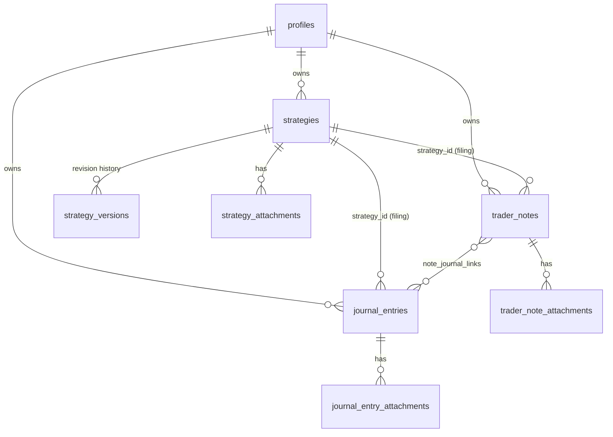

# 01 Trade Journal

# AlphaJournal linked writing surfaces: combined backend handoff

**Scope:** the three writing destinations — **trader notes**, **journal notes** and **strategy notes** — and the link graph that binds them into one workspace. This is the document to build from. It supersedes nothing, and it is not a rewrite of either existing handoff:

| Document | What it owns | Relationship to this one |
|---|---|---|
| [NOTES_BACKEND_HANDOFF.md](./NOTES_BACKEND_HANDOFF.md) | Trader notes **in isolation**: `trader_notes` and its four engagement tables, the `note-attachments` bucket, the `note-ai-refactor` Edge Function | Still authoritative for everything it covers. This document adds only the *linking* obligations on `trader_notes`. |
| [BACKEND_HANDOFF_GUIDELINE.md](./BACKEND_HANDOFF_GUIDELINE.md) | Project-wide conventions: auth, RLS posture, error shapes, environment | Read first. This document assumes those conventions and does not restate them. |
| **This document** | Journal notes, strategy notes, and the **link graph across all three** | New tables, new columns, the reciprocity rules, the derived-performance boundary, every endpoint, and the end-to-end timeline. |

Related specifications: [DYNAMIC_LINKING.md](./03-design/DYNAMIC_LINKING.md) (the client-side link contract), [API_DATA_MODEL.md](./02-architecture/API_DATA_MODEL.md), [DATABASE_ERD.md](./02-architecture/DATABASE_ERD.md).

---

## 1. The state of play

All three features are **frontend-complete and running against in-memory repositories**. No widget, screen or block anywhere in the app touches Supabase. Every read and write in the three destinations passes through one of three abstract interfaces, and each has a single-line injection point:

| Surface | Interface | Injection point | Demo implementation |
|---|---|---|---|
| Trader notes | [`NotesRepository`](../lib/features/notes/data/notes_repository.dart) | `NotesRepositoryScope.override(...)` | `NotesRepositoryImpl` |
| Journal notes | [`JournalRepository`](../lib/features/journal/data/journal_repository.dart) | `JournalRepositoryScope.override(...)` | `JournalRepositoryImpl` |
| Strategy notes | [`StrategiesRepository`](../lib/features/strategies/data/strategies_repository.dart) | `StrategiesRepositoryScope.override(...)` | `StrategiesRepositoryImpl` |

The definition of done for this handoff is three classes — `SupabaseNotesRepository`, `SupabaseJournalRepository`, `SupabaseStrategiesRepository` — and three `override(...)` calls at startup. **Nothing above the repository line changes.** If a proposed backend design requires a widget change, the design is wrong; raise it rather than working around it.

One thing to internalise before reading further, because half of this document follows from it:

> A journal entry is **a trade and its write-up in one row**. The numbers without the reasoning are a broker statement; the reasoning without the numbers is a diary. Two tables would let one exist without the other, which is the failure this feature exists to prevent.

And its counterpart:

> A strategy is **a playbook**. Its performance figures are *derived from the journal entries filed under it*, never entered by hand. A playbook claiming a 68% win rate that no trade supports is worse than one with no numbers at all.

---

## 2. The four record kinds and the shape of the graph

Four kinds address every record in the workspace. They are declared once, in `AppLinkKind`, and the same four appear in the internal URL scheme, in the shell's navigation handoff, in every link tile and in every picker.

| Kind | Record | Table | Owns a row? | Destination |
|---|---|---|---|---|
| `note` | Trader note | `trader_notes` | Yes | `notes` |
| `journal` | Journal note (a trade + its write-up) | `journal_entries` | Yes | `journal` |
| `strategy` | Strategy note (a playbook) | `strategies` | Yes | `strategies` |
| `ticker` | An instrument symbol | — | **No** | none |

**Tickers own no record.** `RELIANCE` is not a row anywhere; it is a string in a `TEXT[]` column, and everything about a ticker is derived by scanning the other three tables. Do not create a `tickers` table for this feature. Naming an instrument is a topic tag, not a relationship to the trader's own work — which is also why tickers are excluded from the orphan prompt.

There are exactly **three edge types** between the record-owning kinds, and they do not all have the same cardinality. Getting this table right is most of the job:

| Edge | Cardinality | Source of truth | Mirror (derived, trigger-maintained) |
|---|---|---|---|
| note ⇄ journal | **many-to-many** | `note_journal_links` (new join table) | `trader_notes.linked_journal_ids`, `journal_entries.linked_note_ids` |
| journal → strategy | **many-to-one** | `journal_entries.strategy_id` | `strategies.linked_journal_ids` |
| note → strategy | **many-to-one** | `trader_notes.strategy_id` | `strategies.linked_note_ids` |



### 2.1 Two asymmetries that are load-bearing

**Filing moves a record; it does not add one.** Both `→ strategy` edges are single-valued on the child. Setting `journal_entries.strategy_id` to a new playbook *removes* the trade from the previous one, and the previous playbook's win rate moves as a result. There is no API for "this trade belongs to two playbooks", and adding one would make the performance figures in section 6 meaningless.

**The parent-side arrays are mirrors, not inputs.** `strategies.linked_journal_ids` and `strategies.linked_note_ids` exist so a library card can render "12 trades · 3 notes" without a join. They are maintained by trigger and **must never be written directly by the client**. The client tolerates them going stale — `bundleForStrategy` unions the array with a live scan for `strategy_id`, so a missed mirror update degrades to "the link still works" rather than "the link is gone" — but a mirror the client can write is a mirror that will eventually disagree with the column it mirrors, and then "which playbook is this note filed under?" has two answers.

> **Correction to a code comment.** The doc comment on `StrategiesRepository` names a `note_strategy_links` table. Do not build it. `AppNote.strategyId` is a single nullable id, so the client cannot express a note belonging to two playbooks; a join table would have rows no client could ever produce or resolve. The note → strategy edge is `trader_notes.strategy_id`, full stop. `note_journal_links` **is** real and **is** required — that is the one genuine many-to-many.

Consequently `StrategiesRepository.linkNote(strategyId, noteId)` and `linkJournal(strategyId, entryId)` are **not** array appends. They are writes to the child row:

| Client call | What the backend actually does |
|---|---|
| `strategies.linkJournal(s, e)` | `UPDATE journal_entries SET strategy_id = s WHERE id = e` |
| `strategies.unlinkJournal(s, e)` | `UPDATE journal_entries SET strategy_id = NULL WHERE id = e AND strategy_id = s` |
| `strategies.linkNote(s, n)` | `UPDATE trader_notes SET strategy_id = s WHERE id = n` |
| `strategies.unlinkNote(s, n)` | `UPDATE trader_notes SET strategy_id = NULL WHERE id = n AND strategy_id = s` |
| `journal.attachStrategy(e, s)` | The same write as `linkJournal`, reached from the other screen |

The `unlink` guards on `strategy_id = s` deliberately. Two open documents can disagree about who owns a trade; an unguarded `SET NULL` lets a stale playbook screen unfile a trade that was refiled elsewhere thirty seconds ago.

### 2.2 The reciprocity rule for the one real many-to-many

Every note ⇄ journal edge is **stored on both ends and unioned by the client**. A note lists the entries it discusses; those entries list the note back. That redundancy is deliberate: a single-sided edge is one failed write away from disappearing, and a half-migrated backend then degrades gracefully instead of silently losing a link. Both mirrors are maintained from `note_journal_links` by one trigger, so there is exactly one write path and no window in which the two arrays disagree.

---

## 3. Database

### 3.1 What already exists, and how far it is from the client

`database/schema.sql` already declares `strategies`, `strategy_versions`, `journal_entries`, `journal_entry_links` and the five `trader_note*` tables. The trader-notes group is **current** — it was written against `AppNote` and needs only the linking additions in 3.4. The other two predate the writing surfaces and are a long way from the models the client ships:

| Table | Drift from the shipped model |
|---|---|
| `strategies` | `content` is `JSONB`; the client stores **markdown text**. `title` vs `AppStrategy.name`. No `status`, `summary`, `tags`, `linked_tickers`, markdown counters, or version counter. `visibility TEXT` carries `isPublic`. |
| `strategy_versions` | `content JSONB`, `version_number`; no `note` (the changelog line), no `author`, no `is_current`, no `summary`, no `word_count`. |
| `journal_entries` | No `title`, `opened_at`/`closed_at`, `pnl_percent`, `r_multiple`, `linked_note_ids`, or markdown counters. `psychology` is `TEXT` where the client has an integer `psychologyScore`. `screenshots TEXT[]` predates the attachments table. |
| `journal_entry_links` | Entry ⇄ entry links. **Unused by the client** — "other trades on this playbook" is derived from `strategy_id` (`AppLinkGraph.siblingEntries`), not from stored edges. Leave it in place; do not wire it. |

Four migrations close the gap. Apply in order, then re-run `rls_policies.sql` — the policy script is idempotent by design and is the only place policies live.

```
009_journal_notes.sql       -- journal_entries → AppTrade, + journal_entry_attachments
010_strategy_notes.sql      -- strategies + strategy_versions → AppStrategy, + strategy_attachments
011_note_link_graph.sql     -- note_journal_links, the four mirror triggers
012_linked_notes_reads.sql  -- strategy_performance, public_document + its two helpers
rls_policies.sql            -- re-run; adds policies for every new table and bucket
```

The derived and public reads are a separate file from the link graph on purpose:
011 is the last migration that writes anything, and 012 creates nothing but a
view and three functions. If a public-payload column needs to change later, 012
can be re-run alone.

Every CHECK constraint these migrations add on an **existing** table is added
`NOT VALID`, each preceded by its own `DROP CONSTRAINT IF EXISTS` (there is no
`ADD CONSTRAINT IF NOT EXISTS`, so that pair is what makes a re-run safe). `NOT
VALID` constrains everything written from now on without failing the migration on
rows that predate it — a deployment with one lowercase-`Long` side value should
not be unable to migrate. Where the fix is mechanical the migration also
normalises in place first (`side`, `outcome`), so in practice most deployments
can validate immediately:

```sql
ALTER TABLE journal_entries VALIDATE CONSTRAINT journal_entries_outcome_check;
```

`ALTER TABLE ... ALTER COLUMN content TYPE TEXT` on `strategies` is the one destructive step. Existing rows hold JSONB. Convert rather than drop:

```sql
ALTER TABLE strategies
  ALTER COLUMN content TYPE TEXT
  USING CASE
    WHEN content IS NULL THEN ''
    WHEN jsonb_typeof(content) = 'string' THEN content #>> '{}'
    ELSE content::text
  END;
ALTER TABLE strategies ALTER COLUMN content SET DEFAULT '';
ALTER TABLE strategies ALTER COLUMN content SET NOT NULL;
```

Run it once. On a second pass `jsonb_typeof(content)` is being handed a `text`
column and raises, which is the correct outcome — the conversion has already
happened and re-running it would be the bug.

If production already holds structured strategy bodies, stop and raise it — a lossy conversion of real playbooks is worth a conversation, not a migration.

### 3.2 Migration 009 — journal notes

```sql
ALTER TABLE journal_entries
  ADD COLUMN IF NOT EXISTS title            TEXT    NOT NULL DEFAULT '',
  ADD COLUMN IF NOT EXISTS opened_at        TIMESTAMPTZ,
  ADD COLUMN IF NOT EXISTS closed_at        TIMESTAMPTZ,
  ADD COLUMN IF NOT EXISTS pnl_percent      NUMERIC,
  ADD COLUMN IF NOT EXISTS r_multiple       NUMERIC,
  ADD COLUMN IF NOT EXISTS psychology_score INTEGER
    CHECK (psychology_score IS NULL OR psychology_score BETWEEN 1 AND 10),
  ADD COLUMN IF NOT EXISTS linked_note_ids  UUID[]  NOT NULL DEFAULT '{}',
  ADD COLUMN IF NOT EXISTS word_count       INTEGER NOT NULL DEFAULT 0 CHECK (word_count >= 0),
  ADD COLUMN IF NOT EXISTS checklist_done   INTEGER NOT NULL DEFAULT 0 CHECK (checklist_done >= 0),
  ADD COLUMN IF NOT EXISTS checklist_total  INTEGER NOT NULL DEFAULT 0
    CHECK (checklist_total >= checklist_done),
  ADD COLUMN IF NOT EXISTS has_images       BOOLEAN NOT NULL DEFAULT false,
  ADD COLUMN IF NOT EXISTS has_code         BOOLEAN NOT NULL DEFAULT false;

-- Backfill before tightening: opened_at is the trade's own clock, not the row's.
UPDATE journal_entries SET opened_at = created_at WHERE opened_at IS NULL;
ALTER TABLE journal_entries ALTER COLUMN opened_at SET NOT NULL;

-- outcome is written by the client, which derives it from pnl unless the trader
-- overrides it. outcome_source records which of the two happened.
ALTER TABLE journal_entries
  DROP CONSTRAINT IF EXISTS journal_entries_outcome_check,
  ADD CONSTRAINT journal_entries_outcome_check
    CHECK (outcome IS NULL OR outcome IN ('win', 'loss', 'breakeven', 'open')),
  DROP CONSTRAINT IF EXISTS journal_entries_side_check,
  ADD CONSTRAINT journal_entries_side_check
    CHECK (side IS NULL OR side IN ('long', 'short')),
  DROP CONSTRAINT IF EXISTS journal_entries_outcome_source_check,
  ADD CONSTRAINT journal_entries_outcome_source_check
    CHECK (outcome_source IN ('auto', 'manual'));

-- An open trade has no exit and no close. Enforce it here: a "closed" row with
-- no exit price silently corrupts every playbook win rate derived from it.
ALTER TABLE journal_entries
  ADD CONSTRAINT journal_entries_open_has_no_exit
    CHECK (outcome IS DISTINCT FROM 'open' OR (exit_price IS NULL AND closed_at IS NULL));

-- strategy_id must NOT cascade-delete the trade. Deleting a playbook unfiles
-- its trades; it does not destroy the trader's record of them.
ALTER TABLE journal_entries
  DROP CONSTRAINT IF EXISTS journal_entries_strategy_id_fkey,
  ADD CONSTRAINT journal_entries_strategy_id_fkey
    FOREIGN KEY (strategy_id) REFERENCES strategies(id)
    ON DELETE SET NULL ON UPDATE CASCADE;
```

That last block is a **bug fix in the shipped schema**, not a new feature. `journal_entries.strategy_id` currently declares `ON DELETE CASCADE`, so deleting one playbook would delete every trade ever filed under it. `trader_notes.strategy_id` already gets this right with `ON DELETE SET NULL`; the journal must match it.

```sql
-- A journal entry's attachments belong to the journal, not to the notes bucket:
-- a trader who deletes a note must not lose the screenshot that proves what a
-- trade looked like.
CREATE TABLE IF NOT EXISTS journal_entry_attachments (
  id           UUID PRIMARY KEY DEFAULT gen_random_uuid(),
  entry_id     UUID NOT NULL REFERENCES journal_entries(id) ON DELETE CASCADE ON UPDATE CASCADE,
  user_id      UUID NOT NULL REFERENCES profiles(id) ON DELETE CASCADE ON UPDATE CASCADE,
  storage_path TEXT NOT NULL UNIQUE,
  filename     TEXT NOT NULL,
  mime_type    TEXT,
  byte_size    BIGINT CHECK (byte_size IS NULL OR byte_size BETWEEN 0 AND 10485760),
  is_image     BOOLEAN NOT NULL DEFAULT false,
  created_at   TIMESTAMPTZ NOT NULL DEFAULT now(),
  updated_at   TIMESTAMPTZ NOT NULL DEFAULT now()
);

CREATE INDEX IF NOT EXISTS idx_journal_entry_attachments_entry
  ON journal_entry_attachments(entry_id);
CREATE INDEX IF NOT EXISTS idx_journal_entry_attachments_user
  ON journal_entry_attachments(user_id);

-- The index the journal actually reads: newest trade first, per owner.
CREATE INDEX IF NOT EXISTS idx_journal_entries_user_sortdate
  ON journal_entries(user_id, COALESCE(closed_at, opened_at) DESC);
-- The two prompts the journal leads with: unwritten and unfiled.
CREATE INDEX IF NOT EXISTS idx_journal_entries_unfiled
  ON journal_entries(user_id) WHERE strategy_id IS NULL;
CREATE INDEX IF NOT EXISTS idx_journal_entries_notes_gin
  ON journal_entries USING GIN (linked_note_ids);
CREATE INDEX IF NOT EXISTS idx_journal_entries_search_gin
  ON journal_entries USING GIN (
    to_tsvector('english', coalesce(title,'') || ' ' || coalesce(ticker,'') || ' ' || content)
  );
```

`screenshots TEXT[]` stays for now and is **write-frozen**: `JournalRepository.uploadAttachment` returns a `journal_entry_attachments.storage_path` and the client embeds it in the markdown body. Migrate the legacy array in a later pass; nothing in the app reads it.

### 3.3 Migration 010 — strategy notes

```sql
ALTER TABLE strategies
  ADD COLUMN IF NOT EXISTS summary            TEXT,
  ADD COLUMN IF NOT EXISTS status             TEXT NOT NULL DEFAULT 'draft'
    CHECK (status IN ('draft', 'testing', 'live', 'retired')),
  ADD COLUMN IF NOT EXISTS tags               TEXT[] NOT NULL DEFAULT '{}',
  ADD COLUMN IF NOT EXISTS linked_tickers     TEXT[] NOT NULL DEFAULT '{}',
  ADD COLUMN IF NOT EXISTS linked_note_ids    UUID[] NOT NULL DEFAULT '{}',
  ADD COLUMN IF NOT EXISTS linked_journal_ids UUID[] NOT NULL DEFAULT '{}',
  ADD COLUMN IF NOT EXISTS version_count      INTEGER NOT NULL DEFAULT 1 CHECK (version_count >= 0),
  ADD COLUMN IF NOT EXISTS word_count         INTEGER NOT NULL DEFAULT 0 CHECK (word_count >= 0),
  ADD COLUMN IF NOT EXISTS checklist_done     INTEGER NOT NULL DEFAULT 0 CHECK (checklist_done >= 0),
  ADD COLUMN IF NOT EXISTS checklist_total    INTEGER NOT NULL DEFAULT 0
    CHECK (checklist_total >= checklist_done),
  ADD COLUMN IF NOT EXISTS has_images         BOOLEAN NOT NULL DEFAULT false,
  ADD COLUMN IF NOT EXISTS has_code           BOOLEAN NOT NULL DEFAULT false;

ALTER TABLE strategies
  DROP CONSTRAINT IF EXISTS strategies_visibility_check,
  ADD CONSTRAINT strategies_visibility_check
    CHECK (visibility IN ('private', 'public'));

ALTER TABLE strategy_versions
  ADD COLUMN IF NOT EXISTS note       TEXT,
  ADD COLUMN IF NOT EXISTS author_id  UUID REFERENCES profiles(id) ON DELETE SET NULL,
  ADD COLUMN IF NOT EXISTS is_current BOOLEAN NOT NULL DEFAULT false,
  ADD COLUMN IF NOT EXISTS summary    TEXT,
  ADD COLUMN IF NOT EXISTS word_count INTEGER NOT NULL DEFAULT 0 CHECK (word_count >= 0);

ALTER TABLE strategy_versions
  ALTER COLUMN content TYPE TEXT
  USING CASE
    WHEN content IS NULL THEN ''
    WHEN jsonb_typeof(content) = 'string' THEN content #>> '{}'
    ELSE content::text
  END;

-- Exactly one live revision per playbook. Without this, "restore v3" can leave
-- two rows claiming to be current and the history screen shows two live badges.
CREATE UNIQUE INDEX IF NOT EXISTS uq_strategy_versions_current
  ON strategy_versions(strategy_id) WHERE is_current;

CREATE INDEX IF NOT EXISTS idx_strategies_user_updated
  ON strategies(user_id, updated_at DESC);
CREATE INDEX IF NOT EXISTS idx_strategies_user_status ON strategies(user_id, status);
CREATE INDEX IF NOT EXISTS idx_strategies_tags_gin ON strategies USING GIN (tags);
CREATE INDEX IF NOT EXISTS idx_strategies_tickers_gin ON strategies USING GIN (linked_tickers);
```

`strategy_attachments` is the third bucket-backed table, identical in shape to `journal_entry_attachments` with `strategy_id` in place of `entry_id`, `ON DELETE CASCADE`, and the same 10 MB `byte_size` check plus `idx_strategy_attachments_strategy` and `..._user`.

### 3.4 Migration 011 — the link graph

The join table. Note the composite primary key: **linking twice is the same as linking once**, because the caller is a picker the trader can reopen, and `linkNote` is specified as idempotent.

```sql
CREATE TABLE IF NOT EXISTS note_journal_links (
  note_id    UUID NOT NULL REFERENCES trader_notes(id) ON DELETE CASCADE ON UPDATE CASCADE,
  entry_id   UUID NOT NULL REFERENCES journal_entries(id) ON DELETE CASCADE ON UPDATE CASCADE,
  user_id    UUID NOT NULL REFERENCES profiles(id) ON DELETE CASCADE ON UPDATE CASCADE,
  created_at TIMESTAMPTZ NOT NULL DEFAULT now(),
  PRIMARY KEY (note_id, entry_id)
);

CREATE INDEX IF NOT EXISTS idx_note_journal_links_entry ON note_journal_links(entry_id);
CREATE INDEX IF NOT EXISTS idx_note_journal_links_user ON note_journal_links(user_id);
```

`user_id` is denormalised onto the join row on purpose: without it every RLS check on this table needs two subqueries, and the policy in section 8 becomes the hot path for the entire linked-records panel.

**Seed the table before you install the triggers.** `trader_notes.linked_journal_ids` already exists and already holds links a trader made before this table did. The moment the triggers below are live that array is *derived* from this table, so an empty table means an emptied array:

```sql
INSERT INTO note_journal_links (note_id, entry_id, user_id)
SELECT n.id, e.id, n.user_id
  FROM trader_notes n
  CROSS JOIN LATERAL unnest(n.linked_journal_ids) AS l(entry_id)
  JOIN journal_entries e ON e.id = l.entry_id AND e.user_id = n.user_id
ON CONFLICT DO NOTHING;
```

The join to `journal_entries` is not decoration: it drops ids that point at a deleted entry, and the `e.user_id = n.user_id` predicate drops any cross-owner id the array picked up before the validation trigger existed. Both would fail the trigger a moment later.

**Cross-owner edges are rejected.** A note and an entry in an edge must share an owner. Enforce it in the trigger below rather than in a `CHECK` — a check constraint cannot reach another table.

Two triggers, because the two jobs need opposite timings: ownership has to be settled **before** the row lands, and the mirrors can only be rebuilt **after** it does.

`SET search_path = public, pg_temp` on every `SECURITY DEFINER` function here is mandatory, not stylistic: without a pinned search path a caller can create a same-named object in a schema that resolves first and have the definer run it with the owner's rights.

```sql
CREATE OR REPLACE FUNCTION validate_note_journal_link()
RETURNS TRIGGER LANGUAGE plpgsql SECURITY DEFINER SET search_path = public, pg_temp AS $$
DECLARE
  n_owner UUID;
  e_owner UUID;
BEGIN
  SELECT user_id INTO n_owner FROM trader_notes    WHERE id = NEW.note_id;
  SELECT user_id INTO e_owner FROM journal_entries WHERE id = NEW.entry_id;
  IF n_owner IS NULL OR e_owner IS NULL OR n_owner <> e_owner THEN
    RAISE EXCEPTION 'note_journal_links: note and entry must share one owner';
  END IF;
  NEW.user_id := n_owner;   -- never trust a client-supplied owner
  RETURN NEW;
END $$;

CREATE OR REPLACE FUNCTION sync_note_journal_mirrors()
RETURNS TRIGGER LANGUAGE plpgsql SECURITY DEFINER SET search_path = public, pg_temp AS $$
DECLARE
  n_id UUID := COALESCE(NEW.note_id,  OLD.note_id);
  e_id UUID := COALESCE(NEW.entry_id, OLD.entry_id);
BEGIN
  -- Recompute, never increment. An append that runs twice leaves a duplicate id
  -- in the array, and the client's union then renders one link as two.
  -- Both UPDATEs may match zero rows: on a cascade delete the parent is already
  -- gone. That is correct and silent -- do not look the parent up first.
  UPDATE trader_notes SET linked_journal_ids = COALESCE(
    (SELECT array_agg(entry_id ORDER BY created_at DESC)
       FROM note_journal_links WHERE note_id = n_id), '{}')
  WHERE id = n_id;

  UPDATE journal_entries SET linked_note_ids = COALESCE(
    (SELECT array_agg(note_id ORDER BY created_at DESC)
       FROM note_journal_links WHERE entry_id = e_id), '{}')
  WHERE id = e_id;

  RETURN NULL;
END $$;

DROP TRIGGER IF EXISTS trg_note_journal_links_validate ON note_journal_links;
CREATE TRIGGER trg_note_journal_links_validate
  BEFORE INSERT ON note_journal_links
  FOR EACH ROW EXECUTE FUNCTION validate_note_journal_link();

DROP TRIGGER IF EXISTS trg_note_journal_links_sync ON note_journal_links;
CREATE TRIGGER trg_note_journal_links_sync
  AFTER INSERT OR DELETE ON note_journal_links
  FOR EACH ROW EXECUTE FUNCTION sync_note_journal_mirrors();
```

The `strategies` mirrors work the same way, driven from the child tables. One function, two triggers — on `journal_entries` and on `trader_notes`, `AFTER INSERT OR DELETE OR UPDATE OF strategy_id`, rebuilding `linked_journal_ids` / `linked_note_ids` for **both** the old and the new `strategy_id`. Rebuilding only the new one is the bug to avoid: refiling a trade would leave it listed under the playbook it just left.

`UPDATE OF strategy_id` fires when the column appears in the SET list, not only when its value actually changes. A client that PATCHes a whole row therefore rebuilds on every save. That is fine — the rebuild is a recompute, so running it more often than necessary costs a query and changes nothing.

```sql
CREATE OR REPLACE FUNCTION rebuild_strategy_mirrors(p_strategy UUID)
RETURNS void LANGUAGE plpgsql SECURITY DEFINER SET search_path = public, pg_temp AS $$
BEGIN
  IF p_strategy IS NULL THEN RETURN; END IF;
  UPDATE strategies SET
    linked_journal_ids = COALESCE((
      SELECT array_agg(e.id ORDER BY COALESCE(e.closed_at, e.opened_at) DESC)
        FROM journal_entries e WHERE e.strategy_id = p_strategy), '{}'),
    linked_note_ids = COALESCE((
      SELECT array_agg(n.id ORDER BY n.updated_at DESC)
        FROM trader_notes n WHERE n.strategy_id = p_strategy), '{}')
   WHERE id = p_strategy;
END $$;

CREATE OR REPLACE FUNCTION sync_strategy_mirrors()
RETURNS TRIGGER LANGUAGE plpgsql SECURITY DEFINER SET search_path = public, pg_temp AS $$
BEGIN
  IF TG_OP <> 'INSERT' THEN PERFORM rebuild_strategy_mirrors(OLD.strategy_id); END IF;
  IF TG_OP <> 'DELETE' THEN PERFORM rebuild_strategy_mirrors(NEW.strategy_id); END IF;
  RETURN NULL;
END $$;
```

The `IF p_strategy IS NULL THEN RETURN` guard is what makes an unfiled record free: a trade with no playbook fires the trigger, the helper returns immediately, and nothing is scanned.

Finish the migration with one full pass, so every mirror matches truth the moment it ends rather than the first time each parent is next touched:

```sql
SELECT rebuild_strategy_mirrors(id) FROM strategies;

UPDATE trader_notes n SET linked_journal_ids = COALESCE(
  (SELECT array_agg(l.entry_id ORDER BY l.created_at DESC)
     FROM note_journal_links l WHERE l.note_id = n.id), '{}');

UPDATE journal_entries e SET linked_note_ids = COALESCE(
  (SELECT array_agg(l.note_id ORDER BY l.created_at DESC)
     FROM note_journal_links l WHERE l.entry_id = e.id), '{}');
```

That block is also the repair procedure in section 10.1. It is safe to run at any time, on a live database, as many times as you like.

---

## 4. Column ↔ model field mapping

Trader notes are mapped in [NOTES_BACKEND_HANDOFF.md](./NOTES_BACKEND_HANDOFF.md#database-column-and-model-field-mapping) and unchanged, except that `linked_journal_ids` is now trigger-maintained from `note_journal_links` and **read-only to the client**, and `strategy_id` is the note → strategy edge in both directions.

### 4.1 `journal_entries` ↔ `AppTrade`

| Column | Field | Notes |
|---|---|---|
| `id` | `id` | Empty string on the model means an unsaved draft — insert, do not update. |
| `user_id` | `userId` | Server-assigned from `auth.uid()`. Never accept it from the client. |
| `title` | `title` | May be empty. The client derives `RELIANCE long · Gap-and-go` for display; **do not** persist the derived form or the trader can never clear it. |
| `content` | `content` | Raw markdown: thesis, execution log, review. The only authoritative copy. |
| `ticker` | `ticker` | Uppercase, no `$` prefix. |
| `side` | `side` | `long` \| `short`. |
| `entry_price`, `exit_price` | `entry`, `exit` | `exit` null while the trade is open. |
| `stop_loss`, `target`, `size` | `stopLoss`, `target`, `size` | `size` defaults to 1. |
| `pnl`, `pnl_percent`, `r_multiple` | `pnl`, `pnlPercent`, `rMultiple` | Client-computed and sent. `r_multiple` is null when no stop was recorded. |
| `outcome` | `outcome` | `win` \| `loss` \| `breakeven` \| `open`. |
| `outcome_source` | — | Not on the model. `manual` when the trader overrode the derived outcome, `auto` otherwise. Preserve it; the analyzer reads it. |
| `opened_at`, `closed_at` | `openedAt`, `closedAt` | The trade's clock, distinct from `created_at`. Sort key is `COALESCE(closed_at, opened_at) DESC`. |
| `strategy_id` | `strategyId` | The filing edge. `ON DELETE SET NULL`. |
| (joined) | `strategy` | The playbook **name**, denormalised into the response so a list row renders without resolving the graph. Join `strategies.title`; null is acceptable. |
| `linked_note_ids` | `linkedNoteIds` | Trigger-maintained mirror of `note_journal_links`. Read-only to the client. |
| `tags` | `tags` | No leading `#`. |
| `psychology_score` | `psychologyScore` | 1–10 or null. |
| `psychology`, `mistakes_made`, `lessons_learned` | — | Legacy prose columns; the write-up now lives in `content`. Return them, do not require them. |
| `screenshots` | — | Legacy. Superseded by `journal_entry_attachments`; write-frozen. |
| `word_count`, `checklist_done`, `checklist_total`, `has_images`, `has_code` | same | Derived by `AppTrade.withDerivedCounts()` before every write. Trust the client; do not re-parse markdown server-side. |
| `is_public` | — | **Always false.** Journal notes have no public route at any depth. See section 9. |
| `created_at`, `updated_at` | — / `updatedAt` | `updated_at` maintained by `trg_journal_entries_updated_at`. |

### 4.2 `strategies` ↔ `AppStrategy`

| Column | Field | Notes |
|---|---|---|
| `id` | `id` | |
| `user_id` | `userId` | Server-assigned. |
| `title` | **`name`** | The names differ. Do not rename the column; map it. |
| `summary` | `summary` | The trader's own elevator pitch, plain text, safe to render in a card. |
| `ai_summary` | — | Pre-existing, AI-generated, separate field. Not surfaced by these screens. |
| `content` | `content` | Raw markdown: the playbook. `TEXT` after migration 010, not `JSONB`. |
| `status` | `status` | `draft` \| `testing` \| `live` \| `retired`, via `AppStrategyStatus.wireId` (the enum name verbatim). |
| `visibility` | **`isPublic`** | `'public'` ⇄ `true`, `'private'` ⇄ `false`. **Do not add an `is_public` boolean** — `strategies_public_read` already keys off `visibility`, and a second flag creates two answers to one question. |
| `is_favorite` | `isFavorite` | |
| `category` | `category` | |
| `tags` | `tags` | No leading `#`. |
| `linked_tickers` | `linkedTickers` | Uppercase, no `$`. The instruments the playbook is *written for*, distinct from the ones its trades were taken on. |
| `linked_note_ids` | `linkedNoteIds` | Mirror of `trader_notes.strategy_id`. Read-only to the client. |
| `linked_journal_ids` | `linkedJournalIds` | Mirror of `journal_entries.strategy_id`. Read-only to the client. |
| `version_count` | `versionCount` | Trigger-maintained `COUNT(*)` over `strategy_versions`. |
| — | `trades`, `winRate`, `avgR`, `netPnl`, `equityCurve` | **Not columns.** Derived; see section 6. Serve them from `strategy_performance` joined into every read. |
| `word_count`, `checklist_done`, `checklist_total`, `has_images`, `has_code` | same | From `AppStrategy.withDerivedCounts()`. |
| `created_at`, `updated_at` | `createdAt`, `updatedAt` | |

### 4.3 `strategy_versions` ↔ `AppStrategyVersion`

| Column | Field | Notes |
|---|---|---|
| `id` | `id` | |
| `strategy_id` | `strategyId` | |
| `version_number` | `version` | 1-based, gap-free per playbook, enforced by `UNIQUE (strategy_id, version_number)`. |
| `content` | `content` | Full markdown snapshot at that revision. Snapshot, not a diff — the history screen renders a whole body. |
| `summary`, `word_count` | `summary`, `wordCount` | Snapshotted alongside the body. |
| `note` | `note` | The changelog line the trader typed when saving. Null for an auto-tracked save. |
| `author_id` | (joined) `author` | Resolve to a display name. The client shows `'You'` when it matches the session user. |
| `is_current` | `isCurrent` | Exactly one true row per playbook (partial unique index). |
| `created_at` | `savedAt` | |

**Two save modes, and the difference is the whole feature.** `update(strategy)` with no `versionNote` **tracks** the live revision — it overwrites `content`/`summary`/`word_count` on the existing `is_current` row so a playbook does not spawn a revision per keystroke. `update(strategy, versionNote: '...')`, and `saveVersion(id, note:)`, **cut** a new revision: demote the current row, insert `version_number = MAX + 1` with `is_current = true`.

`restoreVersion(strategyId, versionId)` copies the target's body onto the live playbook and then cuts a *new* revision noted `Restored v3`. Restoring never deletes history: the revision restored from is still there, and so is the one it replaced. Implement it as one `RPC` inside a transaction; a partial restore that lands the body without the revision is unrecoverable from the client.

---

## 5. The API surface

Every method below already exists on an interface the client calls today. This is not a menu — it is the complete set, and the signatures are fixed. Failures **throw**; they never return an empty payload. Callers surface them through `UiToast.error`, and a silent empty list is indistinguishable from "you have no trades yet", which is the one thing a journal must never say wrongly.

### 5.1 `JournalRepository`

| Method | Implementation |
|---|---|
| `watchAll()` | `from('journal_entries').stream(primaryKey: ['id']).eq('user_id', uid)`, ordered by `COALESCE(closed_at, opened_at)` descending. Must emit an initial snapshot before any change, so a fresh listener paints instead of spinning. |
| `fetchAll()` | `select(<entry columns>, strategies(title)).eq('user_id', uid)`, same order. |
| `getById(id)` | `select(...).eq('id', id).maybeSingle()` → null when absent, not an error. |
| `create(draft)` | `insert(payload).select().single()`. **Ignore `draft.id`** — the client sends `''` or a local `trd_new_004`. Return the server row; the client swaps its optimistic copy for it. |
| `update(entry)` | `update(payload).eq('id', entry.id).select().single()` |
| `delete(id)` | `delete().eq('id', id)`. Attachments and `note_journal_links` rows cascade. |
| `linkNote(entryId, noteId)` | `insert into note_journal_links (note_id, entry_id) ... on conflict do nothing`, then return the refreshed entry. **Idempotent.** |
| `unlinkNote(entryId, noteId)` | `delete from note_journal_links where note_id = ? and entry_id = ?`, then return the refreshed entry. Deleting an absent edge is a success, not a 404. |
| `attachStrategy(entryId, strategyId, {strategyName})` | `update journal_entries set strategy_id = ?`. A null or empty `strategyId` clears it. `strategyName` is a display convenience the client passes so it can repaint before the next stream tick; the server should still return the joined name. |
| `uploadAttachment(entryId, file)` | Upload to `journal-attachments/<user_id>/<entry_id>/<uuid><ext>`, insert into `journal_entry_attachments`, return `storage_path`. That exact string is written into the markdown body. |
| `resolveAttachmentUrl(ref)` | `createSignedUrl(ref, 3600)`. Local paths (prototype leftovers) must pass through unchanged. |

### 5.2 `StrategiesRepository`

| Method | Implementation |
|---|---|
| `watchAll()` | Stream `strategies` for `uid`, `updated_at DESC`, **left-joined to `strategy_performance`**. A playbook card without its numbers is a blank card. |
| `watchPublic()` | The same read filtered to `visibility = 'public'`, across all owners. Edit affordances are already disabled client-side for this stream; do not rely on that — enforce with RLS. |
| `fetchAll()`, `getById(id)` | As the journal equivalents. |
| `create(draft)` | Insert the playbook **and** its `version_number = 1` row noted `Created`, in one transaction. A playbook with no revisions breaks the history screen's "the first entry is always the live playbook" invariant. |
| `update(strategy, {versionNote})` | Track or cut, per section 4.3. One RPC, `strategy_save(p_id, p_body, p_summary, p_version_note)`. |
| `delete(id)` | Cascades `strategy_versions` and `strategy_attachments`; **nulls** `strategy_id` on entries and notes (section 12). |
| `toggleFavorite(id)` | `update ... set is_favorite = not is_favorite` |
| `setStatus(id, status)` | `update ... set status = ?` |
| `setVisibility(id, isPublic)` | `update ... set visibility = case when ? then 'public' else 'private' end` |
| `versions(strategyId)` | `select ... order by version_number desc`. Newest first; the current revision is first. |
| `saveVersion(strategyId, {note})` | RPC `strategy_cut_version`. Returns the new revision. |
| `restoreVersion(strategyId, versionId)` | RPC `strategy_restore_version`, transactional. Returns the playbook. |
| `linkNote` / `unlinkNote` / `linkJournal` / `unlinkJournal` | Writes to the **child** row, per the table in section 2.1. |
| `uploadAttachment` / `resolveAttachmentUrl` | `strategy-attachments/<user_id>/<strategy_id>/<uuid><ext>`, otherwise as the journal. |

### 5.3 `NotesRepository` — the linking delta

All eleven methods are specified in [NOTES_BACKEND_HANDOFF.md](./NOTES_BACKEND_HANDOFF.md#2-api-contract). Two obligations are added by the link graph:

- **`update(note)` must silently ignore `linked_journal_ids` in the payload.** The client sends it — `AppLinkGraphService` builds a whole `AppNote` and hands it to `update` — but the column is trigger-maintained. Strip it from the payload server-side. Rejecting the write, or honouring it, both break the graph: the first fails every link, the second lets the mirror diverge from `note_journal_links`.
- **`strategy_id` on a note is a real edge**, not metadata. Filing a note under a playbook makes it appear in that playbook's linked-records panel, and unfiling it removes it. Same `ON DELETE SET NULL` semantics as the journal.

### 5.4 There is no graph endpoint, and there must not be one

`AppLinkGraphService` builds the whole graph client-side by subscribing once to the three `watchAll()` streams and rebuilding a fresh immutable snapshot whenever any of them emits. Rebuilding is three map constructions over a few hundred records. Do not build `/graph`, `/links`, or a `link_graph` view for the client to read — a graph assembled from a stale note list and a fresh journal renders edges pointing at records the trader just deleted, and the whole point of rebuilding from one source of three lists is that it cannot.

What this **does** mean for the backend: `watchAll()` on all three repositories is on the critical path for every linked-records panel in the app. If those three streams are slow, every document in the product is slow.

### 5.5 The write pattern to expect: both ends, every time

`AppLinkGraphService.link()` normalises twelve directional cases into four pairs and then **writes both ends**. Several of those pairs collapse onto one row, so the same write arrives twice in quick succession:

| Client call | Writes issued | Rows touched |
|---|---|---|
| `link(note → journal)` | `notes.update(note)` then `journal.linkNote(e, n)` | `trader_notes` (payload minus the mirror), then `note_journal_links` |
| `link(note → strategy)` | `notes.update(note)` then `strategies.linkNote(s, n)` | `trader_notes.strategy_id` — **twice, same value** |
| `link(journal → strategy)` | `journal.attachStrategy(e, s)` then `strategies.linkJournal(s, e)` | `journal_entries.strategy_id` — **twice, same value** |
| `link(*, ticker)` | one `update` on the owning record's `linked_tickers` | `trader_notes` or `strategies`; a journal entry's ticker is the trade's own and is never linked or unlinked |

Every one of these must be idempotent and must not throw on the second write. This is not defensive over-engineering — it is the shipped call pattern, and a backend that 409s the duplicate will fail on the first link a trader creates.

---

## 6. Derived, never stored: playbook performance

`trades`, `winRate`, `avgR`, `netPnl` and `equityCurve` on `AppStrategy` are **computed from the journal entries filed under the playbook**. There is no write path for them, no column, and no client payload field. Filing a trade moves those numbers; nothing else does.

```sql
CREATE OR REPLACE VIEW strategy_performance WITH (security_invoker = true) AS
WITH closed AS (
  SELECT strategy_id, user_id, pnl, r_multiple,
         COALESCE(closed_at, opened_at) AS at
    FROM journal_entries
   WHERE strategy_id IS NOT NULL
     AND outcome IS DISTINCT FROM 'open'
)
SELECT
  s.id                                                    AS strategy_id,
  s.user_id,
  COUNT(c.*)                                              AS trades,
  COALESCE(SUM(c.pnl), 0)                                 AS net_pnl,
  CASE WHEN COUNT(c.*) = 0 THEN 0
       ELSE ROUND(100.0 * COUNT(c.*) FILTER (WHERE c.pnl > 0) / COUNT(c.*), 2)
  END                                                     AS win_rate,
  COALESCE(AVG(c.r_multiple), 0)                          AS avg_r
FROM strategies s
LEFT JOIN closed c ON c.strategy_id = s.id
GROUP BY s.id, s.user_id;

GRANT SELECT ON strategy_performance TO authenticated;
```

**`WITH (security_invoker = true)` is load-bearing — do not drop it.** A Postgres view without it runs with its *owner's* privileges, and RLS is evaluated against the owner rather than the caller. Since this view is owned by the migration role and reads `journal_entries`, omitting one clause turns an owner-scoped read into `SELECT * FROM every_trader_in_the_product`. `security_invoker` makes the view see exactly what the caller sees and nothing more, which is why the `GRANT` beside it is safe: the grant opens the view, and RLS on the underlying table still decides the rows.

`COUNT(c.*)` rather than `COUNT(*)` in all three places, including inside the `FILTER`. On a `LEFT JOIN` with no match `COUNT(*)` counts the outer row and returns 1; `COUNT(c.*)` counts non-null right-hand rows and returns 0. A playbook with no trades filed under it must report zero trades, not one.

**`win_rate` is a percentage, 0–100.** This is not a stylistic choice: `AppStrategy.winRate` is 0..100 while `AppJournalStats.winRate` and the two stat-row models are 0..1, and the split is deliberate and tested — a widget test fails on any rendered percentage above 100. Return 0..100 here and 0..1 nowhere near it. If you find yourself dividing by 100 in a repository, you have crossed the two conventions; go back to this paragraph.

**Only closed trades count.** An open position has no realised P/L and no outcome, so it contributes to `linked_journal_ids` and to the trade list, but not to the win rate. `journal_entries_open_has_no_exit` from migration 009 is what keeps this honest.

`equity_curve` is the running sum of `pnl` over closed trades in date order, capped at the last ~40 points the sparkline can show. It is a separate small query rather than a column in the view — an ordered array aggregate per playbook makes the list read materially slower for a sparkline nobody reads on a phone:

```sql
SELECT strategy_id,
       array_agg(running ORDER BY at) AS equity_curve
  FROM (
    SELECT strategy_id,
           COALESCE(closed_at, opened_at) AS at,
           SUM(pnl) OVER (PARTITION BY strategy_id ORDER BY COALESCE(closed_at, opened_at)) AS running
      FROM journal_entries
     WHERE user_id = auth.uid() AND strategy_id IS NOT NULL AND outcome IS DISTINCT FROM 'open'
  ) t
 GROUP BY strategy_id;
```

A materialised view is the wrong tool here. The numbers must move the moment a trade is filed — the repair loop in section 10 is *watching them move* — and a refresh lag turns a working feature into a bug report. If the view becomes slow at scale, add a trigger-maintained counter table keyed on `strategy_id` and keep the same read shape.

---

## 7. Storage: three private buckets, not one

| Bucket | Owner table | Object key | Exists today |
|---|---|---|---|
| `note-attachments` | `trader_note_attachments` | `<user_id>/<note_id>/<uuid><ext>` | Yes |
| `journal-attachments` | `journal_entry_attachments` | `<user_id>/<entry_id>/<uuid><ext>` | **Create** |
| `strategy-attachments` | `strategy_attachments` | `<user_id>/<strategy_id>/<uuid><ext>` | **Create** |

All three: private, 10 MB per object matching the `byte_size` CHECK, MIME allow-list `image/*` + `application/pdf` + `text/*`, and 1-hour signed URLs which the client caches for the session.

**Why three and not one.** Two reasons, and both are about what happens when a record is deleted or shared:

- A trader who deletes a note must not lose the screenshot that proves what a trade looked like. One bucket with one cascade path makes the note's lifetime the screenshot's lifetime.
- A shared playbook's diagrams have to travel with it when it is published; a private research note's images must not. Section 9's server-side stripping is far easier to get right when "is this object publicly readable?" is answerable from the bucket and the key prefix alone.

The `<user_id>/` leading segment is what makes the storage policies prefix matches rather than joins:

```sql
CREATE POLICY journal_attachments_owner_all ON storage.objects FOR ALL
  USING (bucket_id = 'journal-attachments'
         AND (storage.foldername(name))[1] = auth.uid()::text)
  WITH CHECK (bucket_id = 'journal-attachments'
         AND (storage.foldername(name))[1] = auth.uid()::text);
```

`journal-attachments` gets **no public read policy at all** — there is no public journal route, so there is no reader to grant. `strategy-attachments` gets one, mirroring `trader_note_attachments_public_read`: `SELECT` on objects whose second path segment is the id of a playbook with `visibility = 'public'`. Without it a published playbook renders with broken images for every reader but its author, since the preview resolves each attachment row before signing.

---

## 8. Row-level security

Existing policies already cover `strategies` (`strategies_own_all`, `strategies_public_read` on `visibility`), `journal_entries` (`journal_entries_own_all`, plus a `journal_entries_public_read`) and the five `trader_note*` tables. Three additions, all in `rls_policies.sql`:

```sql
ALTER TABLE note_journal_links ENABLE ROW LEVEL SECURITY;
CREATE POLICY note_journal_links_own_all ON note_journal_links FOR ALL
  USING (auth.uid() = user_id) WITH CHECK (auth.uid() = user_id);

ALTER TABLE journal_entry_attachments ENABLE ROW LEVEL SECURITY;
CREATE POLICY journal_entry_attachments_own_all ON journal_entry_attachments FOR ALL
  USING (auth.uid() = user_id) WITH CHECK (auth.uid() = user_id);

ALTER TABLE strategy_attachments ENABLE ROW LEVEL SECURITY;
CREATE POLICY strategy_attachments_own_all ON strategy_attachments FOR ALL
  USING (auth.uid() = user_id) WITH CHECK (auth.uid() = user_id);
CREATE POLICY strategy_attachments_public_read ON strategy_attachments FOR SELECT
  USING (EXISTS (SELECT 1 FROM strategies s
                  WHERE s.id = strategy_attachments.strategy_id
                    AND s.visibility = 'public'));
```

`note_journal_links_own_all` is why `user_id` is denormalised onto the join row. The existing `journal_links_own_all` policy on `journal_entry_links` shows the alternative — two correlated subqueries against `journal_entries` per row, in `USING` *and* again in `WITH CHECK`. That table is unused, so it costs nothing; `note_journal_links` is on the hot path of every linked-records panel in the app, so it cannot afford the same shape.

**One existing policy to decide about, not to quietly change.** `journal_entries_public_read` is already in `rls_policies.sql` and is double-gated: it needs `journal_entries.is_public = true` **and** the owner's `profiles.public_journals = true`. That is not an accidental hole — it is a deliberate opt-in that predates these screens. But the shipped route table gives journal notes **no public route at any depth** ([DYNAMIC_LINKING.md](./03-design/DYNAMIC_LINKING.md#4-route-table-target-state)), no screen sets `is_public` on an entry, and no share action exists to set it. So the policy is currently unreachable surface rather than a live feature.

Leave it in place — dropping it is a product decision about whether public journals are still on the roadmap, and that call belongs to whoever owns that feature, not to this migration. What matters for this handoff: **do not build a client path to it.** `SupabaseJournalRepository` never writes `is_public`, and a trade log is the most sensitive record in the product. If publishing a single trade becomes a feature, it gets a design and a review, not a boolean that already happens to exist.

## 9. Public read paths, and why they cannot use the link graph

Exactly two of these records are ever readable by someone who is not their owner: a strategy with `visibility = 'public'`, and a trader note with `is_public = true`. Both policies already exist (`strategies_public_read`, `trader_notes_public_read`). A journal entry is never public, and a `strategy_versions` row is never public — the route table marks `/strategies/{id}/versions` owner-only and no policy grants otherwise. Do not add one.

### 9.1 A visitor has no workspace, so a visitor has no graph

Everywhere else in this document, links resolve client-side: `AppLinkGraphService` subscribes to three `watchAll()` streams, holds the signed-in trader's entire workspace in memory, and `AppLinkGraph.refFor` turns an id into a titled tile with no round trip. That is why section 5.4 says there is no graph endpoint.

The public path cannot work that way, and the reason is not privacy but arithmetic. For an anonymous caller, RLS makes `watchAll()` return *every public strategy and every public note in the product* — a corpus that grows with the user base, streamed over a realtime subscription, to render one read-only document. The public read is therefore **a different read, not the same read with fewer rows**: one record, with its visible refs already resolved server-side.

### 9.2 Migration 010 opens a leak unless the public read is narrowed

`strategies_public_read` grants `SELECT` on the *whole row*. After migration 010 that row carries `linked_journal_ids` and `linked_note_ids`. `trader_notes` already ships this way — its public policy exposes `linked_journal_ids` and `strategy_id` today.

Two things go wrong, and the second is a visible bug rather than a privacy footnote:

1. **Existence and cardinality disclosure.** "This playbook has 47 trades behind it" is exactly what the share contract says a visitor must not learn: *the playbook's performance figures are shown, the trades behind them are not* ([DYNAMIC_LINKING.md](./03-design/DYNAMIC_LINKING.md#6-sharing-workflows)). The UUIDs themselves are also durable correlation handles across every other endpoint that takes an id.
2. **The panel renders the leak as damage.** `AppLinkGraph.refFor` never returns null — an unresolvable id becomes `AppLinkRef.missing`, on purpose, so a broken edge reads as a broken edge. A visitor holding 47 ids they cannot resolve gets 47 *unavailable record* tiles where the design says show nothing at all.

**A policy cannot fix this.** RLS is row-level; there is no `USING` clause that hides a column. Column-level `GRANT` is per-role, and `authenticated` is one role covering both the owner reading their own playbook and a logged-in stranger reading someone else's — the restriction is row-dependent, so role-dependent privileges cannot express it. The fix is a definer-rights read that projects a column subset, not a change to the two existing policies.

### 9.3 What survives the strip

Ticker refs are not rows — they live in `linked_tickers` on the record itself and own nothing, so they travel with the document payload and need no filtering. Everything else does:

| On a public… | Ref kind | Included | Why |
|---|---|---|---|
| strategy | journal | **Never** | The share contract publishes the figures, not the trades behind them |
| strategy | note | Only where `is_public` | A private write-up of a public playbook stays private |
| note | journal | **Never** | Same rule, and there is no journal read path at any depth |
| note | strategy | Only where `visibility = 'public'` | Otherwise the note discloses the existence of a private playbook |
| note | note | Not applicable | There is no note ↔ note edge (section 2); related notes are derived from shared tags |

```sql
CREATE OR REPLACE FUNCTION public_refs(p_kind text, p_id uuid)
RETURNS jsonb
LANGUAGE sql
STABLE
SECURITY DEFINER
SET search_path = public, pg_temp
AS $$
  SELECT COALESCE(jsonb_agg(r ORDER BY r ->> 'title'), '[]'::jsonb)
  FROM (
    -- public notes filed under a public strategy
    SELECT jsonb_build_object(
             'kind', 'note', 'id', n.id,
             'title', n.title, 'subtitle', n.note_type
           ) AS r
      FROM trader_notes n
      JOIN strategies s ON s.id = n.strategy_id
     WHERE p_kind = 'strategy'
       AND s.id = p_id AND s.visibility = 'public'
       AND n.is_public
    UNION ALL
    -- the public playbook a public note is filed under
    SELECT jsonb_build_object(
             'kind', 'strategy', 'id', s.id,
             'title', s.title, 'subtitle', s.summary
           )
      FROM trader_notes n
      JOIN strategies s ON s.id = n.strategy_id
     WHERE p_kind = 'note'
       AND n.id = p_id AND n.is_public
       AND s.visibility = 'public'
  ) refs;
$$;
```

Both arms re-check the publish flag on **both** ends. Neither trusts that the caller already did — this function is reachable by `anon`, so its arguments are hostile input. Note also that `trader_notes` has no `summary` column and is not getting one; a note tile's subtitle is its `note_type`.

### 9.4 One RPC, and the column list is the security boundary

A `SECURITY DEFINER` function runs as its owner and therefore **bypasses RLS entirely**. That is the point — it is how a visitor reads aggregates over rows they cannot select — and it is also why the projected column list is not a convenience. There is no second check behind it. Every column named here is published; every column not named is not.

```sql
CREATE OR REPLACE FUNCTION public_document(p_kind text, p_id uuid)
RETURNS jsonb
LANGUAGE sql
STABLE
SECURITY DEFINER
SET search_path = public, pg_temp
AS $$
  SELECT jsonb_build_object(
           'kind', 'strategy', 'id', s.id, 'name', s.title,
           'summary', s.summary, 'body', s.content, 'status', s.status,
           'tags', s.tags, 'tickers', s.linked_tickers,
           'updated_at', s.updated_at,
           'author', jsonb_build_object('handle', p.handle,
                                        'display_name', p.display_name,
                                        'avatar_url', p.avatar_url),
           'performance', public_strategy_performance(s.id),
           'refs', public_refs('strategy', s.id)
         )
    FROM strategies s JOIN profiles p ON p.id = s.user_id
   WHERE p_kind = 'strategy' AND s.id = p_id AND s.visibility = 'public'
  UNION ALL
  SELECT jsonb_build_object(
           'kind', 'note', 'id', n.id, 'title', n.title,
           'body', n.content, 'note_type', n.note_type,
           'tags', n.tags, 'tickers', n.linked_tickers,
           'updated_at', n.updated_at,
           'like_count', n.like_count, 'view_count', n.view_count,
           'author', jsonb_build_object('handle', p.handle,
                                        'display_name', p.display_name,
                                        'avatar_url', p.avatar_url),
           'refs', public_refs('note', n.id)
         )
    FROM trader_notes n JOIN profiles p ON p.id = n.user_id
   WHERE p_kind = 'note' AND n.id = p_id AND n.is_public
   LIMIT 1;
$$;
```

Deliberately absent: both mirror arrays, the raw `user_id` (`handle` is the public identity — a visitor never needs an auth uuid), `version_count`, and every owner-scoped flag. `strategy_versions` is not reachable from here at all.

**A missing record and a private record must return the same thing: no row, hence `NULL`.** Do not raise a not-found for one and a forbidden for the other; that difference is an oracle a script can walk to enumerate which ids exist. The client renders one unavailable notice for both cases, which is what [NAVIGATION_ROUTING.md §7](./04-frontend/NAVIGATION_ROUTING.md) already specifies.

### 9.5 Publishing figures without publishing trades

The performance block is the one place a visitor legitimately reads through private rows. Section 6 computes it for the owner from a view; the public path needs the same arithmetic under definer rights, because `strategy_performance` inherits the caller's RLS and a visitor selects zero journal entries:

```sql
CREATE OR REPLACE FUNCTION public_strategy_performance(p_id uuid)
RETURNS jsonb
LANGUAGE sql
STABLE
SECURITY DEFINER
SET search_path = public, pg_temp
AS $$
  SELECT CASE WHEN COUNT(*) < 5 THEN NULL ELSE jsonb_build_object(
           'total_trades', COUNT(*),
           'win_rate',     ROUND(100.0 * COUNT(*) FILTER (WHERE c.pnl > 0)
                                 / NULLIF(COUNT(*), 0), 2),
           'avg_r',        ROUND(AVG(c.r_multiple)::numeric, 2),
           'net_pnl',      ROUND(SUM(c.pnl)::numeric, 2)
         ) END
    FROM journal_entries c
   WHERE c.strategy_id = p_id
     AND c.outcome <> 'open';
$$;
```

The `< 5` floor is a recommendation, not an existing requirement: a published playbook with one closed trade behind it does not report a statistic, it reports that trade's outcome. Five is a tunable constant — raise it, lower it, or have the product owner overrule it, but pick the number deliberately and put it in one place. `NULL` here means "not enough closed trades", and the reader shows nothing rather than a zero.

Everything else about section 6 still holds on this path: only closed trades count, `win_rate` is **0..100** here because it maps to `AppStrategy.winRate`, and nothing is stored.

**Grant exactly one entry point.**

```sql
REVOKE EXECUTE ON FUNCTION public_document(text, uuid)            FROM PUBLIC;
REVOKE EXECUTE ON FUNCTION public_refs(text, uuid)               FROM PUBLIC;
REVOKE EXECUTE ON FUNCTION public_strategy_performance(uuid)     FROM PUBLIC;
GRANT  EXECUTE ON FUNCTION public_document(text, uuid)           TO anon, authenticated;
```

The two helpers are never granted. Inside a `SECURITY DEFINER` function the effective role is the owner, so the nested `EXECUTE` checks pass against the owner and `anon` still cannot call them directly — one door, one allow-list to review. The `SET search_path = public, pg_temp` on all three is not decoration either: without it a caller-controlled `search_path` can put a shadow `trader_notes` in front of the real one, and the function will happily read it as its owner.

### 9.6 Images inside a public document

A visitor reading a public note or playbook still fetches its images from a **private** bucket. Two policies are needed, not one, and the existing note path shows why: `trader_note_attachments_public_read` grants the *metadata row*, so the reader can list attachments and ask for a signed URL — but `createSignedUrl` checks `storage.objects` RLS for the caller, and the owner-prefix policy in section 7 fails for anyone who is not the owner. Without a matching object policy the visitor gets a row, a request, and a 403.

```sql
CREATE POLICY strategy_attachments_public_read ON storage.objects FOR SELECT
  USING (
    bucket_id = 'strategy-attachments'
    AND EXISTS (
      SELECT 1 FROM strategies s
       WHERE s.id::text = (storage.foldername(name))[2]
         AND s.visibility = 'public'
    )
  );
```

The same shape, against `trader_notes n ... AND n.is_public`, is needed on `note-attachments`. Compare `s.id::text` to the path segment rather than casting the segment to `uuid` — an object with a malformed key would otherwise raise inside a policy, which fails the whole query instead of the one row.

`journal-attachments` gets neither policy. A journal entry has no reader other than its owner, so there is nothing to grant, and adding a "just in case" object policy there is how a trade screenshot ends up on a CDN.

Signed URLs stay short-lived on the public path too — one hour, same as everywhere else. A public document is public because a policy says so *right now*; a URL that outlives the policy is a document that stays published after its author unpublishes it. This is the one place where the visitor's cache and the author's intent can diverge, and an hour is the size of that window.

---

## 10. The timeline: one trade, end to end

This is the sequence the three surfaces exist to serve. Every step below is a real call in the shipped client — the section numbers point at the table or contract that governs it, so this doubles as the integration order.

**Step 1 — the trade is logged.** The trader closes a position and files it: `JournalRepository.create(AppTrade)` → `INSERT INTO journal_entries`. `strategy_id` is null. Nothing is linked yet, and this is the most common state in the table: a row that records what happened and nothing about why.

The entry immediately appears in the journal index because `watchAll()` is a realtime subscription, not a fetch (section 11). It also appears in **`idx_journal_entries_unfiled`** — the partial index from migration 009 — which is what makes "unfiled trades" a cheap query rather than a full scan, and what feeds the nudge in step 2.

**Step 2 — the graph notices the gap.** `AppLinkGraph.orphans` is computed client-side from the same three streams: entries with no `strategy_id` and no linked notes. The journal index surfaces them, and `notifications.deep_link` can point at `/journal/{entryId}` (`journal_nudge`, [DYNAMIC_LINKING.md §5](./03-design/DYNAMIC_LINKING.md#5-notification-to-deep-link-mapping)). No backend work is required for the client-side part; the nudge job, if it ships, reads the partial index.

**Step 3 — the trade is filed under a playbook.** The trader picks a strategy in the link dialog. One client call, `AppLinkGraphService.link(journal, entryId, strategy, strategyId)`, becomes two repository calls because the service writes both ends of every edge (section 2.2):

| Client call | SQL |
|---|---|
| `journal.attachStrategy(entryId, strategyId)` | `UPDATE journal_entries SET strategy_id = $2 WHERE id = $1` |
| `strategies.linkJournal(strategyId, entryId)` | `UPDATE journal_entries SET strategy_id = $1 WHERE id = $2` |

**These are the same statement.** The second is a no-op that must succeed, not a duplicate that must 409 — this is the idempotency requirement of section 5.5, and step 3 is where a backend that got it wrong fails on the very first link a trader creates.

The `AFTER UPDATE` trigger then rebuilds `linked_journal_ids` on the strategy. If the entry was previously filed elsewhere, it rebuilds **both** the old and the new playbook's array; rebuilding only the new one leaves the trade listed under two playbooks forever (section 3.4).

**Step 4 — the numbers move, and the trader is watching them.** Nothing was written to `strategies` about performance. The next read of `strategy_performance` includes this trade, and because the figures are derived rather than stored (section 6) the playbook's win rate, average R and net P&L change on the same frame the link lands.

This is not a nicety. Filing trades is tedious, and the only thing that makes it feel worth doing is watching the playbook's numbers sharpen as the sample grows. A cached or materialised figure that lags by a minute turns the product's core feedback loop into a bug report — which is why section 6 rejects the materialised view outright.

**Step 5 — the write-up.** The trader opens the entry and writes the note: `NotesRepository.create(AppNote)`, then `link(note, noteId, journal, entryId)`. The service again writes both ends, and here the two writes are genuinely different:

| Client call | What the backend must do |
|---|---|
| `notes.update(note.copyWith(linkedJournalIds: ids))` | **Ignore `linked_journal_ids` in the payload.** Persist every other field. |
| `journal.linkNote(entryId, noteId)` | `INSERT INTO note_journal_links (note_id, entry_id) ... ON CONFLICT DO NOTHING` |

So of the two calls the client makes, one is deliberately inert. Section 5.3 explains why rejecting that field is as wrong as honouring it: the array is a trigger-maintained mirror, and the client cannot know that. It sends its optimistic view of the edge; the join table is the truth; the trigger reconciles them; the realtime stream corrects the client a moment later. If the update *honoured* the array, two writers would own one column.

**Step 6 — the note joins the playbook.** `link(note, noteId, strategy, strategyId)` → `UPDATE trader_notes SET strategy_id = $2 WHERE id = $1`, plus the mirror rebuild on `strategies.linked_note_ids` for the old and new playbook. Many-to-one, exactly like step 3: filing the note **moves** it, so a note filed under a second playbook is no longer under the first. The client offers no multi-select for this and the column cannot hold two values.

At this point one trade has three edges and the loop is closed: the entry names the playbook, the note names both, and the playbook's two arrays name them back.

**Step 7 — reading it back, from any of the three directions.** Every surface resolves the same graph, so nothing here is a new query:

| Opened surface | Bundle builder | Panel shows |
|---|---|---|
| The journal entry | `bundleForJournal` | Its playbook, its notes, its ticker |
| The note | `bundleForNote` | Its playbook, its trades, its tickers |
| The playbook | `bundleForStrategy` | Its trades, its notes, aggregate figures |

Each builder **unions the child-side field with a scan of the other list** rather than trusting the mirror. That is a deliberate redundancy with one consequence worth knowing before you debug a support ticket: if a mirror array is stale, the links still resolve — the panel is built from the union, so the trade still shows under its playbook. A stale mirror is a *performance* defect and an ordering wobble, never a broken link. Do not "fix" a missing tile by hand-editing an array; find the trigger that did not fire.

**Step 8 — publishing, or not.** The playbook can be shared (`visibility = 'public'`) and so can the note (`is_public`). The trade never can. That asymmetry is the whole reason section 9 exists: two of the three records in this loop have a public read path, and the third is what the other two are *about*.

```mermaid
sequenceDiagram
    participant T as Trader
    participant C as Client (repositories)
    participant S as AppLinkGraphService
    participant DB as Postgres
    participant TR as Triggers

    T->>C: create(AppTrade)
    C->>DB: INSERT journal_entries (strategy_id NULL)
    DB-->>C: realtime → watchAll()
    Note over C: entry is an orphan; index nudges

    T->>S: link(journal → strategy)
    S->>C: attachStrategy + linkJournal
    C->>DB: UPDATE journal_entries SET strategy_id  (twice, idempotent)
    DB->>TR: AFTER UPDATE
    TR->>DB: rebuild linked_journal_ids (old + new strategy)
    DB-->>C: realtime → both streams
    Note over T: playbook figures move on read, nothing stored

    T->>S: link(note ↔ journal)
    S->>C: notes.update (array ignored) + journal.linkNote
    C->>DB: INSERT note_journal_links ON CONFLICT DO NOTHING
    DB->>TR: BEFORE INSERT validate owner · AFTER INSERT sync mirrors
    TR->>DB: rebuild both mirror arrays
    DB-->>C: realtime → three streams reconcile
```

### 10.1 The repair loop, and the two health numbers behind it

The timeline above is the happy path. In practice a trader logs trades in a hurry and writes them up later, so the graph's normal state is *partially connected* and the product's job is to make the gaps visible and cheap to close. Two numbers drive that, and they measure different failures:

| Number | Definition | Missing what |
|---|---|---|
| Unfiled trades | `journal_entries` with `strategy_id IS NULL` | The *why* — which playbook this trade was supposed to be |
| Coverage | `AppJournalStats.coverage` = entries with a written story ÷ all entries | The *story* — the trade is filed but never reflected on |

Both are computed client-side today from the three streams, so **neither needs an endpoint** (section 5.4 again). What the backend owes them is the partial index `idx_journal_entries_unfiled`, for the day a scheduled `journal_nudge` job has to count unfiled trades across every user without scanning the table.

The loop itself is [DYNAMIC_LINKING.md §7.5](./03-design/DYNAMIC_LINKING.md#75-filing-an-unfiled-trade-the-graphs-main-repair-loop): health card → open the entry → pick a playbook → the figures move → optionally link a note. Its backend footprint is exactly step 3 plus step 5 of the timeline. Note the third line of that flow — *previous playbook loses the trade* — which is the many-to-one rule of section 2.1 seen from the trader's side, and the reason the mirror rebuild has to touch two rows.

---

## 11. Realtime, and why `watchAll()` is not a nice-to-have

All three repositories expose `watchAll()`, and `AppLinkGraphService` subscribes to all three **once** for the process lifetime. Every link tile, every linked-records panel, every derived figure and both health numbers are downstream of those three streams. There is no polling anywhere in the client and no manual invalidation call to add.

```
Supabase realtime  →  watchAll() × 3  →  AppLinkGraphService  →  AppLinkGraph (immutable)
                                                              →  every panel, tile and stat
```

What this requires of the backend:

- **Realtime enabled on all four tables**: `journal_entries`, `strategies`, `trader_notes`, and `note_journal_links`. Miss the last one and a link created on one device never appears on another — the mirror arrays update, but nothing tells the client to re-read them.
- **Trigger writes must be visible to realtime.** The mirror rebuilds in section 3.4 are `UPDATE`s on `strategies` and `trader_notes`, so they emit their own change events. That is the mechanism by which the client's optimistic array (the inert write of step 5) gets corrected — do not suppress trigger-originated events to reduce chatter.
- **`REPLICA IDENTITY`** must be set such that the client receives the row it needs. Default (primary key) is enough for `UPDATE` payloads; `note_journal_links` needs `REPLICA IDENTITY FULL` for `DELETE`, because its primary key is composite and an unlink event that arrives without both columns cannot be applied.
- **RLS applies to realtime.** A subscription only delivers rows the subscriber could select, so the owner policies of section 8 are what scope each stream. This is also why an anonymous visitor must never open one (section 9.1).

`AppLinkGraph` is rebuilt whole on any change — one immutable value replacing another, not a patch. Streams may therefore coalesce or arrive out of order without corrupting anything; the cost of a redundant event is one rebuild, and the cost of a *missing* event is a stale panel. Err toward chatty.

## 12. Deletion: what survives, what follows, what leaks

Every delete in these three features is a **hard delete**. There are no tombstones and no soft-delete flag, because the client offers no undo and a trader who deletes a trade means it. Strategy notes are the one partial exception — `strategy_versions` gives a playbook a history to restore from, which is version recovery, not deletion recovery.

| Deleted | Follows it | Survives, and how |
|---|---|---|
| Journal entry | `note_journal_links` rows (FK cascade), `journal_entry_attachments` rows | Its notes and its playbook. Both mirrors rebuild; the playbook's figures drop this trade on the next read |
| Trader note | `note_journal_links` rows, `trader_note_attachments`, likes / comments / views | Its trades and its playbook, untouched |
| Strategy | `strategy_versions`, `strategy_attachments` | **Its trades and its notes.** `strategy_id` goes `NULL` on both, and the trades reappear as unfiled |
| Profile | Everything above, by cascade from `profiles.id` | Nothing. Storage objects need the sweep below |

The third row is the one that matters most, and it is the bug fix from migration 009. Before that migration, `journal_entries.strategy_id` was `ON DELETE CASCADE`: deleting a playbook deleted every trade filed under it. Deleting a playbook is a routine act of tidying — retiring an approach that stopped working — and it must not destroy the record of what happened while it did. **Deleting a playbook unfiles its trades; it does not delete them.**

**The mirror trigger has to tolerate a vanished parent.** `sync_note_journal_mirrors()` fires `AFTER DELETE` on `note_journal_links`, including for rows removed by a cascade. When the *note* was what got deleted, the rebuild targets a `trader_notes` row that no longer exists and updates zero rows — correct, and silent. Write it as an unconditional `UPDATE ... WHERE id = OLD.note_id` and let it match nothing; do not add a `RAISE` on zero rows and do not look the parent up first.

### 12.1 Storage objects do not cascade

An FK cascade removes the `*_attachments` **row**. The object in the bucket stays, forever, paid for and unreferenced. This is the one place in these three features where a delete leaves a mess, and it needs a deliberate answer:

- **Do not** rely on the client deleting the object before deleting the row. It is two calls with a network in between, and the failure mode is exactly the one you are trying to prevent.
- **Do not** call the storage API from a trigger. A database transaction that depends on an HTTP round trip will eventually hold a lock across a timeout.
- **Do** run a scheduled sweep: list objects per bucket, anti-join against `storage_path` in the owning table, delete what has no row and is older than a grace window (an hour is plenty — long enough that an in-flight upload whose row has not landed yet is never eaten).

The grace window is the whole design of that job. An upload writes the object first and the row second, so a sweep with no grace period races every upload in the product.

## 13. Rollout order

Server side, in this order. Steps 1–4 are one deploy; nothing in them is visible to the app.

1. **`009_journal_notes.sql`** — the `journal_entries` columns, the FK fix, `journal_entry_attachments`, the indexes.
2. **`010_strategy_notes.sql`** — the `strategies` and `strategy_versions` columns, the `content` JSONB→TEXT conversion, the `is_current`/`version_count` backfills, `uq_strategy_versions_current`, `strategy_attachments`.
3. **`011_note_link_graph.sql`** — `note_journal_links`, the seed from the pre-existing array, and the four mirror triggers. Depends on 009 for `journal_entries.linked_note_ids`, so it cannot run earlier.
4. **`012_linked_notes_reads.sql`** — `strategy_performance`, then `public_strategy_performance`, `public_refs`, `public_document`, then the `REVOKE`/`GRANT` pair. Last of the four, because it references columns from all three before it. It writes nothing, so it is the one file you can re-run alone when a public payload changes.
5. **Re-run `rls_policies.sql` whole.** It is written `DROP POLICY IF EXISTS` then `CREATE`, so it is idempotent, and re-running it is how the three new tables get their policies alongside the existing thirty. Create the two new buckets *before* this step — the storage block at the end of the file names them.
6. **Buckets and object policies** — create `journal-attachments` and `strategy-attachments` private. Their policies are now part of `rls_policies.sql` (a second transaction at the bottom, separate because `storage.objects` is owned by `supabase_admin` and a privilege failure there must not roll back the table policies above it). Run that file from the dashboard SQL editor, which connects as `postgres`.
7. **Realtime** — add all four tables to the publication, and `ALTER TABLE note_journal_links REPLICA IDENTITY FULL`.

`database/schema.sql` is the same database expressed as one file, for a project created from scratch. It already contains everything in steps 1–4. Use it *or* the migrations, never both against one database: 010's JSONB→TEXT conversion raises if `content` is already `text`, which is exactly what a fresh `schema.sql` gives you.

Then the client, one repository at a time. This is the part worth being deliberate about, because the `Scope.override` injection points make a partial cutover safe:

| Order | Ship | Why here |
|---|---|---|
| 1 | `SupabaseJournalRepository` | No dependency on the other two. The journal is also the surface where a mapping mistake is most visible — a wrong `pnl` sign shows up immediately |
| 2 | `SupabaseStrategiesRepository` | Needs 010 and the performance view. Version save/restore is the fiddly part; do it with the journal already real so the figures have data |
| 3 | The `NotesRepository` delta of section 5.3 | Small — one ignored field and the link methods |

`AppLinkGraphService` needs no version of its own: it reads all three through their interfaces, so a real journal repository and a demo notes repository coexist without it noticing. Keep `DemoDataSource` wired as the test double after the cutover — the 354 widget and unit tests currently green run against it, and they are the regression net for every mapping decision in section 4.

**One thing not to do:** do not ship a "sync links" batch job to reconcile the mirrors during the transition. The mirrors are rebuilt by triggers from the join table and the two `strategy_id` columns, all of which exist before any client writes to them. A reconciler is a second writer for a column that already has one, and section 5.5 is the reason that ends badly.

## 14. Acceptance tests

Every row below is a defect this document was written to prevent, expressed as something you can run in `psql` against a seeded database before the client is pointed at it. Rows 1–8 are the link graph, 9–12 the lifecycle, 13–17 the public boundary.

| # | Set up | Assert |
|---|---|---|
| 1 | Call `attachStrategy(e, S)` then `linkJournal(S, e)` — the pair the client always sends | No error. `strategy_id = S`, and `S.linked_journal_ids` contains `e` **exactly once** |
| 2 | File `e` under `S1`, then under `S2` | `S1.linked_journal_ids` excludes `e`; `S2.linked_journal_ids` includes it |
| 3 | File `e` under `S1`, refile under `S2`, then call `unlinkJournal(S1, e)` | `strategy_id` is still `S2`. The stale unlink is a no-op |
| 4 | `INSERT INTO note_journal_links` with a note owned by A and an entry owned by B | Raises. No row is written |
| 5 | `INSERT INTO note_journal_links (note_id, entry_id)` with no `user_id` | Row exists with `user_id` = the note's owner |
| 6 | Insert the same `(note_id, entry_id)` twice | One row, no error |
| 7 | Create one note ↔ journal link | `trader_notes.linked_journal_ids` **and** `journal_entries.linked_note_ids` each name the counterpart |
| 8 | `UPDATE` a note through the repository payload with a fabricated `linked_journal_ids` | Column unchanged. Every other field in the payload is saved |
| 9 | Delete a playbook with 3 trades and 2 notes filed under it | 3 trades remain with `strategy_id IS NULL`; 2 notes remain with `strategy_id IS NULL` |
| 10 | Delete a note that has 2 journal links | Link rows gone; neither entry's `linked_note_ids` names it; both entries intact |
| 11 | Set `is_current = true` on a second `strategy_versions` row for one strategy | Unique violation on `uq_strategy_versions_current` |
| 12 | Add an entry with `outcome = 'open'` to a playbook | `strategy_performance` figures unchanged |
| 13 | Public playbook with 4 closed trades behind it | `public_document` returns `performance` as `null`, not zeros |
| 14 | `anon` calls `public_document('strategy', <public id>)` | Payload has no `linked_journal_ids`, no `linked_note_ids`, no `user_id`; `refs` contains zero journal entries and no private note |
| 15 | `anon` calls `public_document` with a private id, then with a random uuid | Both return exactly the same thing. No distinguishable error, code or timing tell |
| 16 | `anon` runs `SELECT * FROM journal_entries` | Zero rows, whatever `is_public` says |
| 17 | User B requests a signed URL for an object under A's prefix in `journal-attachments` | Denied |

Rows 1, 3 and 8 are the three that a reasonable backend gets wrong by being *careful* — treating a duplicate as a conflict, an unlink as unconditional, and a client-supplied array as data to trust. Each of those choices is defensible in isolation and breaks the graph here.

## 15. Deliberately not covered here

| Topic | Where it lives |
|---|---|
| Note likes, comments, view counts, and the `note-ai-refactor` Edge Function | [NOTES_BACKEND_HANDOFF.md](./NOTES_BACKEND_HANDOFF.md), still authoritative for everything it covers |
| Auth, profiles, subscription tiers, RevenueCat | [AUTH_FLOWCHART_AND_SCHEMA.md](./AUTH_FLOWCHART_AND_SCHEMA.md) and [02-architecture/INTEGRATIONS.md](./02-architecture/INTEGRATIONS.md) |
| The relational graph view (`/graph`) | Deferred. [DYNAMIC_LINKING.md §8](./03-design/DYNAMIC_LINKING.md#8-deferred-route-specifications). No backend work — it would read the same graph the panels read |
| `go_router` and Universal Links | [NAVIGATION_ROUTING.md §5–11](./04-frontend/NAVIGATION_ROUTING.md), a migration target. Nothing in this handoff waits on it |
| Strategy Analyzer (`/strategies/{id}/analyzer`) | A filtered read of `journal_entries` by `strategy_id`. No new tables, no new endpoint |
| Organization and team features | Post-MVP. Not modelled |

### 15.1 The six invariants

If you read nothing else in this document, hold these. Every section above is one of them argued out at length, and every acceptance test in section 14 is one of them defended:

1. **The join table is the truth; the arrays are mirrors.** `note_journal_links` is written; `linked_journal_ids` and `linked_note_ids` are rebuilt from it by trigger. One writer per column.
2. **The client writes both ends of every edge, so every write must be idempotent.** A duplicate is a no-op that succeeds, never a conflict that fails.
3. **Playbook performance is derived, never stored.** The figures move on read, the moment a trade is filed, because that movement *is* the feature.
4. **There is no graph endpoint, and there must not be one.** Three `watchAll()` streams, one client-side graph, no server round trip to resolve a link.
5. **A journal entry is never public.** Two of the three records here can be shared; the trade they are about cannot.
6. **Nothing above the repository line changes.** Three classes implementing three existing interfaces. If a backend design requires a widget change, the design is wrong.


## Cron Jobs
- Optionally, a nightly job to aggregate trade stats or compute moving win-rates.
