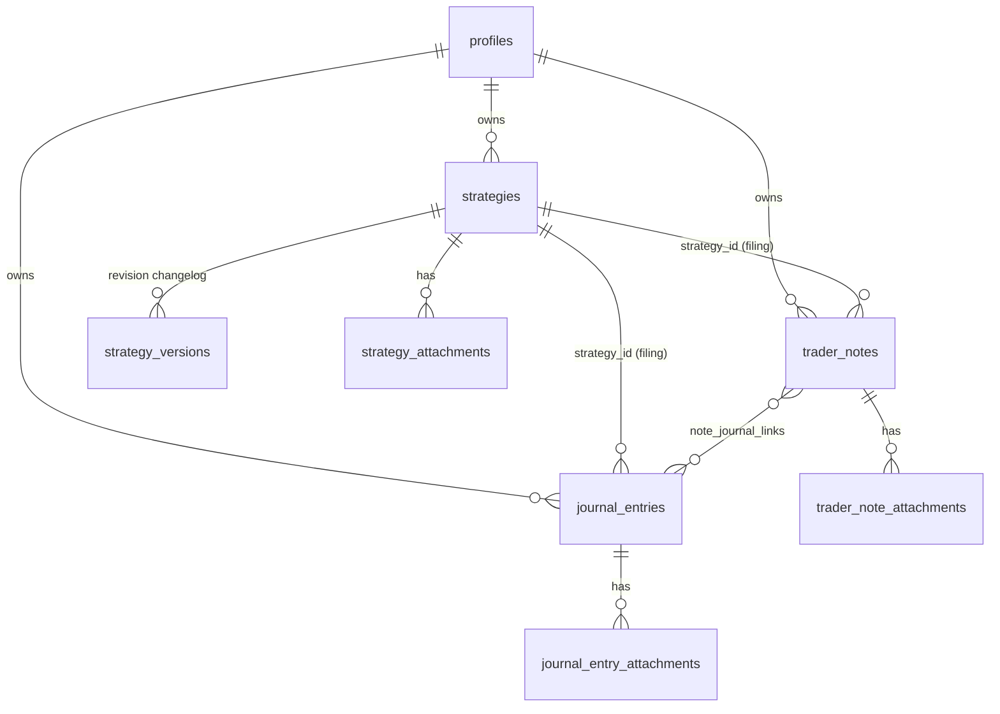

# [Feature]: Flow-Wise Backend Linking of Journal, Notes & Strategies and Online Database Migration

**Issue Type:** `Feature / Architecture / Backend Integration`  
**Components:** `lib/features/notes`, `lib/features/journal`, `lib/features/strategies`, `lib/features/linking`, `database/migrations`, `backend_handoff/`  
**Reference Handoffs:** 
- [01-Trade_Journal](../backend_handoff/01-Trade_Journal/HOW_IT_WORKS.md)
- [02-Trader_Notes](../backend_handoff/02-Trader_Notes/HOW_IT_WORKS.md)
- [03-Strategy_Notes](../backend_handoff/03-Strategy_Notes/HOW_IT_WORKS.md)
- [11-Universal_Link_Graph](../backend_handoff/11-Universal_Link_Graph/HOW_IT_WORKS.md)
- [00-Backend_Readiness](../backend_handoff/00-Backend_Readiness.md)

---

## 1. Summary & Objective

The Writing Desk frontend surfaces (**Trader Notes**, **Journal Notes / Trades**, and **Strategy Playbooks**) are fully built, responsive, and tested, but currently run against in-memory mock implementations (`DemoDataSource`, `NotesRepositoryImpl`, `JournalRepositoryImpl`, `StrategiesRepositoryImpl`).

This issue tracks:
1. **Flow-Wise Backend Linking:** Enforcing the relational schema and link graph connecting Notes ⇄ Journal Entries, Journal Entries → Strategies, and Notes → Strategies with triggers, reciprocity rules, and live performance derivation.
2. **Online Database Migration:** Applying database migrations (`007` through `012`), configuring Row Level Security (RLS) policies, and persisting mock/seed data from `DemoDataSource` to the online Supabase PostgreSQL database.
3. **Repository Swapping:** Implementing `SupabaseNotesRepository`, `SupabaseJournalRepository`, and `SupabaseStrategiesRepository` to replace the in-memory implementations behind existing repository scopes (`NotesRepositoryScope.override`, etc.) with zero modifications to UI widgets.
4. **Storage & Edge Function Provisioning:** Configuring storage buckets (`note-attachments`, `journal-attachments`, `strategy-attachments`) and deploying the `note-ai-refactor` Edge Function.

---

## 2. Relational Schema & Flow-Wise Link Graph Contract

### 2.1 The Four Record Kinds
Addressable workspace records are unified under `AppLinkKind`:
| Kind | Entity | Database Table | Storage Row? | Navigation Route |
| :--- | :--- | :--- | :--- | :--- |
| `note` | Trader Note | `trader_notes` | **Yes** | `/notes` |
| `journal` | Trade + Write-up | `journal_entries` | **Yes** | `/journal` |
| `strategy` | Strategy Playbook | `strategies` | **Yes** | `/strategies` |
| `ticker` | Symbol mention | *(None)* | **No** (stored in `TEXT[]` array) | `/market` |

> **Crucial Rule:** Tickers own no database rows. `$AAPL` or `RELIANCE.NS` are string items in `linked_tickers TEXT[]`.

### 2.2 Edge Types & Cardinality
There are strictly three edge types connecting the record-owning kinds:



| Edge | Cardinality | Authoritative Source of Truth | Mirror Array (Trigger-Maintained) | Operational Behavior |
| :--- | :--- | :--- | :--- | :--- |
| **Note ⇄ Journal** | Many-to-Many (`N:M`) | Join table `note_journal_links` | `trader_notes.linked_journal_ids`<br>`journal_entries.linked_note_ids` | Symmetric reciprocity. Managed by trigger `sync_note_journal_mirrors()`. Client unions both sides on fetch. |
| **Journal → Strategy** | Many-to-One (`N:1`) | Column `journal_entries.strategy_id` | `strategies.linked_journal_ids` | Filing moves the trade from its old playbook to new playbook. Managed by trigger `sync_strategy_mirrors()`. |
| **Note → Strategy** | Many-to-One (`N:1`) | Column `trader_notes.strategy_id` | `strategies.linked_note_ids` | Single-playbook filing. Managed by trigger `sync_strategy_mirrors()`. |

### 2.3 Load-Bearing Invariants
1. **No manual mirror writes:** The client must NEVER write directly to `strategies.linked_journal_ids`, `strategies.linked_note_ids`, `trader_notes.linked_journal_ids`, or `journal_entries.linked_note_ids`. They are maintained solely by database triggers.
2. **Guarded unlinking:**
   - Unlinking a journal from a strategy:
     ```sql
     UPDATE journal_entries SET strategy_id = NULL WHERE id = $entryId AND strategy_id = $strategyId;
     ```
   - Unlinking a note from a strategy:
     ```sql
     UPDATE trader_notes SET strategy_id = NULL WHERE id = $noteId AND strategy_id = $strategyId;
     ```
3. **No `note_strategy_links` table:** `AppNote.strategyId` is a single nullable UUID. Do not create a join table for note-to-strategy edges.
4. **Derived Strategy Performance:**
   Strategy metrics (win rate, total net PnL, profit factor, trade count, average R) are **never entered manually**. They are derived dynamically from closed journal entries filed under `strategy_id` via the `strategy_performance` view (`security_invoker = true`).

---

## 3. Database Migrations Execution Plan

Apply the following migrations sequentially against the online Supabase PostgreSQL database:

1. **`007_trader_notes.sql`**:
   - `trader_notes` table (Markdown `content`, `note_type`, `tags`, `linked_tickers`, `strategy_id`, derived counter columns).
   - `trader_note_attachments` table with bucket references.
2. **`008_trader_note_engagement.sql`**:
   - Engagement counters (`trader_note_likes`, `trader_note_comments`, `trader_note_views`) with automated increment/decrement triggers.
3. **`009_journal_notes.sql`**:
   - Aligns `journal_entries` with `AppTrade` (adds `title`, `opened_at`, `closed_at`, `pnl`, `pnl_percent`, `r_multiple`, `psychology_score`, markdown counters).
   - `journal_entry_attachments` table.
4. **`010_strategy_notes.sql`**:
   - Aligns `strategies` with `AppStrategy` (Markdown `content`, `status`, `summary`, `tags`, `linked_tickers`, `version_count`).
   - `strategy_versions` table for revision changelogs and snapshot history.
   - `strategy_attachments` table.
5. **`011_note_link_graph.sql`**:
   - Creates `note_journal_links` join table with foreign key cascades and validation trigger `validate_note_journal_link()`.
   - Triggers `sync_note_journal_mirrors()` and `sync_strategy_mirrors()`.
   - Initial backfill to synchronize mirror arrays.
6. **`012_linked_notes_reads.sql`**:
   - `strategy_performance` view (with `security_invoker = true`).
   - `public_document(kind, id)` secure RPC function for anonymous unauthenticated access with field projection.
   - `public_strategy_performance(p_id)` RPC function with `< 5` trades privacy threshold.
7. **`rls_policies.sql`**:
   - Idempotently configure Row-Level Security policies for all tables and buckets ensuring strict tenant isolation via `auth.uid()`.

---

## 4. Mock Data to Online Database Migration

Create a dedicated online seed script (`database/seeds/05_linked_writing_desk.sql`) that converts `DemoDataSource` fixtures into valid SQL seeds linked to the test/authenticated user:

1. **Strategies Seed:**
   - Pre-populate sample playbooks (e.g., "VWAP Momentum Breakout", "Opening Range Breakout (ORB)", "Supply & Demand Reversal", "High-Tight Flag").
   - Populate `strategy_versions` with initial v1.0 and revision changelogs.
2. **Journal Entries Seed:**
   - Pre-populate realistic trade records across varied instruments (`AAPL`, `NVDA`, `TSLA`, `RELIANCE.NS`, `HDFCBANK.NS`) with entry/exit timestamps, PnL, R-multiple, trade psychology scores, and rich markdown write-ups.
   - File each trade under its respective `strategy_id`.
3. **Trader Notes Seed:**
   - Pre-populate notes spanning all note types: `general`, `marketReview`, `cheatSheet`, `riskRule`, `mistakeAnalysis`.
   - Associate notes with `strategy_id` and include ticker tags (`$NVDA`, `$AAPL`).
4. **Cross-Linking Seed:**
   - Populate `note_journal_links` associating mistake analysis notes and market reviews directly to executed journal trades.
   - Verify that triggers automatically populate `linked_journal_ids` and `linked_note_ids` across parent records.

---

## 5. Client Repository Implementation Checklist

### 5.1 Implement `SupabaseNotesRepository` (`lib/features/notes/data/`)
- [ ] Implement `NotesRepository`:
  - `watchAll()`: Realtime stream / polling from `trader_notes` for `user_id = auth.uid()`.
  - `getById(id)`: Fetch single note, resolving joined `strategy_name`.
  - `save(note)`: Insert (when `id` empty) or update `trader_notes`, computing derived word count and checklist counts.
  - `delete(id)`: Delete row and purge attachments.
  - `togglePin(id)` / `toggleArchive(id)`.
  - `getPublicNotes()`: Fetch notes where `is_public = true`.

### 5.2 Implement `SupabaseJournalRepository` (`lib/features/journal/data/`)
- [ ] Implement `JournalRepository`:
  - `watchAll()`: Realtime stream of `journal_entries` ordered by trade date.
  - `getById(id)`: Fetch trade write-up and executions.
  - `save(entry)`: Insert or update `journal_entries`.
  - `attachStrategy(entryId, strategyId)` / `detachStrategy(entryId, strategyId)`.
  - `getStats()`: Aggregate journal performance stats.

### 5.3 Implement `SupabaseStrategiesRepository` (`lib/features/strategies/data/`)
- [ ] Implement `StrategiesRepository`:
  - `watchAll()`: Stream `strategies` joined with `strategy_performance` view.
  - `getById(id)`: Fetch strategy, including version history from `strategy_versions`.
  - `save(strategy, {String? revisionNote})`: Insert/update strategy and record revision row when note provided.
  - `linkJournal(strategyId, entryId)` / `unlinkJournal(strategyId, entryId)`.
  - `linkNote(strategyId, noteId)` / `unlinkNote(strategyId, noteId)`.
  - `getPerformance(strategyId)`: Read from `strategy_performance`.

### 5.4 Repository Scope Wiring (`lib/main.dart` / App Initialization)
- [ ] Wire repositories into their respective DI scopes:
  ```dart
  NotesRepositoryScope.override(
    repository: SupabaseNotesRepository(supabaseClient),
    child: JournalRepositoryScope.override(
      repository: SupabaseJournalRepository(supabaseClient),
      child: StrategiesRepositoryScope.override(
        repository: SupabaseStrategiesRepository(supabaseClient),
        child: const TradeXApp(),
      ),
    ),
  );
  ```
- [ ] Ensure `DemoDataSource` fallback remains selectable via environment flag (`--dart-define=USE_DEMO_DATA=true`) for widget tests and offline previews.

---

## 6. Storage Buckets & Edge Functions

- [ ] Create Supabase Storage Buckets:
  - `note-attachments` (Max 10MB per file, images/PDFs/markdown).
  - `journal-attachments` (Max 15MB per file, chart screenshots, broker execution CSVs).
  - `strategy-attachments` (Max 10MB per file, diagram illustrations).
- [ ] Enforce Storage RLS:
  - Key convention: `<user_id>/<parent_id>/<uuid>.<ext>`.
  - Read access permitted if user is owner or if parent record has `is_public = true`.
- [ ] Deploy Edge Function `note-ai-refactor`:
  - Securely invoke LLM from Edge Function using environment credentials (no API keys in client).
  - Formats raw notes into structured playbooks or trading checklists.

---

## 7. Acceptance Criteria & Definition of Done

- [ ] **Zero Widget Changes:** All UI widgets in `lib/features/notes`, `lib/features/journal`, and `lib/features/strategies` interact exclusively through their existing abstract repository interfaces.
- [ ] **Symmetric Reciprocity:** Linking a note to a journal entry in `note_journal_links` reflects in both `note.linkedJournalIds` and `journalEntry.linkedNoteIds`.
- [ ] **Accurate Playbook Performance:** The win rate and net PnL displayed on a Strategy Playbook card dynamically matches the mathematical aggregation of its linked closed journal entries.
- [ ] **Isolated Ownership:** RLS policies prevent authenticated User A from reading or modifying User B's private notes, journal entries, or strategies.
- [ ] **Public Boundary Safety:** Anonymous `public_document()` queries on public records return only sanitized fields without leaking unshared private relationships.
- [ ] **Static Analysis & Testing:**
  - `flutter analyze` reports 0 issues.
  - All unit and widget tests in `test/features/journal/`, `test/features/notes/`, and `test/features/strategies/` pass cleanly.
