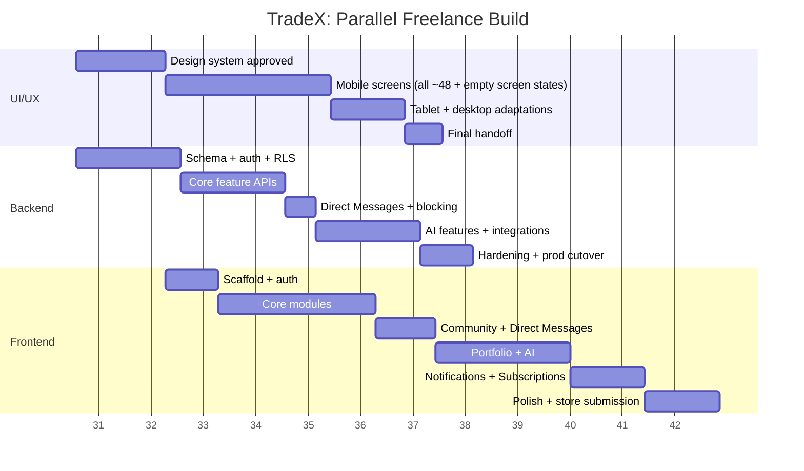

# TradeX delivery timeline

## Project delivery timeline

Work is structured across three parallel development tracks:

| Track | Estimated duration | Prerequisites |
|---|---|---|
| UI/UX design | 4 to 6 weeks | Starts immediately. Full screen and interaction specifications are documented in `03-design/`. |
| Backend | 5 to 7 weeks | Starts immediately. Complete database schema and API contracts are documented in `02-architecture/`. |
| Frontend | 5 to 7 weeks | Begins once the design system milestone is reached (around week 2 of design). Development proceeds against documented API mocks prior to backend completion. |

Critical path: Frontend. Development is initially blocked on design system approval, and final integration requires backend completion. Total calendar time is estimated at 8 to 10 weeks.
