# TradeX entity relationship diagram and indexing guide

Visual companion to [API_DATA_MODEL.md](./API_DATA_MODEL.md), summarizing entity relationships, database constraints, indexing recommendations, and migration standards.

Three files under `database/` are authoritative; this document is a reading of them, not a second source of truth:

| File | What it is |
|---|---|
| [`database/schema.sql`](../../database/schema.sql) | Every table, index, trigger, view and function, as one file |
| [`database/erd.dbml`](../../database/erd.dbml) | The same graph in DBML, column for column |
| [`database/rls_policies.sql`](../../database/rls_policies.sql) | Row-level security, for tables **and** `storage.objects` |

The linked-notes half of the schema — `note_journal_links`, the two `strategy_id` columns, the four mirror arrays, and the `strategy_performance` view — is argued out in [LINKED_NOTES_BACKEND_HANDOFF.md](../LINKED_NOTES_BACKEND_HANDOFF.md). Read section 3 there before changing anything in section 2 below.

### 1. Entity relationship diagram

Scoped to the trading workspace, its link graph, and the social surface. Billing, affiliate and webhook tables appear as relationships only; their columns are in `erd.dbml`.

```mermaid
erDiagram
    profiles ||--o{ journal_entries : owns
    profiles ||--o{ trader_notes : owns
    profiles ||--o{ strategies : owns
    profiles ||--o{ watchlists : owns
    profiles ||--o{ posts : authors
    profiles ||--o{ comments : authors
    profiles ||--o{ saved_posts : bookmarks
    profiles ||--o{ notifications : receives
    profiles ||--o{ device_tokens : registers
    profiles ||--o{ conversations : "participant A"
    profiles ||--o{ conversations : "participant B"
    conversations ||--o{ messages : contains
    profiles ||--o{ blocks : "blocker"
    profiles ||--o{ blocks : "blocked"
    profiles ||--o{ follows : "follower"
    profiles ||--o{ follows : "followee"
    profiles ||--o{ likes : likes
    profiles ||--|| subscriptions : has
    profiles ||--o| affiliate_profiles : "may be"
    affiliate_profiles ||--o{ affiliate_referrals : earns
    affiliate_profiles ||--o{ affiliate_payouts : "is paid by"

    trader_notes ||--o{ note_journal_links : "edge from"
    journal_entries ||--o{ note_journal_links : "edge from"
    strategies |o--o{ journal_entries : "trades filed under"
    strategies |o--o{ trader_notes : "notes filed under"

    journal_entries ||--o{ journal_entry_links : "source"
    journal_entries ||--o{ journal_entry_links : "target"
    journal_entries ||--o{ journal_entry_attachments : embeds
    trader_notes ||--o{ trader_note_attachments : embeds
    strategies ||--o{ strategy_attachments : embeds
    strategies ||--o{ strategy_versions : "version history"

    trader_notes ||--o{ trader_note_likes : receives
    trader_notes ||--o{ trader_note_comments : receives
    trader_notes ||--o{ trader_note_views : records

    watchlists ||--o{ watchlist_items : contains

    posts ||--o{ comments : has
    posts ||--o{ likes : has
    posts ||--o{ saved_posts : "saved by"

    profiles {
        uuid id PK
        citext handle UK
        citext email UK
        text display_name
        text role "customer | affiliate | user_admin"
        text status "active | suspended | pending_approval"
        text referral_code UK
        text avatar_url
        text experience_level
        text trading_style
        boolean public_journals
        text subscription_tier
    }
    journal_entries {
        uuid id PK
        uuid user_id FK
        text title
        text ticker
        text content "markdown body"
        numeric entry_price
        numeric exit_price
        numeric stop_loss
        numeric target
        numeric size
        text side "long | short"
        numeric pnl
        numeric pnl_percent
        numeric r_multiple
        timestamptz opened_at
        timestamptz closed_at
        int psychology_score "1..10"
        text mistakes_made
        text lessons_learned
        uuid strategy_id FK "nullable, ON DELETE SET NULL"
        text outcome "win | loss | breakeven | open"
        text outcome_source "auto | manual"
        text[] tags
        uuid[] linked_note_ids "mirror, trigger-maintained"
        int word_count
        int checklist_done
        int checklist_total
        boolean has_images
        boolean has_code
        boolean is_public "always false"
    }
    note_journal_links {
        uuid note_id PK,FK
        uuid entry_id PK,FK
        uuid user_id FK "denormalised owner, trigger-assigned"
        timestamptz created_at
    }
    trader_notes {
        uuid id PK
        uuid user_id FK
        text title
        text content "markdown body"
        text note_type
        text[] tags
        text[] linked_tickers
        uuid strategy_id FK "nullable, ON DELETE SET NULL"
        uuid[] linked_journal_ids "mirror, trigger-maintained"
        boolean is_public
        int word_count
        int view_count
        int like_count
    }
    strategies {
        uuid id PK
        uuid user_id FK
        text title
        text summary
        text content "markdown body, not structured data"
        text category
        text status "draft | testing | live | retired"
        text visibility "private | public"
        text[] tags
        text[] linked_tickers
        uuid[] linked_note_ids "mirror, trigger-maintained"
        uuid[] linked_journal_ids "mirror, trigger-maintained"
        int version_count
        int word_count
        boolean is_favorite
        text ai_summary
    }
    strategy_versions {
        uuid id PK
        uuid strategy_id FK
        text content
        text summary
        text note
        int version_number
        uuid author_id FK "ON DELETE SET NULL"
        boolean is_current "unique per strategy where true"
    }
    journal_entry_attachments {
        uuid id PK
        uuid entry_id FK
        uuid user_id FK
        text storage_path UK "user_id/entry_id/uuid.ext"
        text filename
        text mime_type
        bigint byte_size "max 10 MB"
        boolean is_image
    }
    strategy_attachments {
        uuid id PK
        uuid strategy_id FK
        uuid user_id FK
        text storage_path UK "user_id/strategy_id/uuid.ext"
        text filename
        text mime_type
        bigint byte_size "max 10 MB"
        boolean is_image
    }
    trader_note_attachments {
        uuid id PK
        uuid note_id FK
        uuid user_id FK
        text storage_path UK "user_id/note_id/uuid.ext"
        text filename
        bigint byte_size
        boolean is_image
    }
    trader_note_likes {
        uuid note_id PK,FK
        uuid user_id PK,FK
        timestamptz created_at
    }
    trader_note_comments {
        uuid id PK
        uuid note_id FK
        uuid user_id FK
        text content
    }
    trader_note_views {
        uuid note_id PK,FK
        uuid user_id PK,FK
        timestamptz viewed_at
    }
    journal_entry_links {
        uuid id PK
        uuid source_entry_id FK
        uuid target_entry_id FK
    }
    subscriptions {
        uuid user_id PK,FK
        text tier
        text status
        text revenuecat_id UK
        text billing_cycle
        timestamptz expires_at
    }
    device_tokens {
        uuid id PK
        uuid user_id FK
        text token
        text platform
    }
    conversations {
        uuid id PK
        uuid user_a_id FK
        uuid user_b_id FK
        timestamptz last_message_at
    }
    messages {
        uuid id PK
        uuid conversation_id FK
        uuid sender_id FK
        text content
        timestamptz read_at
    }
    blocks {
        uuid blocker_id PK,FK
        uuid blocked_id PK,FK
        timestamptz created_at
    }
    follows {
        uuid follower_id PK,FK
        uuid followee_id PK,FK
        timestamptz created_at
    }
    likes {
        uuid user_id PK,FK
        uuid post_id PK,FK
        timestamptz created_at
    }
    watchlists {
        uuid id PK
        uuid user_id FK
        text name
    }
    watchlist_items {
        uuid id PK
        uuid watchlist_id FK
        text ticker
        numeric price_alert_threshold
        text price_alert_direction
        boolean alert_armed
        timestamptz alert_last_triggered_at
    }
    posts {
        uuid id PK
        uuid user_id FK
        text content_type
        text ticker
    }
    comments {
        uuid id PK
        uuid post_id FK
        uuid user_id FK
    }
    saved_posts {
        uuid user_id PK,FK
        uuid post_id PK,FK
    }
    notifications {
        uuid id PK
        uuid user_id FK
        text category
        text deep_link
        timestamptz read_at
    }
    ai_insights {
        uuid id PK
        text ticker
        text summary
        jsonb indicators
    }
    ai_insight_requests {
        uuid id PK
        uuid user_id FK
        text kind
        text ticker
    }
    revenuecat_webhook_events {
        text event_id PK
        text event_type
        timestamptz processed_at
    }
```



Entities that own no foreign key, and things the diagram cannot draw:

- `ai_insights` is intentionally not user-scoped; it serves as a shared cache per ticker.
- `revenuecat_webhook_events` has no foreign keys; it acts as an independent idempotency log keyed on RevenueCat event IDs.
- `follows`, `likes`, `blocks`, `saved_posts`, `trader_note_likes`, `trader_note_views` and `note_journal_links` are composite-key junction tables. Only the last one carries a denormalised `user_id`, because it is the only one whose RLS check would otherwise need a join.
- `portfolio_stats` is a view, not a table: real-time aggregates (`sum(pnl)`, `win_rate`, `avg_rr`) grouped by `user_id`.
- `strategy_performance` is a view: `trades`, `net_pnl`, `win_rate` and `avg_r` per playbook, derived from the journal entries filed under it. **There are no such columns on `strategies`.** It is declared `WITH (security_invoker = true)`, without which it would run with owner rights and serve every trader's figures to any authenticated caller.
- `public_document(kind, id)` is a `SECURITY DEFINER` function and the only read path an unauthenticated visitor has. RLS is row-level and cannot hide a column, so the function's projected column list — not a policy — is what keeps the mirror arrays out of a shared payload.
- Tickers own no table. `linked_tickers` is a `text[]` on `trader_notes` and `strategies`; a ticker is a string the market defines, not a row this product maintains.
- `ai_chat_messages` will be introduced once message retention policies are finalized for AI conversations.

### 2. The link graph

Three edge types connect the three authoring surfaces, and they are deliberately not the same shape:

```text
  trader_notes  <--- note_journal_links ---> journal_entries   many-to-many
  journal_entries.strategy_id -------------> strategies        many-to-one
  trader_notes.strategy_id ----------------> strategies        many-to-one
```

| Edge | Stored as | Why this shape |
|---|---|---|
| note ⇄ journal | `note_journal_links` join table | A note can reference many trades and a trade can be discussed by many notes. This is the only genuine many-to-many in the graph |
| journal → strategy | `journal_entries.strategy_id` | A trade is filed under exactly one playbook, or none. A join table here would allow a trade to be counted twice in one playbook's win rate |
| note → strategy | `trader_notes.strategy_id` | Same reason, same shape |

There is no note ⇄ note edge. Related notes are derived at read time from shared tags, which is why no table appears for them and no API endpoint returns them.

**The join table and the two `strategy_id` columns are the truth. The four `linked_*_ids` arrays are mirrors**, rebuilt by the triggers in section 5 and never written by a client. `trader_notes.linked_journal_ids` and `journal_entries.linked_note_ids` mirror the join table; `strategies.linked_note_ids` and `strategies.linked_journal_ids` mirror the two child columns. A repository that accepts a client-supplied value for any of the four has introduced a second writer for a column that already has one.

The arrays exist because the mobile list read needs a link count without a per-row join. They are a denormalisation for one screen, not a parallel model.

### 3. Query cardinality and constraint notes

On the link graph and the two authoring tables:

- `journal_entries.strategy_id` and `trader_notes.strategy_id` are both nullable and both `ON DELETE SET NULL`. Many trades are never filed, so analytical queries need outer joins or explicit null checks — and the partial index `idx_journal_entries_unfiled` exists because "trades with no playbook" is the prompt the journal screen leads with.
- `journal_entries_open_has_no_exit` enforces `outcome <> 'open' OR (exit_price IS NULL AND closed_at IS NULL)`. An open position cannot carry an exit; without this the win rate is computable from data that contradicts itself.
- `psychology_score` is `1..10` or NULL. `psychology` remains as legacy free text and is not the same field.
- `journal_entries.is_public` exists and is always `false`. There is no public journal route in the product, and the double-gated `journal_entries_public_read` policy is left in place only because removing a policy is riskier than never satisfying it. Do not build a client path to it.
- `note_journal_links.user_id` is assigned by a `BEFORE INSERT` trigger from the note's owner; a client-supplied value is discarded. A link whose two ends have different owners is rejected before the row lands.
- Inserting the same `(note_id, entry_id)` twice is one row and no error. The client writes both ends of every edge, so duplicate writes are the shipped call pattern, not a defect to reject.
- `uq_strategy_versions_current` is a partial unique index on `strategy_versions(strategy_id) WHERE is_current`. Exactly one revision per playbook may be live — enforced by the database, not by application code, because "restore v3" is two writes and the window between them is where two live badges come from.
- `strategy_versions.author_id` is `ON DELETE SET NULL`: losing the author must not lose the revision.
- `strategies.content` and `strategy_versions.content` are `TEXT`, not JSONB. A playbook is markdown. Migration 010 performs that conversion and cannot be re-run.
- `journal_entry_links` carries a check constraint (`source_entry_id != target_entry_id`) preventing self-links at the database layer.

Everywhere else, unchanged:

- `strategies.visibility` controls row-level security between private owner access and public read access. Administrative queries bypassing RLS must respect this visibility flag.
- `profiles.subscription_tier` is denormalized from `subscriptions.tier`. The `subscriptions` table is the authoritative source updated by the RevenueCat webhook function under the service role. Clients have read-only access.
- `watchlist_items.alert_armed` and `alert_last_triggered_at` manage price alert state machines to prevent repeated notifications on consecutive scheduler runs.
- `conversations.user_a_id` and `user_b_id` store a sorted UUID pair where the smaller identifier is assigned to `user_a_id`. Client and server code creating conversations must sort participant IDs before insert to ensure the unique constraint prevents duplicates.
- `messages` enforces subscription tier gating directly within its RLS insert policy, confirming that the author holds an active Premium or Enterprise tier before allowing writes.
- `conversations` enforces `user_a_id != user_b_id` so users cannot start conversations with themselves.
- `messages.read_at` can only be updated by the recipient. The RLS update policy ensures senders cannot alter message bodies or manipulate read receipts.
- `blocks` enforces `blocker_id != blocked_id`. The `are_blocked()` helper function runs with `security definer` privileges to evaluate block statuses bidirectionally without granting direct table read access.

Several CHECK constraints added by migrations 009 and 010 are `NOT VALID` on purpose: they constrain everything written from now on without failing the migration on rows that predate them. Clean the old rows, then `VALIDATE CONSTRAINT`.

### 4. Indexes as shipped

These are the indexes in [`database/schema.sql`](../../database/schema.sql), not a wish list. Every one exists because a screen or a policy reads that way.

**Journal**

| Index | Definition | Purpose |
|---|---|---|
| `idx_journal_entries_user_sortdate` | `(user_id, (COALESCE(closed_at, opened_at)) DESC)` | The order the journal list actually reads. **Not `created_at`** — a trade backfilled today belongs where it happened |
| `idx_journal_entries_user_created` | `(user_id, created_at DESC)` | Audit and "recently added" reads, which are a different question from the one above |
| `idx_journal_entries_unfiled` | `(user_id) WHERE strategy_id IS NULL` | The unfiled-trades prompt. Partial, because a filed trade never appears in that query again |
| `idx_journal_entries_user_strategy` | `(user_id, strategy_id)` | `strategy_performance` and the Strategy Analyzer rollup |
| `idx_journal_entries_user_ticker` | `(user_id, ticker)` | Filtering trade logs by symbol |
| `idx_journal_entries_tags_gin` | GIN on `tags` | Tag containment |
| `idx_journal_entries_notes_gin` | GIN on `linked_note_ids` | "Which trades mention this note" without touching the join table |
| `idx_journal_entries_search_gin` | GIN on `to_tsvector('english', title \|\| ticker \|\| content)` | Full-text search across the workbench |
| `idx_journal_entry_attachments_entry` / `_user` | `(entry_id)` / `(user_id)` | Attachment fetch, and the owner check in RLS |

**Notes and the link graph**

| Index | Definition | Purpose |
|---|---|---|
| `idx_trader_notes_user_updated` | `(user_id, updated_at DESC)` | Default note list order |
| `idx_trader_notes_user_type` | `(user_id, note_type)` | The type filter chips |
| `idx_trader_notes_user_strategy` | `(user_id, strategy_id)` | Notes filed under a playbook |
| `idx_trader_notes_tags_gin` / `_tickers_gin` | GIN on `tags` / `linked_tickers` | Tag and ticker containment; the tag index is also what makes "related notes" cheap |
| `idx_trader_notes_public_updated` | `(updated_at DESC) WHERE is_public = true` | The public note feed, partial so private notes never enter it |
| `idx_trader_notes_search_gin` | GIN on `to_tsvector('english', title \|\| content)` | Full-text search |
| `idx_note_journal_links_entry` | `(entry_id)` | Reverse traversal. The PK `(note_id, entry_id)` already covers the forward direction |
| `idx_note_journal_links_user` | `(user_id)` | The one-comparison RLS check |
| `idx_trader_note_comments_note_created` | `(note_id, created_at)` | Comment threads in order |
| `idx_trader_note_attachments_note` / `_user` | `(note_id)` / `(user_id)` | Attachment fetch and owner check |

**Strategies**

| Index | Definition | Purpose |
|---|---|---|
| `idx_strategies_user_updated` | `(user_id, updated_at DESC)` | Default playbook list order |
| `idx_strategies_user_status` | `(user_id, status)` | The draft/testing/live/retired filter |
| `idx_strategies_user_category` | `(user_id, category)` | Categorized navigation |
| `idx_strategies_public_visibility` | `(visibility) WHERE visibility = 'public'` | Public playbook discovery |
| `idx_strategies_tags_gin` / `_tickers_gin` | GIN on `tags` / `linked_tickers` | Containment |
| `idx_strategies_journal_gin` | GIN on `linked_journal_ids` | Mirror lookups from the strategy side |
| `uq_strategy_versions_current` | UNIQUE `(strategy_id) WHERE is_current` | Constraint, not an optimisation. See section 3 |
| `idx_strategy_attachments_strategy` / `_user` | `(strategy_id)` / `(user_id)` | Attachment fetch and owner check |

**Everything else**

| Table | Index | Purpose |
|---|---|---|
| `profiles` | `(role)`, `(email)`, `(referral_code)` | Admin filters, lookup by email, referral resolution |
| `affiliate_profiles` | `(affiliate_code)` | Referral link resolution |
| `affiliate_referrals` | `(affiliate_id)`, `(referred_user_id)` | Dashboard rollups, and the once-ever referral check |
| `affiliate_payouts` | `(affiliate_id, status)` | Unpaid-balance queries |
| `posts` | `(created_at DESC)`, `(content_type, created_at DESC)` | Feed ordering, category-filtered feeds |
| `notifications` | `(user_id, read_at, created_at DESC)` | Unread-first ordering |
| `ai_insight_requests` | `(user_id, kind, requested_at)` | Per-user rate limit counting |
| `watchlist_items` | `(alert_armed, price_alert_threshold)` partial | Background price alert scanning |
| `device_tokens` | `(user_id)` | Push dispatch |
| `subscriptions` | `(revenuecat_id)` | Webhook lookups on renewal and cancellation |
| `conversations` | `(user_a_id, last_message_at DESC)`, `(user_b_id, last_message_at DESC)` | Thread ordering from either side |
| `messages` | `(conversation_id, created_at DESC)` | Chat history |
| `blocks` | `(blocked_id)` | Reverse lookup inside `are_blocked()` |
| `follows` | `(followee_id)` | Follower counts |
| `likes` | `(post_id)` | Like counts |
| `comments` | `(post_id, created_at)` | Comment threads |

### 5. Triggers with cross-table effects

**The link graph — four triggers, one writer per column**, plus the `updated_at` trigger every table shares.

| Trigger | Fires | Effect |
|---|---|---|
| `trg_note_journal_links_validate` | `BEFORE INSERT ON note_journal_links` | Resolves `user_id` from the note's owner, discarding any client-supplied value, and raises if the note and the entry have different owners |
| `trg_note_journal_links_sync` | `AFTER INSERT OR DELETE ON note_journal_links` | Rebuilds `trader_notes.linked_journal_ids` and `journal_entries.linked_note_ids` for the affected pair, from the join table |
| `trg_journal_entries_strategy_mirror` | `AFTER INSERT OR DELETE OR UPDATE OF strategy_id ON journal_entries` | Rebuilds `strategies.linked_journal_ids` for the old and the new playbook |
| `trg_trader_notes_strategy_mirror` | `AFTER INSERT OR DELETE OR UPDATE OF strategy_id ON trader_notes` | Rebuilds `strategies.linked_note_ids` for the old and the new playbook |
| `trg_<table>_updated_at` (one per table) | `BEFORE UPDATE` | Touches `updated_at` via `set_updated_at()`. Installed by a `DO` loop over every table that has the column; deliberately absent from `note_journal_links`, `trader_note_likes` and `trader_note_views`, which are append-only rows with nothing to touch |

Two details in that list are load-bearing:

- `UPDATE OF strategy_id` fires on the column appearing in the `SET` list, not on its value changing. A payload that writes `strategy_id` to the value it already held still fires the trigger, which rebuilds the mirror to the same array — correct, and the reason the trigger is written as a full rebuild rather than an incremental append.
- Both mirror functions rebuild from the source of truth rather than editing the array in place. `INSERT`, `DELETE` and refile all reduce to the same statement, so a duplicate write is a no-op and a lost write self-heals on the next one.

To repair every mirror in one pass — safe to run at any time, because a rebuild from the truth is idempotent:

```sql
SELECT rebuild_strategy_mirrors(id) FROM strategies;

UPDATE trader_notes n SET linked_journal_ids = COALESCE(
  (SELECT array_agg(l.entry_id ORDER BY l.created_at DESC)
     FROM note_journal_links l WHERE l.note_id = n.id), '{}');

UPDATE journal_entries e SET linked_note_ids = COALESCE(
  (SELECT array_agg(l.note_id ORDER BY l.created_at DESC)
     FROM note_journal_links l WHERE l.entry_id = e.id), '{}');
```

The `ORDER BY` clauses are not decoration: they reproduce the ordering the triggers write, so a repair pass over a healthy database changes nothing at all. Drop them and every array comes back reordered, which makes "did the repair find anything?" unanswerable.

**Engagement counts.**

- `trg_trader_note_like_counts` (`AFTER INSERT OR DELETE ON trader_note_likes`) and `trg_trader_note_view_counts` (`AFTER INSERT OR DELETE ON trader_note_views`) both run `refresh_trader_note_engagement_counts()`, which recounts `trader_notes.like_count` and `view_count` from scratch rather than incrementing — for the same reason as above.

**Messaging and signup.**

- `on_new_message` (`AFTER INSERT ON messages`) runs `notify_new_message()`: it inserts a `notifications` row for the recipient with `category = 'direct_message'`, then updates `conversations.last_message_at` so thread ordering follows activity. It runs `SECURITY DEFINER` because the recipient's RLS would otherwise block the sender from writing into their notifications.
- `on_auth_user_created` (`AFTER INSERT ON auth.users`) runs `public.handle_new_user_signup()`: it creates the `profiles` row, creates an `affiliate_profiles` row when the signup metadata says `role = 'affiliate'`, and resolves `referred_by_code` into an `affiliate_referrals` row plus a balance update. Every table it touches is schema-qualified.

**One hardening gap, inherited.** A `SECURITY DEFINER` function that does not pin its `search_path` resolves unqualified names against the *caller's* path, which is a privilege-escalation vector rather than a style preference. Every function added for the linked-notes work pins `SET search_path = public, pg_temp` — `validate_note_journal_link`, `sync_note_journal_mirrors`, `rebuild_strategy_mirrors`, `sync_strategy_mirrors`, `public_strategy_performance`, `public_refs`, `public_document`. Three older ones do not, and one pins `public` without `pg_temp`:

| Function | Today | Should be |
|---|---|---|
| `are_blocked(uuid, uuid)` | no `SET search_path` | `SET search_path = public, pg_temp` |
| `notify_new_message()` | no `SET search_path` | `SET search_path = public, pg_temp` |
| `public.handle_new_user_signup()` | no `SET search_path` | `SET search_path = public, extensions, pg_temp` |
| `refresh_trader_note_engagement_counts()` | `SET search_path = public` | append `, pg_temp` |

`pg_temp` belongs last, never first: a caller can create a temp table that shadows a real one, and a definer function that searches `pg_temp` early will happily read it. The signup function needs `extensions` in its path because `CREATE EXTENSION IF NOT EXISTS citext` in migration 001 names no schema, so on a Supabase project where the extension already lives in `extensions` the `citext` equality operator used by `WHERE handle = v_referred_by_code` is not in `public`. That is also why this is listed rather than already changed: the correct path depends on where a given project's extensions landed, and getting it wrong breaks signup rather than failing loudly.

### 6. Migration conventions

- Keep migrations modular: scope each file to a single logical feature, table addition, or related column changes.
- Include corresponding row-level security policies in the same migration file that creates a table, preventing unprotected states. `rls_policies.sql` is written `DROP POLICY IF EXISTS` then `CREATE`, so re-running it whole is the safe way to pick up new policies.
- Handle destructive updates using a multi-step release pattern: deprecate columns in one deployment and drop them in a subsequent release to maintain rollback safety.
- Add CHECK constraints `NOT VALID` when existing rows may violate them, and validate separately once the data is clean. Note that there is no `ADD CONSTRAINT IF NOT EXISTS` — pair every add with a `DROP CONSTRAINT IF EXISTS` to keep the file re-runnable.
- **`schema.sql` and `migrations/` must be edited together.** They describe the same database two ways: where it should end up, and how an existing deployment gets there. A column added to one and not the other means a fresh project and an upgraded project stop agreeing — which is the failure this document exists to make visible.
- Apply one or the other against a given database, never both. Migration 010 converts `strategies.content` from JSONB to TEXT and raises if it is already TEXT, which is exactly what a fresh `schema.sql` produces.
