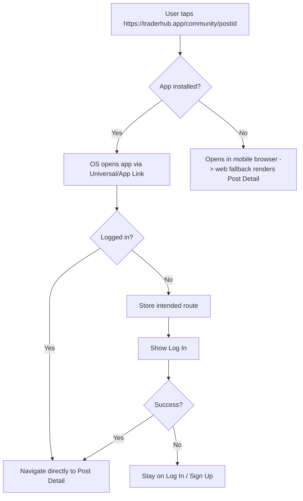
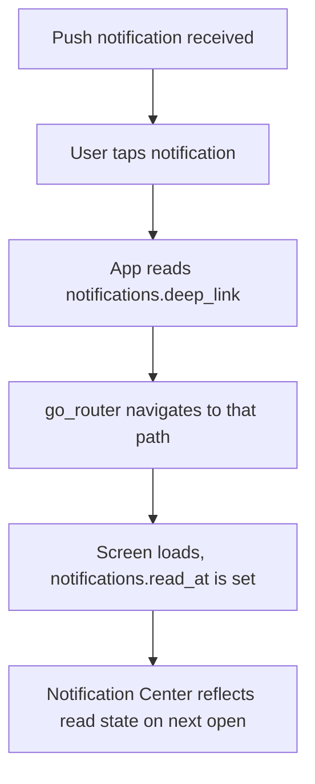
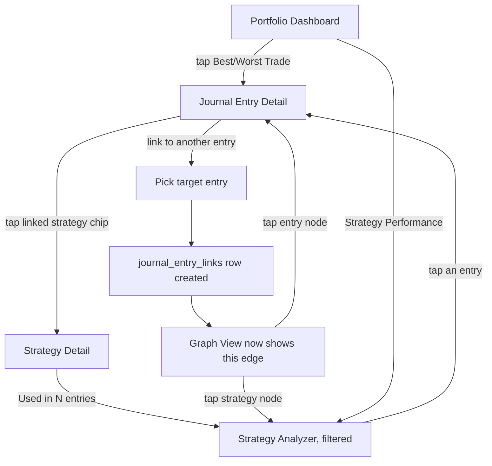

# Dynamic Linking & Feature Flows — TraderHub

How every screen is addressed by a link (deep link, universal/app link, or in-app navigation event), and how each feature's screen-to-screen flow is triggered — including from outside the app (push notification, shared link, email). Screen contents: [SCREENS_MOBILE.md](./SCREENS_MOBILE.md). Data behind each entity: [API_DATA_MODEL.md](./API_DATA_MODEL.md).

### 1. URL scheme
- **Custom scheme (mobile deep link):** `traderhub://`
- **Universal / App Links (web + mobile, same paths):** `https://traderhub.app/`
- Both resolve to the same route table (§ 2) via `go_router`'s route parsing (ARCHITECTURE.md § 1) — a `traderhub://journal/{id}` and `https://traderhub.app/journal/{id}` open the identical screen/state.
- Unauthenticated deep links: if the link requires a login (almost all do, except public profile/post/strategy links — § 2 marks which), the router stores the intended destination, routes through Sign Up/Log In first, then redirects to the original target on success.

### 2. Route table

| Path | Screen | Auth required? | Params |
|---|---|---|---|
| `/` | App Shell (default tab) | Yes | — |
| `/signup`, `/login`, `/forgot-password` | Auth screens | No | — |
| `/u/{handle}` | Public Profile | **No** (public) | `handle` |
| `/profile` | Own Profile | Yes | — |
| `/settings` | Settings | Yes | — |
| `/journal` | Journal List | Yes | — |
| `/journal/{entryId}` | Journal Entry Detail | Yes, owner-only | `entryId` |
| `/journal/new` | Journal Entry Create | Yes | optional `ticker`, `strategyId` prefill |
| `/strategies` | Strategy List | Yes | — |
| `/strategies/{strategyId}` | Strategy Detail | **No** if `visibility=public`, else owner-only | `strategyId` |
| `/strategies/{strategyId}/versions` | Version History | Yes, owner-only | `strategyId` |
| `/strategies/{strategyId}/analyzer` | Strategy Analyzer (filtered) | Yes, owner-only | `strategyId` |
| `/graph` | Graph View | Yes | optional `focusNodeId` |
| `/watchlists` | Watchlist List | Yes | — |
| `/watchlists/{watchlistId}` | Watchlist Detail | Yes, owner-only | `watchlistId` |
| `/portfolio` | Portfolio Dashboard | Yes | optional `range=weekly\|monthly` |
| `/portfolio/strategies` | Strategy Performance Breakdown | Yes | — |
| `/community` | Community Feed | Yes (Free: rate-limited) | optional `type={content_type}` |
| `/community/{postId}` | Post Detail | **No** (public) | `postId` |
| `/community/saved` | Saved Posts | Yes | — |
| `/messages` | Direct Messages List | Yes, Premium+ (Free tier never reaches this route — see § 5.3-style upsell interception, § 6) | — |
| `/messages/new` | New Message | Yes, Premium+ | — |
| `/messages/{conversationId}` | Conversation Detail | Yes, participant-only | `conversationId` — **not** tier-gated at the route level; a Free-tier participant (e.g. downgraded after the thread started) can still open and read an existing conversation, just can't send — the tier check happens at message-insert time (API_DATA_MODEL.md § 2), not at navigation time |
| `/insights/{ticker}` | Ticker Search / Detail | Yes | `ticker` |
| `/insights/{ticker}/assistant` | AI Trading Assistant (scoped to ticker) | Yes, Premium+ | `ticker` |
| `/insights/digest` | Daily Digest | Yes, Premium+ | — |
| `/insights/review?period=weekly\|monthly` | Performance Review | Yes, Premium+ | `period` |
| `/notifications` | Notification Center | Yes | — |
| `/notifications/preferences` | Notification Preferences | Yes | — |
| `/paywall` | Plan Comparison | Yes | optional `feature={locked feature id}` (drives the upsell interstitial copy) |
| `/subscription` | Manage Subscription | Yes | — |
| `/org` | Org Dashboard | Yes, org member (Enterprise) | — |

Public (no-auth) routes are deliberately narrow: `/u/{handle}`, `/strategies/{id}` (only when public), `/community/{postId}`. These are the only entities designed to be shared outside the app.

### 3. Notification → deep link mapping
`notifications.deep_link` (API_DATA_MODEL.md § notifications table) stores a path from § 2 directly. Mapping by category:

| Notification category | deep_link target |
|---|---|
| `market_alert` | `/watchlists/{watchlistId}` (scrolled/highlighted to the triggering ticker) |
| `community_update` | `/community/{postId}` (new comment/like) or `/u/{handle}` (new follower) |
| `direct_message` | `/messages/{conversationId}` — written by the `notify_new_message` trigger (API_DATA_MODEL.md § 11) |
| `strategy_reminder` | `/strategies/{strategyId}` |
| `ai_recommendation` | `/insights/review?period=weekly` or `/insights/digest`, depending on which AI feature generated it |
| `subscription_reminder` | `/subscription` |

### 4. Share flows
| Shared entity | Share target link | Recipient experience |
|---|---|---|
| Public Strategy Note | `https://traderhub.app/strategies/{id}` | Opens Strategy Detail read-only if not logged in; full interactive (favorite, etc. — except edit) if logged in as a non-owner |
| Community post | `https://traderhub.app/community/{postId}` | Opens Post Detail; comment/like require login, prompt-to-login on attempt |
| Public profile | `https://traderhub.app/u/{handle}` | Opens Public Profile |
| Private journal entry or private strategy | **Not shareable** — no public route exists; share action is hidden/disabled in the UI for private entities |

### 5. Feature flows (trigger → screens → outcome)

#### 5.1 Cold-start deep link (e.g. tapping a shared post link, app not running)


#### 5.2 Notification tap (warm/background app)


#### 5.3 Upsell interstitial (Free user hits a locked feature)
```mermaid
flowchart TD
    A[Free user taps a Premium-gated action] --> B[Router intercepts before navigating to the real target]
    B --> C[/paywall?feature=locked-feature-id]
    C --> D[Plan Comparison renders with that feature highlighted]
    D --> E{Upgrades?}
    E -- Yes --> F[Checkout] --> G{Success?}
    G -- Yes --> H[Redirect back to the originally tapped screen, now unlocked]
    G -- No --> C
    E -- No, dismiss --> I[Return to previous screen, feature stays locked]
```

#### 5.4 Cross-feature linking: Journal Entry ↔ Strategy ↔ Portfolio ↔ Graph
This is the most-traversed cluster in the app and worth calling out as its own flow, since four modules reference each other constantly:


#### 5.5 Public discovery flow (logged-out visitor → signup)
```mermaid
flowchart TD
    A[Logged-out visitor opens a public link: strategy, post, or profile] --> B[Renders read-only via public route, § 2]
    B --> C{Visitor tries an authenticated action: like, follow, comment, favorite}
    C --> D[Inline "Log in to continue" prompt, not a hard redirect]
    D --> E[Sign Up / Log In]
    E --> F[Original action replays automatically post-auth]
    F --> B
```

### 6. Not-yet-specced
- Global desktop search (SCREENS_DESKTOP.md § 6) has no route table entry yet — needs its own path scheme (likely a modal overlay state rather than a distinct route) before implementation.
- Enterprise routes (`/org/...` sub-paths for Team Management, Admin Controls, etc.) are omitted from § 2 pending the `organizations` data model (see ROADMAP.md) — add once that's specced.
