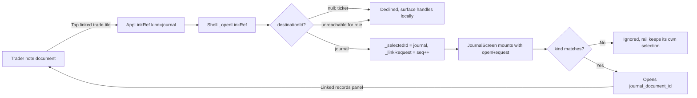
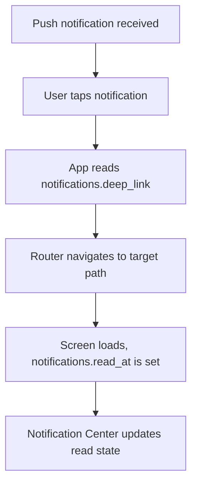
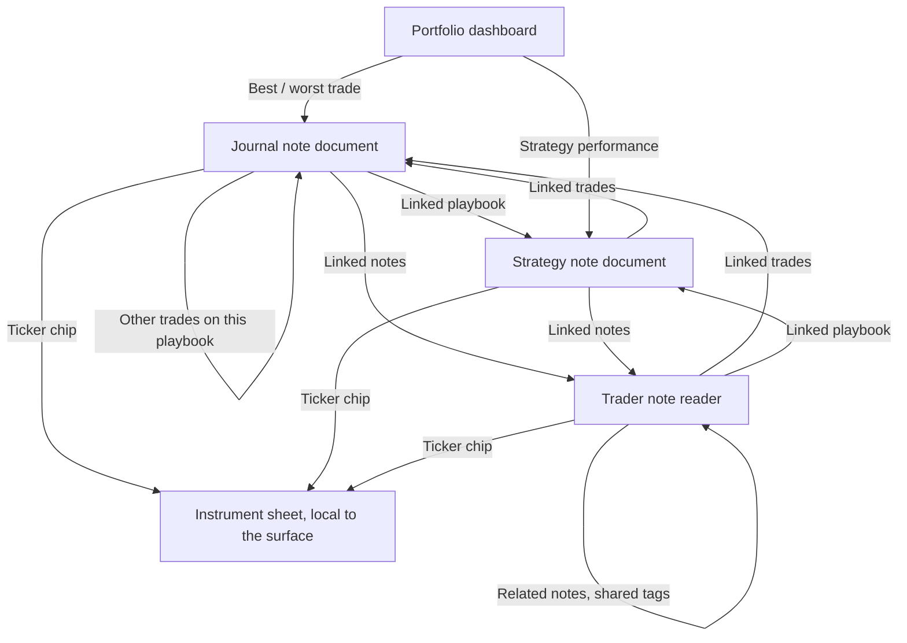
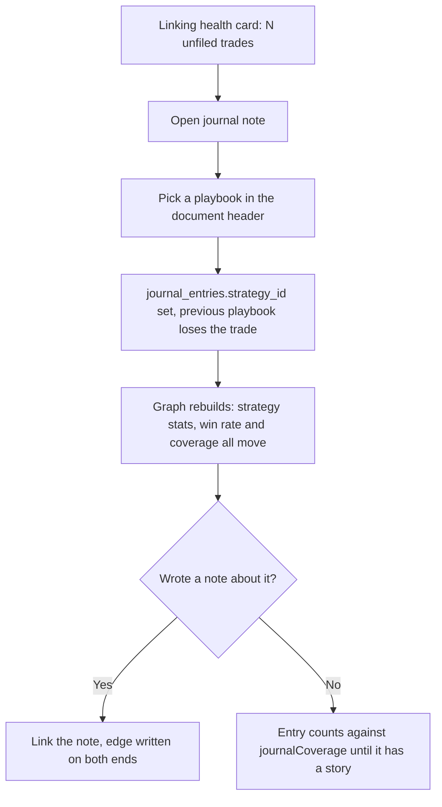
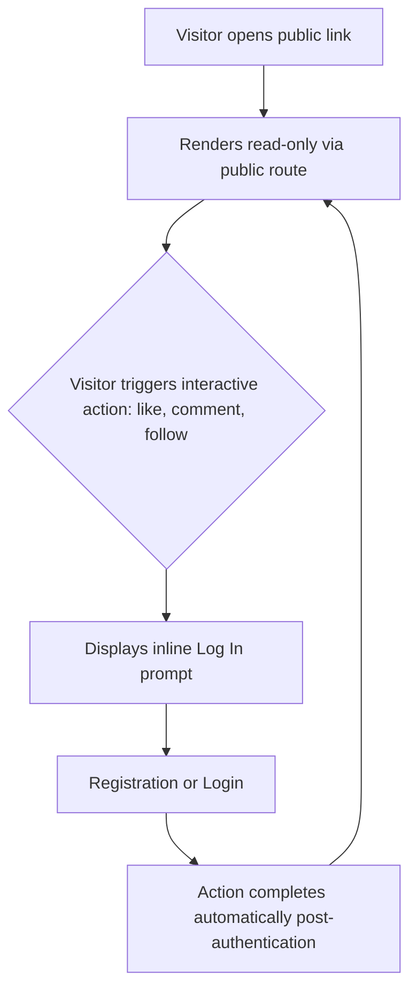

# TradeX linking, deep links and navigation flows

This document covers two related but distinct things, and it is worth being precise about which is which:

1. **The in-app link graph** (sections 1–3) — shipped, in code today. This is how a trader gets from a losing trade to the plan that produced it, and it is the backbone of the three writing destinations: trader notes, journal notes and strategy notes. It has no router and no URLs on the wire; it is an object graph plus a handoff protocol inside the shell.
2. **The public URL space** (sections 4–8) — the target state for when the app gains a router and web/Universal Link entry points. The route table is a specification, not a description of shipped code.

Screen layouts are detailed in [SCREENS_MOBILE.md](./SCREENS_MOBILE.md) and [SCREENS_DESKTOP.md](./SCREENS_DESKTOP.md). Data contracts are defined in [API_DATA_MODEL.md](../02-architecture/API_DATA_MODEL.md). Backend obligations for the linked writing surfaces are in [LINKED_NOTES_BACKEND_HANDOFF.md](../LINKED_NOTES_BACKEND_HANDOFF.md).

### 1. The internal `tradex://` URL space

`AppDeepLink` in [lib/core/linking/link_graph.dart](../../lib/core/linking/link_graph.dart) owns one scheme, used *inside* stored content:

```
tradex://note/<note_id>
tradex://journal/<trade_id>
tradex://strategy/<strategy_id>
tradex://ticker/<SYMBOL>
```

The host segment is `AppLinkKind.host`; `AppLinkKind.fromHost` reverses it. Three properties matter:

- **Editors write these into markdown bodies.** A cross-reference is stored as `[$RELIANCE](tradex://ticker/RELIANCE)` or `[Gap-and-go playbook](tradex://strategy/str_3)`, so a note's links survive export, copy-paste into another note, and a round trip through the backend as plain text. Nothing in the app scans prose for record names — it parses the URL.
- **An unknown host resolves to nothing, never to a guess.** `AppDeepLink.target` returns null for `tradex://watchlist/…`, so a future record kind added to the backend before the client understands it opens nothing rather than the wrong thing.
- **A missing record still renders.** `AppLinkGraph.refFor` returns `AppLinkRef.missing(kind, id)` instead of null, so a broken edge appears in the UI as a broken edge. Silently dropping it is how a workspace loses links without anyone noticing.

The public `https://` space in section 4 is separate and not yet wired. When it lands, `tradex://journal/{id}` and `https://tradex.app/journal/{id}` must resolve to the same destination and state.

### 2. The link graph

`AppLinkGraph` is a pure, immutable snapshot: four record lists in, questions about them out. No repositories, no streams, no `BuildContext`. It answers five kinds of question:

| Question | API | Used by |
|---|---|---|
| What is this record, as a link? | `noteRef` / `journalRef` / `strategyRef` / `tickerRef`, or `refFor(kind, id)` | Every link tile and chip |
| What is attached to this record? | `bundleFor(kind, id)` and the three typed `bundleForNote` / `bundleForJournal` / `bundleForStrategy`, plus the derived `bundleForTicker` | `AppLinkedRecordsPanel` in all three documents |
| What should I read next? | `siblingEntries(entry)` (other trades under the same playbook), `relatedNotes(note)` (tag overlap, most shared first) | Document footers |
| What can I link to? | `options(kind, exclude:, query:)` | Every link picker |
| What is wrong with this workspace? | `orphans()`, `edgeCount`, `journalCoverage` | Linking health cards |

**Every edge is stored on both ends, and the graph unions the two directions.** A note lists the journal entries it discusses (`linked_journal_ids`) and those entries list the note back (`linked_note_ids`). That redundancy is deliberate: a single-sided edge is one failed write away from disappearing, and a half-migrated backend then degrades to "the link still works" rather than "the link is gone". Backends must honour this — see the reciprocity rules in the combined handoff.

Two edges are *not* symmetric arrays, and the asymmetry is load-bearing:

- `journal_entries.strategy_id` is **single-valued**. Filing a trade under a playbook *moves* it. A playbook's own `linked_journal_ids` is a display convenience that can go stale; the graph tolerates this because `bundleForStrategy` unions the array with a scan for `t.strategyId == strategy.id`.
- **Tickers own no record.** `bundleForTicker` is derived entirely from the other three lists, and tickers are excluded from `orphans()` — naming an instrument is a topic tag, not a relationship to the trader's own work.

`AppLinkGraphService` in [lib/features/linking/link_graph_service.dart](../../lib/features/linking/link_graph_service.dart) is the live wiring: a lazy process-lifetime singleton that subscribes once to the three repositories, rebuilds a whole new snapshot on any change, and re-emits. Screens read `.current` or `watch()`. There is no scope to install in the widget tree.

### 3. Cross-destination navigation (no router)

The shell swaps one widget per sidebar id; it does not push routes. So a link that crosses destinations cannot be a navigation call — the note being clicked is unmounted a frame later, and the journal that must show its trade has not been built yet. The handoff is therefore data, owned by the shell:

```dart
// lib/core/widgets/app_scaffold.dart
AppLinkOpenRequest? _linkRequest;
int _linkSeq = 0;

void _openLinkRef(AppLinkRef ref) {
  final String? destination = ref.kind.destinationId;
  if (destination == null || !_canReach(destination)) return;
  setState(() {
    _selectedId = destination;
    _linkRequest = AppLinkOpenRequest(kind: ref.kind, id: ref.id, seq: ++_linkSeq);
  });
}
```

`AppLinkKind.destinationId` maps note → `notes`, journal → `journal`, strategy → `strategies`, ticker → `null`. Each of the three screens takes `onOpenRef` (to leave), `openRequest` (to arrive) and `onSubpageChanged` (so a phone's app bar names what is open).

`seq` is monotonic per shell and **only ever compared, never interpreted**. Without it, following the same link twice would be swallowed as "nothing changed" by the arriving screen's `didUpdateWidget`.

Four cases decline rather than navigate, all deliberate:

| Case | Behaviour | Why |
|---|---|---|
| `AppLinkKind.ticker` | Ignored by the shell | No destination of its own; the raising surface handles it locally |
| Destination the current role cannot reach | Ignored | An affiliate or admin shell does not conjure a trader destination |
| A link into the destination already showing | Handled by that screen | It is a local selection change, not a shell transition |
| A request whose `kind` does not match the receiving screen | Ignored by the screen | Guards against a misrouted request opening a wrong-typed id |

The request is cleared in both `_go` (manual sidebar navigation) and `_resetToOverview`. Screens apply their request in `initState`, and a remount cannot tell a fresh request from a spent one — without the clear, walking back to a destination by hand would re-open whatever a link sent the reader to an hour ago.



### 4. Route table (target state)

The router is not yet implemented; this table is the specification it must satisfy. Paths for the three writing destinations are marked where they differ from today's shell ids.

| Path | Destination screen | Requires login | Parameters |
|---|---|---|---|
| `/` | Application Shell (default tab) | Yes | None |
| `/signup`, `/login`, `/forgot-password` | Authentication screens | No | None |
| `/u/{handle}` | Public Profile | No (public) | `handle` |
| `/profile` | User Profile | Yes | None |
| `/settings` | Account Settings | Yes | None |
| `/journal` | Journal Notes — index (phone) / workbench (desktop) | Yes | None |
| `/journal/{entryId}` | Journal Note document | Yes (owner only) | `entryId` |
| `/journal/new` | Journal Note editor, blank | Yes | Optional `ticker`, `strategyId` prefill |
| `/notes` | Trader Notes — grid (phone) / workspace (desktop) | Yes | None |
| `/notes/{noteId}` | Trader Note reader | Yes, or public if `is_public` | `noteId` |
| `/notes/new` | Trader Note editor, blank | Yes | Optional `strategyId`, `journalId`, `ticker` prefill |
| `/strategies` | Strategy Notes — library (phone) / workbench (desktop) | Yes | None |
| `/strategies/{strategyId}` | Strategy Note document | No if public, otherwise owner only | `strategyId` |
| `/strategies/{strategyId}/versions` | Version History | Yes (owner only) | `strategyId` |
| `/strategies/{strategyId}/analyzer` | Strategy Analyzer (filtered) | Yes (owner only) | `strategyId` |
| `/graph` | Relational Graph View (deferred, see section 8) | Yes | Optional `focusNodeId` |
| `/watchlists` | Watchlist Overview | Yes | None |
| `/watchlists/{watchlistId}` | Watchlist Detail | Yes (owner only) | `watchlistId` |
| `/portfolio` | Portfolio Dashboard | Yes | Optional `range=weekly\|monthly` |
| `/portfolio/strategies` | Strategy Performance Breakdown | Yes | None |
| `/community` | Community Feed | Yes (Free accounts subject to read limits) | Optional `type={content_type}` |
| `/community/{postId}` | Post Detail | No (public) | `postId` |
| `/community/saved` | Saved Posts | Yes | None |
| `/messages` | Direct Messages List | Yes (Premium accounts only; Free accounts intercept to paywall) | None |
| `/messages/new` | Compose Direct Message | Yes (Premium accounts only) | None |
| `/messages/{conversationId}` | Conversation Thread | Yes (thread participants only) | `conversationId` |
| `/insights/{ticker}` | Ticker Detail and Charts | Yes | `ticker` |
| `/insights/{ticker}/assistant` | AI Assistant (scoped to ticker) | Yes (Premium accounts only) | `ticker` |
| `/insights/digest` | Daily Market Digest | Yes (Premium accounts only) | None |
| `/insights/review?period=weekly\|monthly` | Performance Review | Yes (Premium accounts only) | `period` |
| `/notifications` | Notification Center | Yes | None |
| `/notifications/preferences` | Notification Preferences | Yes | None |
| `/paywall` | Subscription Comparison | Yes | Optional `feature={locked_feature_id}` |
| `/subscription` | Manage Subscription | Yes | None |
| `/org` | Organization Dashboard | Yes (Enterprise accounts only) | None |

Public access without authentication is intentionally restricted to public profiles (`/u/{handle}`), published strategies (`/strategies/{id}`), published trader notes (`/notes/{id}` where `is_public`), and community posts (`/community/{postId}`). Journal notes have **no public route at all** — a trade log is the most sensitive record in the product and there is no per-entry publish flag to get wrong.

When the router lands, the `tradex://` internal links of section 1 map onto this table by host: `note` → `/notes/{id}`, `journal` → `/journal/{id}`, `strategy` → `/strategies/{id}`, `ticker` → `/insights/{ticker}`. That mapping belongs in one function, and it is the same one the shell's `_openLinkRef` uses today via `AppLinkKind.destinationId` — replacing the id switch with a path switch is the whole migration for cross-destination links.

### 5. Notification to deep link mapping

`notifications.deep_link` records direct paths matching the route table:

| Notification category | Target path |
|---|---|
| `market_alert` | `/watchlists/{watchlistId}` (highlights the triggered ticker) |
| `community_update` | `/community/{postId}` for comments and likes, or `/u/{handle}` for new followers |
| `direct_message` | `/messages/{conversationId}` (written by the `notify_new_message` trigger) |
| `strategy_reminder` | `/strategies/{strategyId}` |
| `ai_recommendation` | `/insights/review?period=weekly` or `/insights/digest` |
| `subscription_reminder` | `/subscription` |
| `journal_nudge` (unfiled trade, uncovered entry) | `/journal/{entryId}` |
| `note_engagement` (like or comment on a public note) | `/notes/{noteId}` |

### 6. Sharing workflows

| Shared entity | Share URL | Recipient experience |
|---|---|---|
| Public Strategy Note | `https://tradex.app/strategies/{id}` | Opens the strategy document in read-only mode for unauthenticated users. Authenticated users can favourite it. Linked journal entries are **not** included — the playbook's performance figures are shown, the trades behind them are not. |
| Public Trader Note | `https://tradex.app/notes/{id}` | Opens the reader with the markdown body, tags and tickers. Linked journal entries and private notes are stripped from the linked-records panel server-side, not hidden client-side. |
| Community post | `https://tradex.app/community/{postId}` | Opens Post Detail. Likes and comments prompt unauthenticated visitors to log in. |
| Public profile | `https://tradex.app/u/{handle}` | Renders public profile and performance metrics. |
| Journal note | Not shareable | No public route exists; share actions are absent, not disabled. |
| Private note or strategy | Not shareable | Share action offers "make public first". |

### 7. Interaction and navigation flows

#### 7.1 Cold start deep link (App opening from closed state)


#### 7.2 Notification tap (App running in background)


#### 7.3 Upgrade prompt interception
```mermaid
flowchart TD
    A[Free user triggers Premium feature] --> B[Router intercepts before navigating]
    B --> C[/paywall?feature=locked-feature-id]
    C --> D[Plan Comparison renders with highlighted feature]
    D --> E{User upgrades?}
    E -- Yes --> F[Checkout] --> G{Success?}
    G -- Yes --> H[Redirect to requested destination]
    G -- No --> C
    E -- No, dismiss --> I[Return to previous screen]
```

#### 7.4 Cross-module navigation: the three writing surfaces

This is the shipped behaviour of section 3, drawn as the trader experiences it. Every arrow is a tap on a link tile inside an `AppLinkedRecordsPanel`, and every arrow works in both directions because every edge is stored on both ends.



#### 7.5 Filing an unfiled trade (the graph's main repair loop)


#### 7.6 Public discovery flow (Anonymous visitor to registration)


### 8. Deferred route specifications
- Global desktop search: operates as a modal overlay rather than an independent route.
- Enterprise routes (`/org/...` paths for team and member management): deferred to post-MVP roadmap.
- A dedicated graph view (`/graph`): the linking health cards and per-document linked-records panels cover the MVP need. A visual graph is worth building once a workspace routinely holds hundreds of edges.
- Router adoption itself: today's shell handoff (section 3) is sufficient for in-app linking. The router is required by web entry points and notifications, not by the linked writing surfaces.
