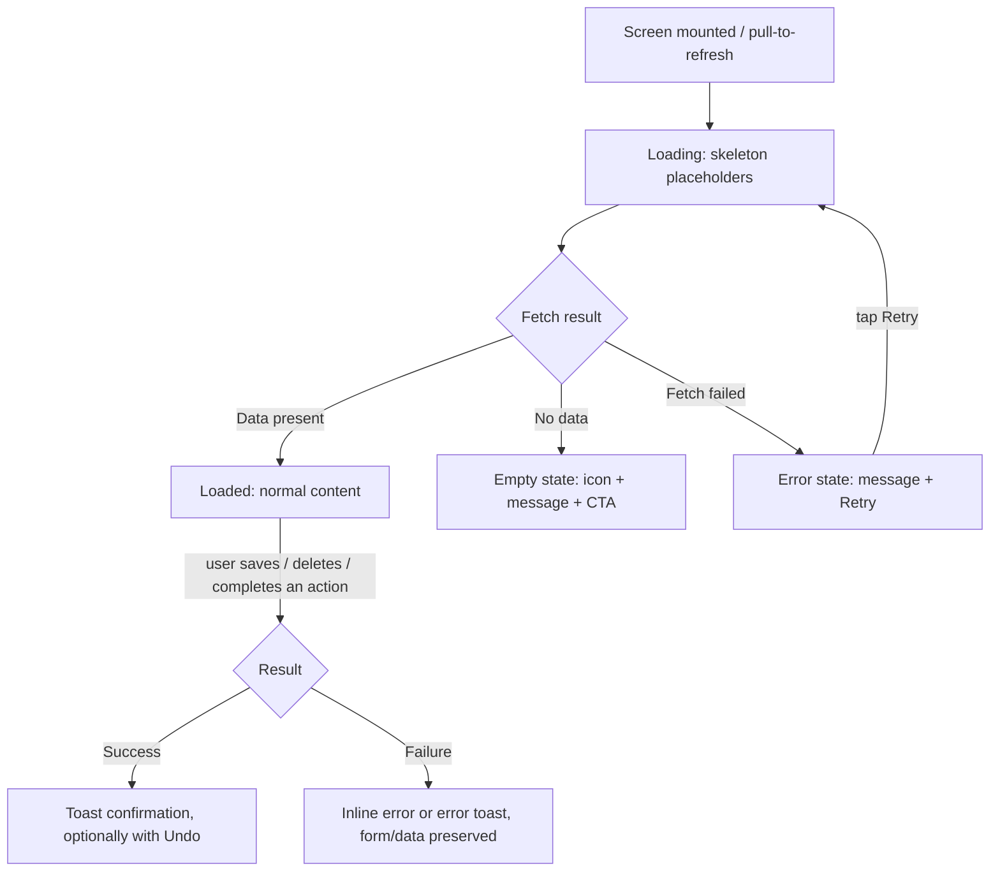
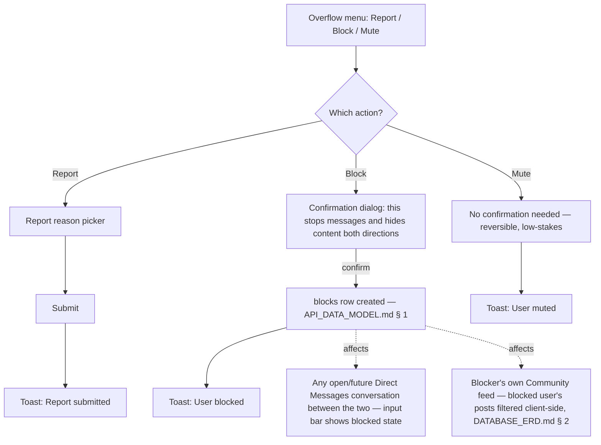
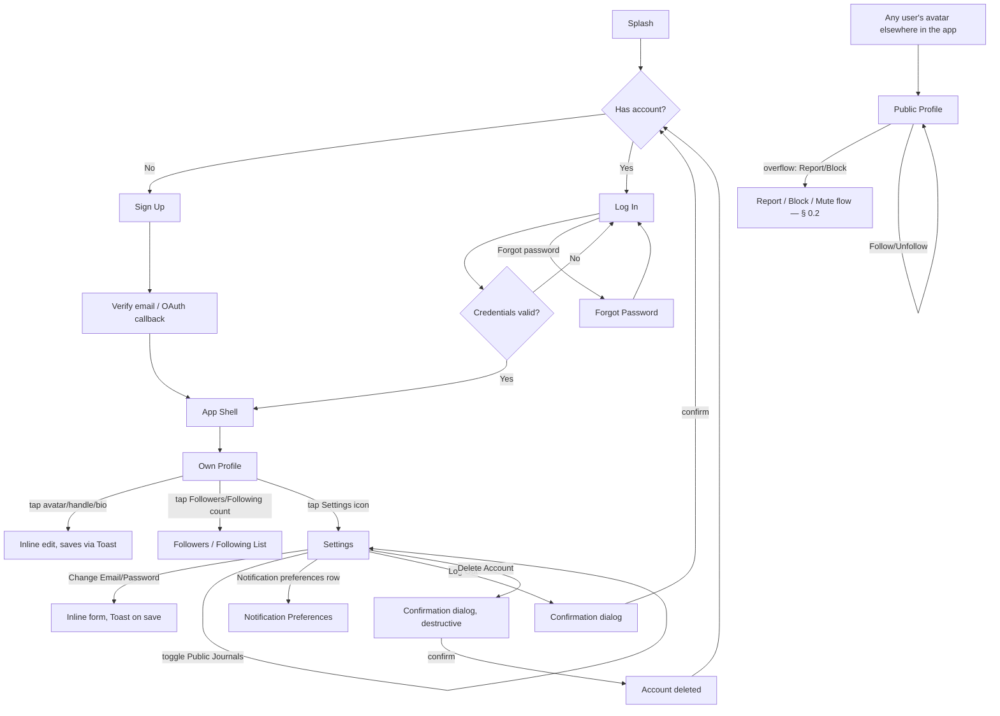
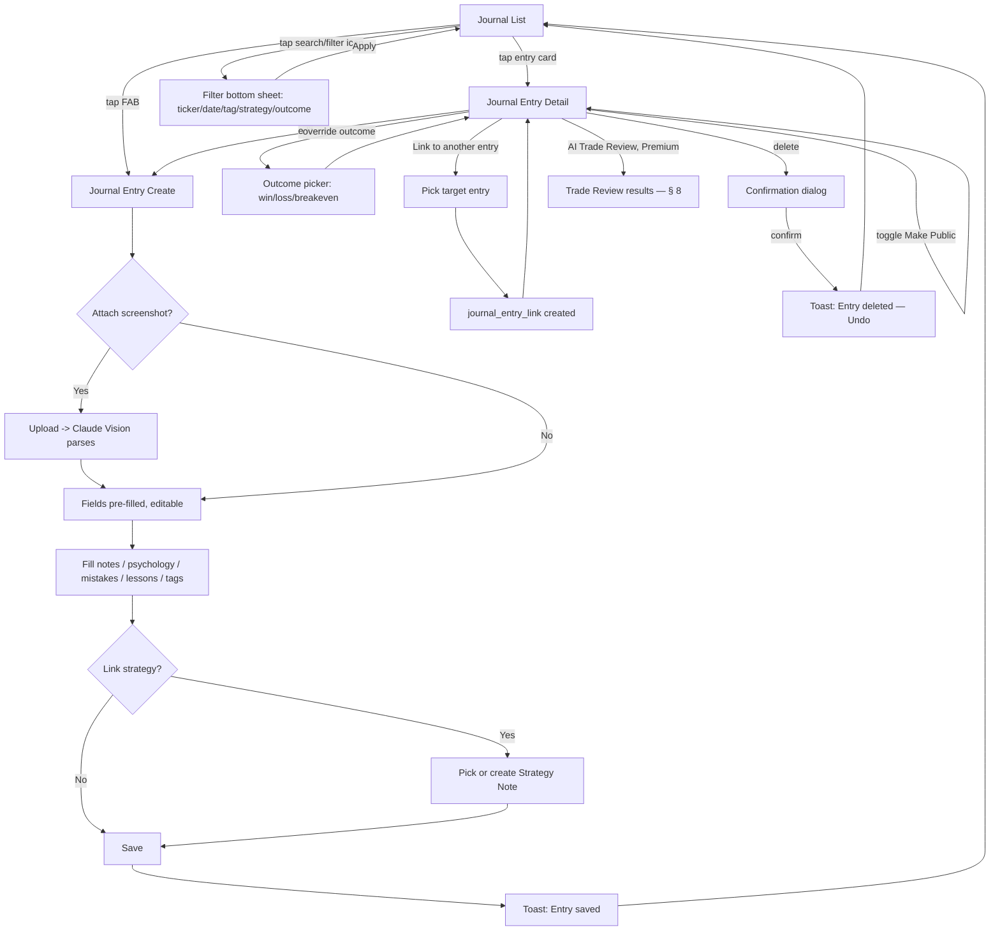
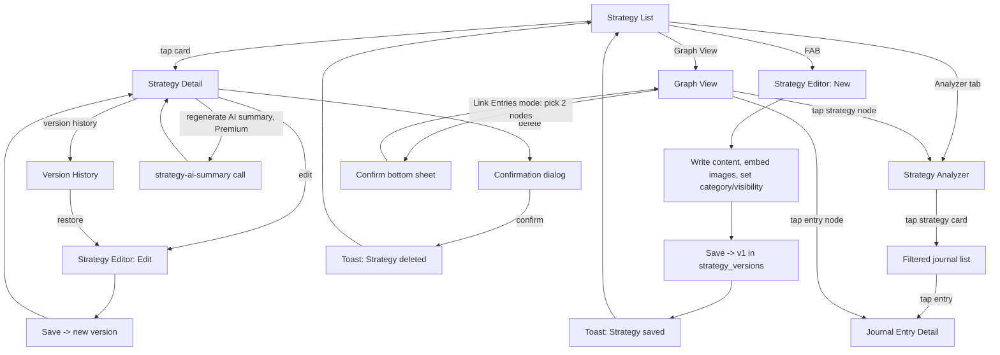
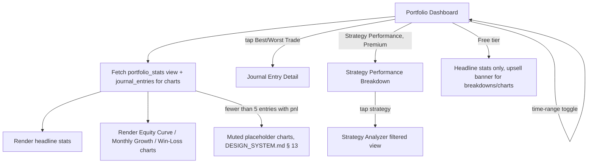
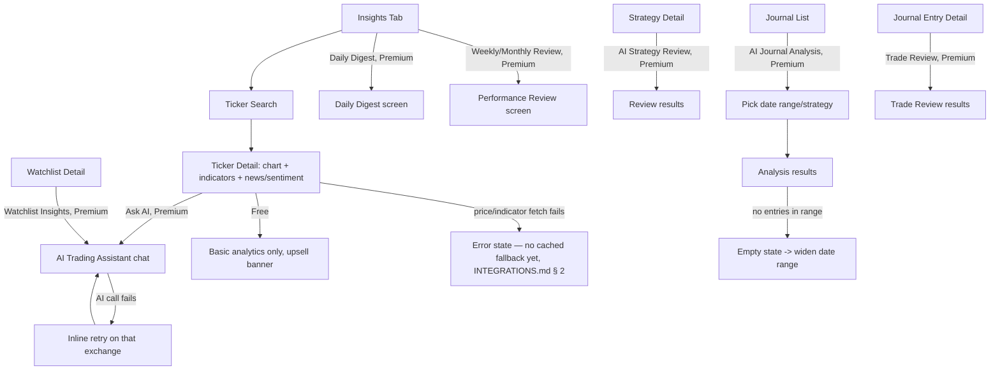
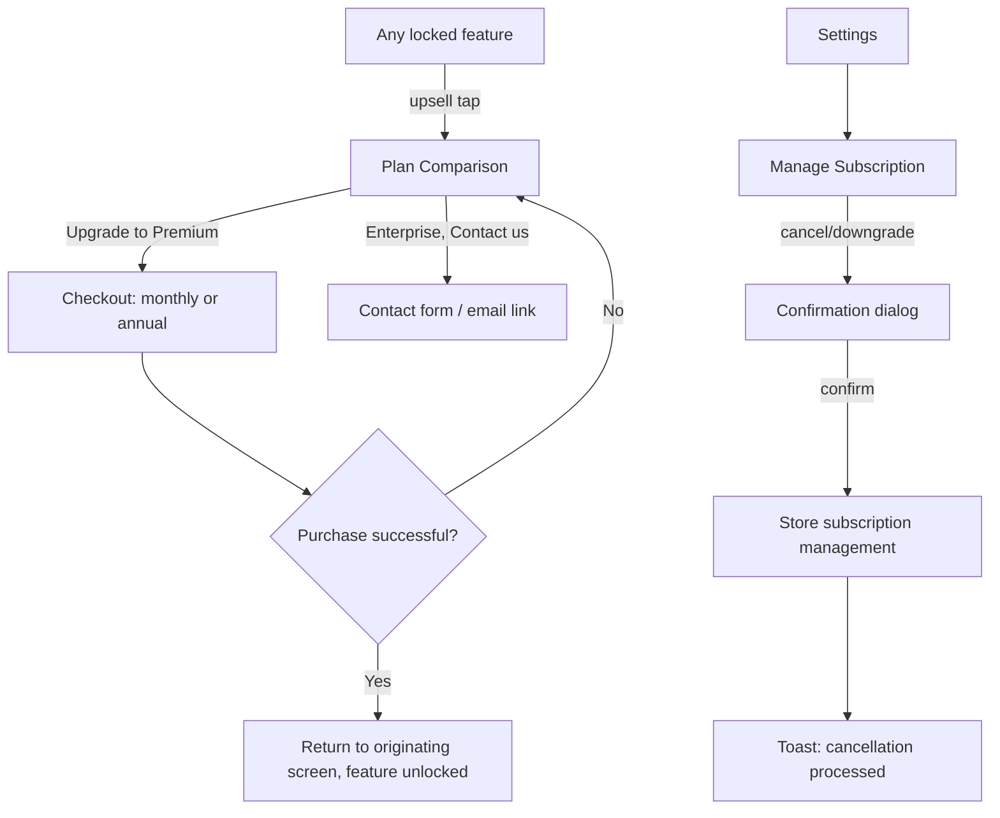
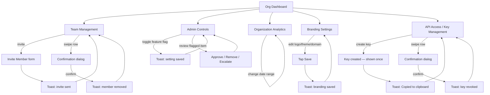

# Screens & Flows — TraderHub
## UI/UX Handoff: Full Screen Inventory, Contents, and Pipelines

This doc is the UI/UX designer handoff: every screen in the app, what each screen contains, how screens connect, and the interaction pipeline for each feature. Product context: [PRD.md](./PRD.md). Data backing every field: [API_DATA_MODEL.md](./API_DATA_MODEL.md). Deeper flows for Strategy Notes/Analyzer: [NOTES_ANALYZER.md](./NOTES_ANALYZER.md). A flat per-screen content reference (no diagrams) is also available in [SCREEN_CONTENTS.md](./SCREEN_CONTENTS.md). Per-screen (not module-level) mermaid diagrams, including every Loading/Empty/Error/Toast state individually, live in [UI_FLOW_DIAGRAMS.md](./UI_FLOW_DIAGRAMS.md) — this doc stays at the module level; that one goes screen-by-screen.

Tier gating shorthand: **F** = Free, **P** = Premium, **E** = Enterprise (post-MVP, see ROADMAP.md — included here for completeness since the tier is priced/scoped in the PRD, but build it last).

---

## 0. Global Navigation Map

Bottom nav tabs: **Journal · Strategies · Watchlists · Portfolio · Community · Insights · Profile** (7 tabs — consider collapsing Strategies under Journal or Portfolio under Insights in a "More" tab if the nav bar feels crowded; flagged for design review). Enterprise screens (dotted lines above) only appear for org-admin accounts once Enterprise ships — see ROADMAP.md.

---

## 0.1 Cross-cutting state flow (applies inside every screen below)
Every screen in every module diagram that fetches data silently passes through this same state machine — shown once here rather than redrawn in each module's diagram. Full per-screen Loading/Error/Empty/Toast tagging: [SCREENS_MOBILE.md](./SCREENS_MOBILE.md)'s cross-cutting section and each screen's own listing.

## 0.2 Report / Block / Mute (recurring pattern — not redrawn per module)
This exact pattern appears three separate places (Public Profile overflow, Post Detail overflow, Conversation Detail overflow) — one flow, reused everywhere it's mentioned in the module sections below.

---

## 1. Auth & Profile

| Screen | Tier | Contains |
|---|---|---|
| Splash / Onboarding | All | App logo, brief value prop (five pillars), Get Started / Log In buttons |
| Sign Up | All | Email/password fields, Google/Apple OAuth buttons, handle picker, ToS/privacy checkbox |
| Log In | All | Email/password fields, OAuth buttons, "Forgot password?" link |
| Forgot Password | All | Email input, reset-link confirmation state |
| Own Profile | All | Avatar/profile picture, handle, bio, experience level, trading style, follower/following counts, public statistics (from Portfolio Dashboard, if public), subscription tier badge, "Public Journals" toggle, tabs/links to their public posts and public Strategy Notes, tier upgrade CTA (Free only), Settings entry point |
| Public Profile (other user) | All | Avatar, handle, bio, experience level, trading style, follower/following counts, public statistics (if shared), their public posts, their public Strategy Notes, their public journal entries (if `public_journals` is on), Follow/Unfollow button, Report/Block |
| Settings | All | Notification preferences (per category — see § 9), account (email/password change), subscription management entry, "Public Journals" visibility toggle, log out, delete account; Enterprise-only: link to Org Dashboard |

---

## 2. Trading Journal

| Screen | Tier | Contains |
|---|---|---|
| Journal List | F (limited count) / P+ (unlimited) | Search bar, filter chips (ticker, date, tag, strategy, outcome), entry cards showing ticker, date, outcome badge (win/loss/breakeven), P/L, snippet of notes; FAB "New Entry" |
| Journal Entry Detail | F/P/E | Ticker, entry/exit price, stop loss, target, size, side, P/L, outcome badge (tap to override), screenshots gallery, notes, psychology, mistakes made, lessons learned, linked strategy (tap to open), tags, "make public" toggle, edit/delete actions, "link to another entry" action (graph) |
| Journal Entry Create/Edit | F/P/E | Ticker input (autocomplete), screenshot attach button → auto-fill flow, trade fields (entry/exit/stop loss/target/size/side — editable pre-fill), P/L (auto-computed or manual), notes rich text area, psychology/mistakes/lessons text areas, tags input, strategy picker (link existing or create new), save/cancel |

---

## 3. Strategy Notes & Analyzer

| Screen | Tier | Contains |
|---|---|---|
| Strategy List | F: locked/upsell · P/E: full | Category filter chips, favorite toggle per card, cards showing title, category, visibility icon (private/public), win-rate summary if entries linked; FAB "New Strategy"; entry points to Strategy Analyzer and Graph View |
| Strategy Detail | P/E (read-only preview shown to Free with upsell) | Title, rendered rich text content, embedded charts/images, category, favorite toggle, visibility toggle (private/public), AI summary block (Premium — "Regenerate" button), linked journal entries count/link to Analyzer, "View version history" link, edit/delete |
| Strategy Editor | P/E | Rich text editor toolbar (headings, lists, images, embeds), title field, category picker/create, visibility toggle, save/cancel; autosave-to-draft indicator |
| Version History | P/E | List of versions (number, timestamp), tap to preview, "Restore this version" action |
| Strategy Analyzer | P/E | Per-strategy rollup cards: win rate, avg P/L, entry count, outcome breakdown (win/loss/breakeven chart); tap card → filtered journal entry list for that strategy |
| Graph View | P/E | Interactive force-directed graph canvas: entry nodes, strategy nodes, ticker nodes, edges (explicit entry-links + derived strategy/ticker links); tap node to open detail; pinch/zoom/pan; "link entries" mode |

---

## 4. Watchlists

| Screen | Tier | Contains |
|---|---|---|
| Watchlist List | F: 1 watchlist · P/E: unlimited | List of named watchlists, ticker-count per watchlist, favorites shortlist section at top, FAB "New Watchlist" |
| Watchlist Detail | F: no alerts · P/E: full | Ticker rows (symbol, last price, day change), per-ticker notes indicator, category grouping/filter, favorite star per ticker, swipe-to-remove, "Add Ticker" button |
| Add Ticker | F/P/E | Ticker search/autocomplete, category assignment, optional note field, "Set price alert" toggle |
| Price Alert Setup | P/E (Free: locked, upsell) | Threshold price input (above/below), notification preview, save/cancel |

---

## 5. Portfolio Dashboard

| Screen | Tier | Contains |
|---|---|---|
| Portfolio Dashboard | F: headline stats only · P/E: full | Headline stat cards (Total P/L, Win Rate, Avg RR, Max Drawdown), time-range toggle (weekly/monthly), Equity Curve chart, Monthly Growth chart, Win/Loss Distribution chart, Best Trade / Worst Trade cards (tap to open entry), "Strategy Performance" section entry point (Premium) |
| Strategy Performance Breakdown | P/E | Per-strategy performance cards (reuses Strategy Analyzer data from § 3), sortable by win rate/P&L/entry count |

---

## 6. Community

| Screen | Tier | Contains |
|---|---|---|
| Community Feed | F: limited reads/day, limited interaction · P/E: unlimited | Reverse-chron post cards (avatar, handle, ticker tag, content-type badge, text, optional image, like/comment/save counts), content-type filter chips (Trade Analysis, Educational, Psychology, Strategies, News, Market Discussion), FAB "New Post", daily-read-limit banner (Free only) |
| Post Detail | F/P/E | Full post content/image, content-type badge, comment thread, comment input, like button, save/bookmark button, report/block/mute on the author |
| Create Post | F/P/E | Text area, content-type picker, optional ticker tag, optional image/screenshot attach, post/cancel |
| Saved Posts | F/P/E | List of the user's bookmarked posts, same card format as feed, unsave action |
| Public Profile | (see § 1) | — |
| Followers / Following List | F/P/E | Searchable list of users, follow/unfollow inline |

---

## 7. Direct Messages — P/E only

| Screen | Tier | Contains |
|---|---|---|
| Direct Messages List | P/E (Free: locked) | Conversation rows sorted by recent activity (avatar, handle, last message preview, timestamp, unread indicator), new-message icon, swipe-to-mute/delete (hides locally, doesn't delete for the other participant) |
| Conversation Detail | P/E | Chat thread (real-time via Supabase Realtime), message bubbles with read receipts, message input bar, tier-downgrade and blocked-state variants replacing the input bar when sending isn't currently allowed |
| New Message | P/E | Handle search, tap a result to open an existing or new Conversation Detail |

---

## 8. AI Trading Assistant

| Screen | Tier | Contains |
|---|---|---|
| Ticker Search / Detail | F: basic analytics only · P/E: full | Ticker search bar, price chart, key indicators (RSI, MACD, SMA), news/sentiment summary block (Premium), "Ask AI" entry point (Premium), basic analytics view (Free) |
| AI Trading Assistant (chat) | P/E (Free: locked, upsell) | Chat-style thread scoped to a ticker, a watchlist, or the user's portfolio; message input; quick-action chips (risk-to-reward analysis, watchlist insights, AI Q&A); disclaimer footer on every AI message |
| Trade Review results | P/E | Triggered from Journal Entry Detail — AI commentary on the completed trade vs. the stated plan, disclaimer footer |
| AI Strategy Review results | P/E | Triggered from Strategy Detail — shows Claude's clarity/consistency review, flagged ambiguous rules, dismiss/re-run |
| AI Journal Analysis results | P/E | Date range picker, optional strategy filter, pattern summary (recurring mistakes, psychology trends, tag/outcome correlations), disclaimer footer |
| Weekly / Monthly Performance Review | P/E | AI-generated narrative layered over Portfolio Dashboard numbers, delivered in-app and as a notification |
| Daily Digest | P/E | Top movers list, AI summary block, disclaimer footer; delivered as push notification + in-app screen |

---

## 9. Notifications

| Screen | Tier | Contains |
|---|---|---|
| Notification Center | F/P/E | Chronological list grouped by category (market alert, community update, direct message, strategy reminder, AI recommendation, subscription reminder), read/unread state, tap-to-deep-link into the relevant screen, mark-all-read action |
| Notification Preferences | F/P/E | Per-category toggle (market alerts, community updates, direct messages, strategy reminders, AI recommendations, subscription reminders), push vs. in-app-only option per category |

---

## 10. Subscriptions

| Screen | Tier | Contains |
|---|---|---|
| Plan Comparison / Paywall | All | Free / Premium / Enterprise columns, feature checklist matching PRD.md § 5.10, monthly/annual toggle for Premium, "Contact us" for Enterprise, Upgrade CTA |
| Upgrade / Checkout | All | RevenueCat-driven native purchase sheet (App Store/Play) or Stripe checkout (web), plan/billing-cycle/price confirmation, success state |
| Manage Subscription | P/E | Current plan, billing cycle, renewal date, cancel/downgrade link (deep-links to store subscription management on mobile), billing history (web/Stripe only) |

---

## 11. Enterprise (post-MVP — build last, see ROADMAP.md)

| Screen | Tier | Contains |
|---|---|---|
| Org Dashboard | E | Org name/logo, member count, quick links to Team Management, Admin Controls, Org Analytics, Branding, API Keys |
| Team Management | E | Member list (name, role, seat status), invite member, remove member, role assignment |
| Admin Controls | E | Org-wide feature toggles, content moderation queue for org-internal posts (if applicable), device licensing list |
| Organization Analytics | E | Aggregate usage across org members: activation, engagement, AI usage volume |
| Branding Settings | E | Logo upload, color theme, custom domain (web) |
| API Access / Key Management | E | List of issued API keys, scopes, create/revoke key, usage logs |

Note: Enterprise's data model (`organizations`, `organization_members`, `api_keys`) is not yet specced in API_DATA_MODEL.md — flagged there and in ROADMAP.md as a design item to complete before this module is built.

---

## 12. Screen Count Summary
- Auth & Profile: 7 screens
- Trading Journal: 3 screens
- Strategy Notes & Analyzer: 6 screens
- Watchlists: 4 screens
- Portfolio Dashboard: 2 screens
- Community: 5 screens (1 shared with § 1)
- Direct Messages: 3 screens
- AI Trading Assistant: 7 screens
- Notifications: 2 screens
- Subscriptions: 3 screens
- Enterprise (post-MVP): 6 screens

**MVP total (§ 1–10, excluding Enterprise): ~42 screens.** Enterprise adds 6 more when built. Recurring cross-module patterns (§ 0.1 state flow, § 0.2 Report/Block/Mute) are documented once rather than redrawn per screen — see [UI_FLOW_DIAGRAMS.md](./UI_FLOW_DIAGRAMS.md) for the fully expanded per-screen version of every diagram in this doc.
