# Screens and flows: TradeX
## UI and UX handoff: screens and interaction pipelines

This document guides UI and UX designers by outlining every screen in the application, detailing component contents, and diagramming interaction flows between screens. For background product requirements, refer to [PRD.md](./PRD.md). For database schemas, see [API_DATA_MODEL.md](./API_DATA_MODEL.md). Strategy notes and analyzer workflows are documented further in [NOTES_ANALYZER.md](./NOTES_ANALYZER.md). For a flat per-screen listing without diagrams, see [SCREEN_CONTENTS.md](./SCREEN_CONTENTS.md). Detailed per-screen diagrams with isolated loading, empty, and error states live in [UI_FLOW_DIAGRAMS.md](./UI_FLOW_DIAGRAMS.md).

Tier gating shorthand: **F** = Free, **P** = Premium, **E** = Enterprise (post-MVP, see ROADMAP.md; included here for completeness since the tier is priced in the PRD, but built last).

---

## 0. Global navigation map

```mermaid
flowchart TD
    Splash[Splash / Onboarding] --> Auth{Logged in?}
    Auth -- No --> SignIn[Sign Up / Log In]
    Auth -- Yes --> Shell[App Shell: bottom nav]
    SignIn --> Shell

    Shell --> TabJournal[Tab: Journal]
    Shell --> TabStrategies[Tab: Strategies]
    Shell --> TabWatchlists[Tab: Watchlists]
    Shell --> TabPortfolio[Tab: Portfolio]
    Shell --> TabCommunity[Tab: Community]
    Shell --> TabInsights[Tab: Insights]
    Shell --> TabProfile[Tab: Profile / Settings]

    TabJournal --> JournalList[Journal List]
    JournalList --> JournalDetail[Journal Entry Detail]
    JournalList --> JournalCreate[Journal Entry Create/Edit]

    TabStrategies --> StrategyList[Strategy List]
    StrategyList --> StrategyDetail[Strategy Detail]
    StrategyList --> StrategyEditor[Strategy Editor]
    StrategyList --> Analyzer[Strategy Analyzer]
    StrategyList --> Graph[Graph View]
    StrategyDetail --> VersionHistory[Version History]

    TabWatchlists --> WatchlistList[Watchlist List]
    WatchlistList --> WatchlistDetail[Watchlist Detail]
    WatchlistDetail --> AddTicker[Add Ticker]
    WatchlistDetail --> PriceAlert[Price Alert Setup]

    TabPortfolio --> PortfolioHome[Portfolio Dashboard]
    PortfolioHome --> StrategyBreakdown[Strategy Performance Breakdown]
    StrategyBreakdown --> Analyzer

    TabCommunity --> FeedHome[Community Feed]
    FeedHome --> PostDetail[Post Detail]
    FeedHome --> CreatePost[Create Post]
    FeedHome --> SavedPosts[Saved Posts]
    FeedHome --> DMList[Direct Messages List]
    PostDetail --> PublicProfile[Public Profile]
    PublicProfile --> FollowersList[Followers / Following List]
    PublicProfile -->|Message, Premium/Enterprise viewer| ConvoDetail[Conversation Detail]
    DMList --> NewMessage[New Message]
    DMList --> ConvoDetail
    NewMessage --> ConvoDetail

    TabInsights --> TickerDetail[Ticker Search / Detail]
    TickerDetail --> AIAssistant[AI Trading Assistant]
    TabInsights --> DailyDigest[Daily Digest]

    TabProfile --> OwnProfile[Own Profile]
    OwnProfile --> FollowersList
    OwnProfile --> Settings[Settings]
    OwnProfile --> Paywall[Plan Comparison / Paywall]
    Paywall --> Checkout[Upgrade / Checkout]
    OwnProfile --> ManageSub[Manage Subscription]
    Settings --> NotificationCenter[Notification Center]
    Settings --> NotificationPrefs[Notification Preferences]
    Settings -->|Log Out| Splash
    Settings -->|Delete Account, confirmed| Splash

    Settings -.Enterprise only.-> OrgDashboard[Org Dashboard]
    OrgDashboard -.-> TeamMgmt[Team Management]
    OrgDashboard -.-> AdminControls[Admin Controls]
    OrgDashboard -.-> OrgAnalytics[Organization Analytics]
    OrgDashboard -.-> Branding[Branding Settings]
    OrgDashboard -.-> APIKeys[API Access / Key Management]
```

Bottom navigation tabs include Journal, Strategies, Watchlists, Portfolio, Community, Insights, and Profile. Teams may collapse Strategies under Journal or Portfolio under Insights into a "More" overflow menu if the bar feels cramped on smaller devices. Enterprise screens (shown with dotted lines) appear only for organization administrators once Enterprise ships.

---

## 0.1 Cross-cutting state flow
Every screen that fetches data follows this standard state pattern. Detailed tags for loading, error, empty, and toast states appear in [SCREENS_MOBILE.md](./SCREENS_MOBILE.md).

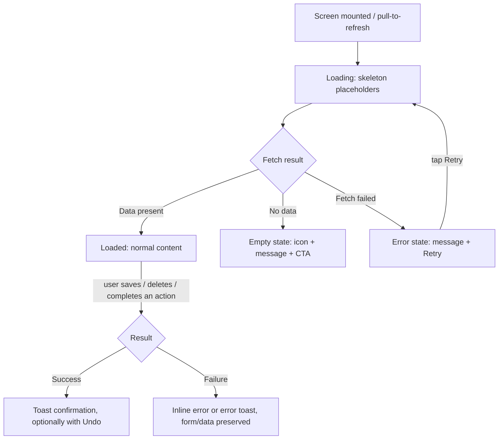

## 0.2 Report, block, and mute flow
This pattern appears on Public Profile, Post Detail, and Conversation Detail overflow menus.

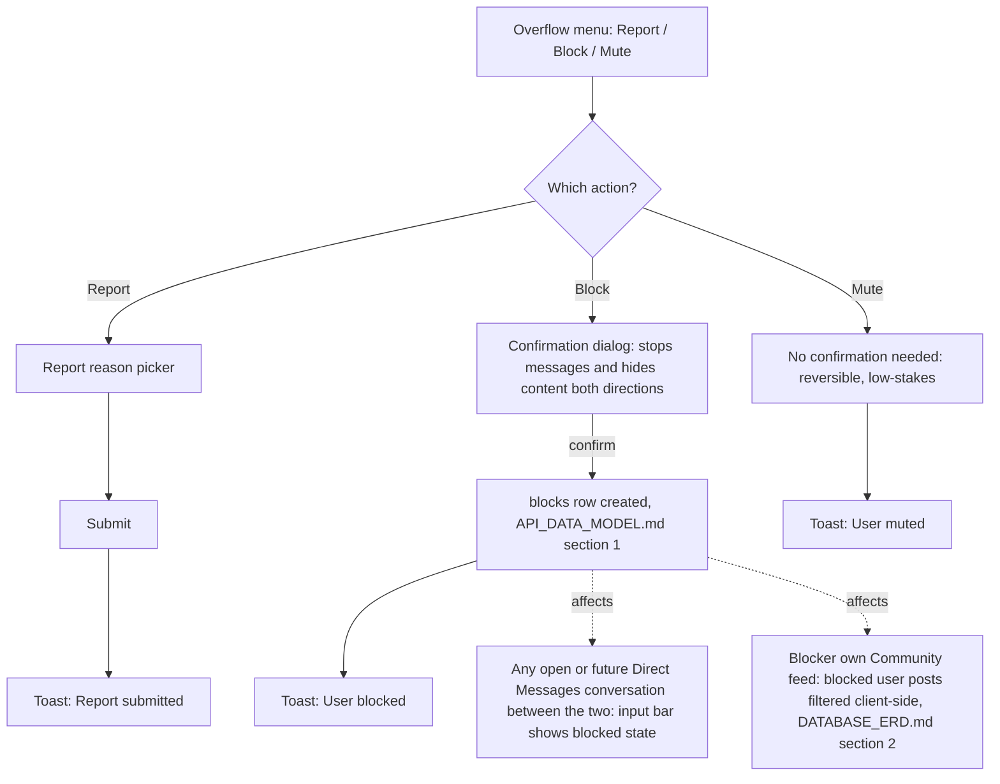

---

## 1. Auth and profile

| Screen | Tier | Contains |
|---|---|---|
| Splash and onboarding | All | App logo, brief value proposition across the five pillars, Get Started and Log In buttons |
| Sign up | All | Email and password fields, Google and Apple authentication, handle picker, terms and privacy checkbox |
| Log in | All | Email and password fields, OAuth buttons, "Forgot password?" link |
| Forgot password | All | Email input, reset link confirmation state |
| Personal profile | All | Avatar, handle, bio, experience level, trading style, follower and following counts, public performance stats, tier badge, public journals toggle, tabs for posts and strategy notes, upgrade CTA for free accounts, settings icon |
| Public profile (other user) | All | Avatar, handle, bio, experience level, trading style, follower and following counts, public stats if shared, public posts, strategy notes, and journals, Follow button, and report or block menu |
| Settings | All | Category notification controls, account settings for email and password, subscription management, public journals toggle, log out, delete account, and enterprise organization link |

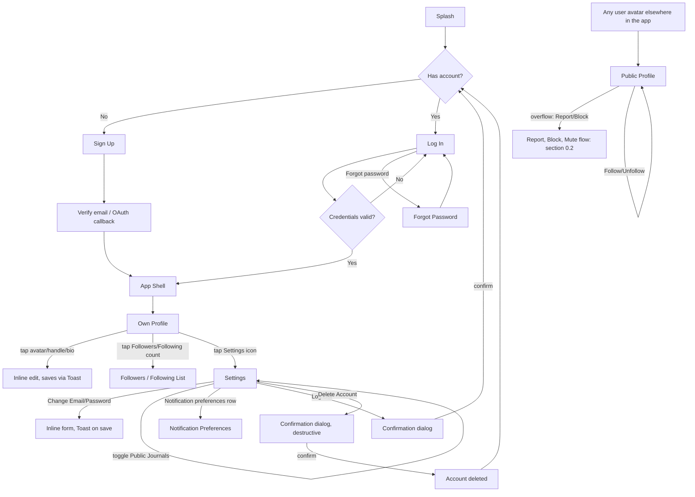

---

## 2. Trading journal

| Screen | Tier | Contains |
|---|---|---|
| Journal list | Free (limited count), Premium and Enterprise (unlimited) | Search bar, filter chips for ticker, date, tag, strategy, and outcome, entry cards with outcome badges and net P/L, and new entry action button |
| Journal entry detail | All | Ticker symbol, entry and exit prices, stop loss, target, position size, trade side, net P/L, outcome badge, screenshot carousel, notes, psychology, mistakes, lessons learned, linked strategy, tags, public toggle, edit and delete actions, entry linking |
| Journal entry create and edit | All | Ticker input with autocomplete, screenshot attachment with automated OCR pre-fill, trade parameters, auto-calculated P/L, notes, psychology, mistakes, lessons learned, tag chips, strategy picker, save and cancel controls |

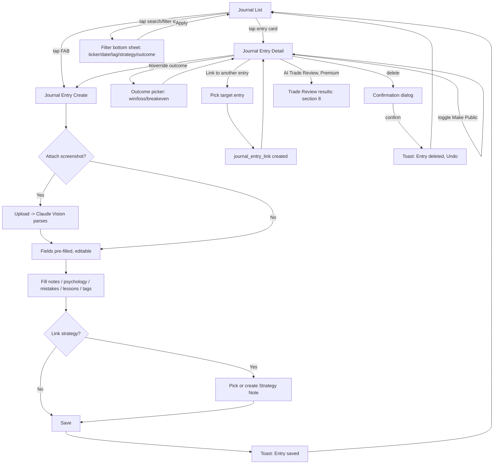

---

## 3. Strategy notes and analyzer

| Screen | Tier | Contains |
|---|---|---|
| Strategy list | Free (locked with upsell), Premium and Enterprise (full) | Category filter chips, favorite toggles, strategy cards with win rate summaries, new strategy button, links to Strategy Analyzer and Graph View |
| Strategy detail | Premium and Enterprise (read-only preview with upsell for Free) | Title, rich text body, embedded charts and media, category chip, favorite toggle, visibility toggle, AI summary block, linked trade counter, version history link, edit and delete buttons |
| Strategy editor | Premium and Enterprise | Rich text formatting toolbar, title field, category selector, visibility toggle, autosave draft status, save and cancel controls |
| Version history | Premium and Enterprise | Chronological revision list, preview pane, version restore button |
| Strategy analyzer | Premium and Enterprise | Rollup summary cards by strategy with win rate, average P/L, trade volume, outcome charts, and filtered trade lists |
| Graph view | Premium and Enterprise | Interactive node-link graph showing trade entries, strategies, and tickers, pan and zoom controls, manual entry-linking mode |

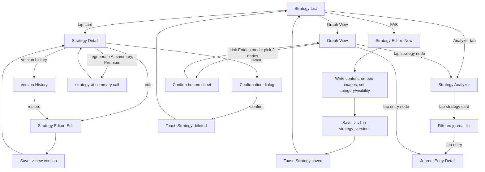

---

## 4. Watchlists

| Screen | Tier | Contains |
|---|---|---|
| Watchlist list | Free (1 watchlist), Premium and Enterprise (unlimited) | Watchlist collection, ticker counts per list, favorites preview bar, create watchlist button |
| Watchlist detail | Free (no alerts), Premium and Enterprise (full) | Ticker rows with latest prices and moves, notes indicator, category filter chips, favorite stars, swipe to remove, add ticker action |
| Add ticker | All | Ticker search with autocomplete, category selector, note field, price alert toggle |
| Price alert setup | Premium and Enterprise (Free shows paywall) | Above or below price condition, threshold input, alert preview string, save and cancel actions |

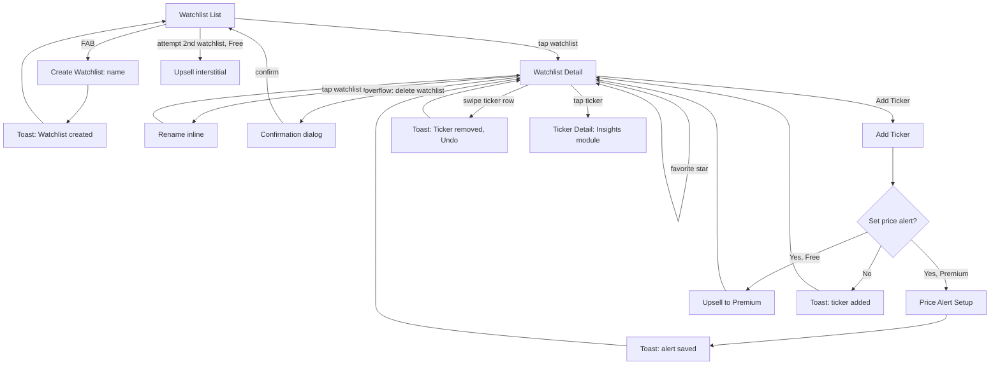

---

## 5. Portfolio dashboard

| Screen | Tier | Contains |
|---|---|---|
| Portfolio dashboard | Free (headline metrics only), Premium and Enterprise (full) | Stat cards for Total P/L, Win Rate, Average Risk/Reward, Maximum Drawdown, weekly and monthly toggle, equity curve, monthly growth bars, win/loss chart, best and worst trade cards, strategy performance section |
| Strategy performance breakdown | Premium and Enterprise | Per-strategy performance cards reusable from the Strategy Analyzer, sortable by win rate, profit, and entry count |

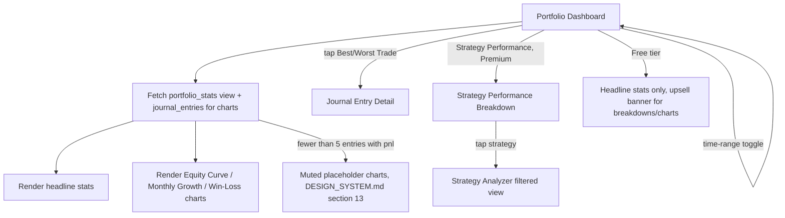

---

## 6. Community

| Screen | Tier | Contains |
|---|---|---|
| Community feed | Free (limited reads and interactions), Premium and Enterprise (unlimited) | Reverse chronological posts with avatars, tags, badges, text, images, and engagement counts; category filter chips; new post button; daily read limit alert on Free |
| Post detail | All | Full post text and image, category badge, comment list, comment input field, like button, save button, author moderation menu |
| Create post | All | Text editor, category selector, ticker search input, image upload button, post and cancel buttons |
| Saved posts | All | User bookmarks feed with swipe to unsave action |
| Followers and following list | All | Searchable user directory with inline follow and unfollow buttons |

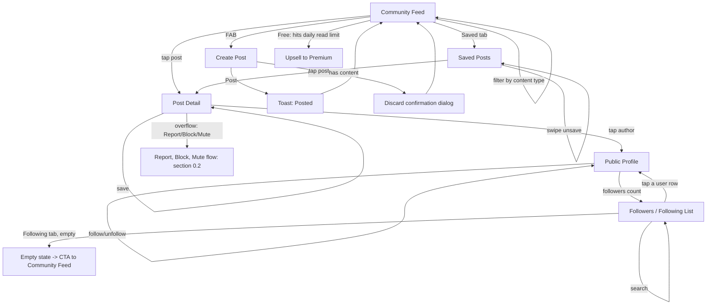

---

## 7. Direct messages (Premium and Enterprise)

| Screen | Tier | Contains |
|---|---|---|
| Direct messages list | Premium and Enterprise (Free shows paywall) | Active conversation rows with avatar, handle, message preview, timestamp, and unread indicator; new message button; swipe to mute or hide |
| Conversation detail | Premium and Enterprise | Realtime chat thread, message bubbles with delivery receipts, composer bar, downgrade and blocked message states |
| New message | Premium and Enterprise | Handle search input, mutual follow badges, conversation routing |

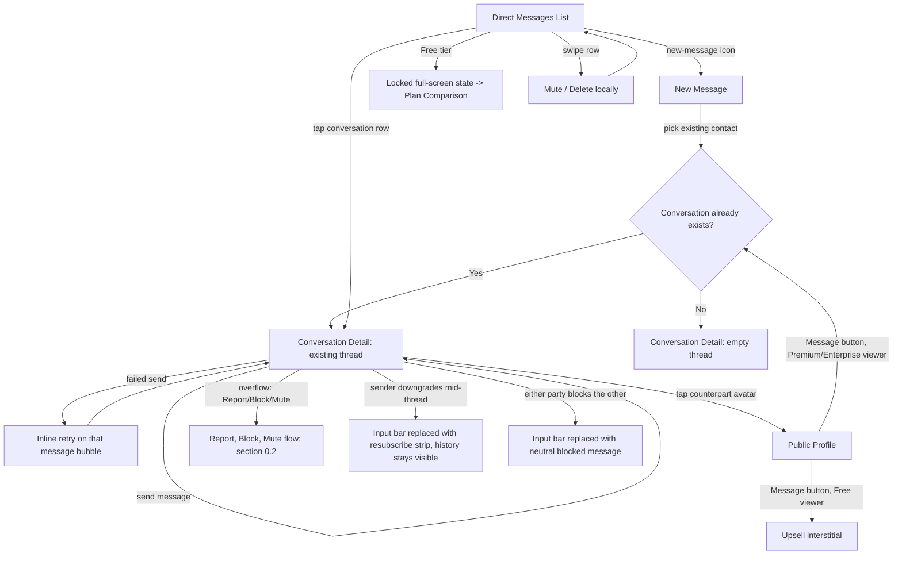

---

## 8. AI trading assistant

| Screen | Tier | Contains |
|---|---|---|
| Ticker search and detail | Free (basic analytics), Premium and Enterprise (full) | Ticker search bar, price chart, technical indicators (RSI, MACD, SMA), news and sentiment summary, "Ask AI" entry button, basic analytics view for Free |
| AI trading assistant chat | Premium and Enterprise (Free shows paywall) | Chat thread scoped to ticker, watchlist, or overall portfolio; query composer; prompt suggestions; disclaimer footer on every response |
| Trade review results | Premium and Enterprise | AI review analyzing an executed trade against its plan, disclaimer notice, re-run action |
| AI strategy review results | Premium and Enterprise | AI evaluation of strategy consistency and clarity, flagged conflicting rules, dismiss and re-run actions |
| AI journal analysis results | Premium and Enterprise | Date range picker, strategy filter, pattern analysis highlighting mistakes, emotional tendencies, and tag performance |
| Weekly and monthly performance review | Premium and Enterprise | AI narrative report reviewing portfolio results, delivered in-app and as a push notification |
| Daily digest | Premium and Enterprise | Top market movers, AI market overview, disclaimer notice, delivered via push alert and in-app feed |

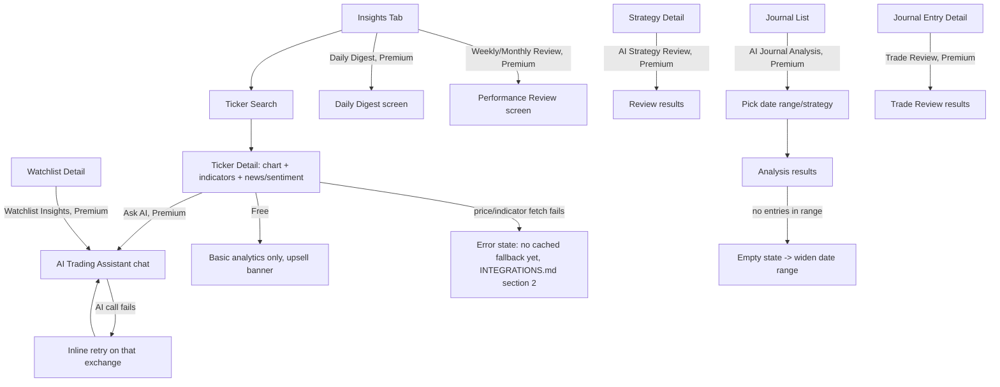

---

## 9. Notifications

| Screen | Tier | Contains |
|---|---|---|
| Notification center | All | Categorized alerts (market, community, direct messages, strategy, AI, subscription), read and unread indicators, tap to navigate, mark all read action |
| Notification preferences | All | Per-category delivery toggles, push versus in-app delivery options |

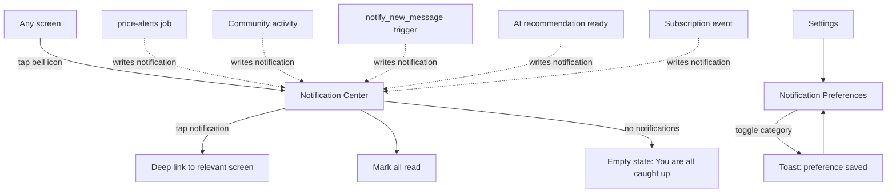

---

## 10. Subscriptions

| Screen | Tier | Contains |
|---|---|---|
| Plan comparison and paywall | All | Free, Premium, and Enterprise comparison tiers, feature matrix, monthly and annual pricing toggle, contact button for Enterprise, upgrade action |
| Upgrade and checkout | All | RevenueCat native app store purchase flow or web Stripe checkout, billing recap, confirmation screen |
| Manage subscription | Premium and Enterprise | Current tier, renewal schedule, cancellation link, billing invoices on web |

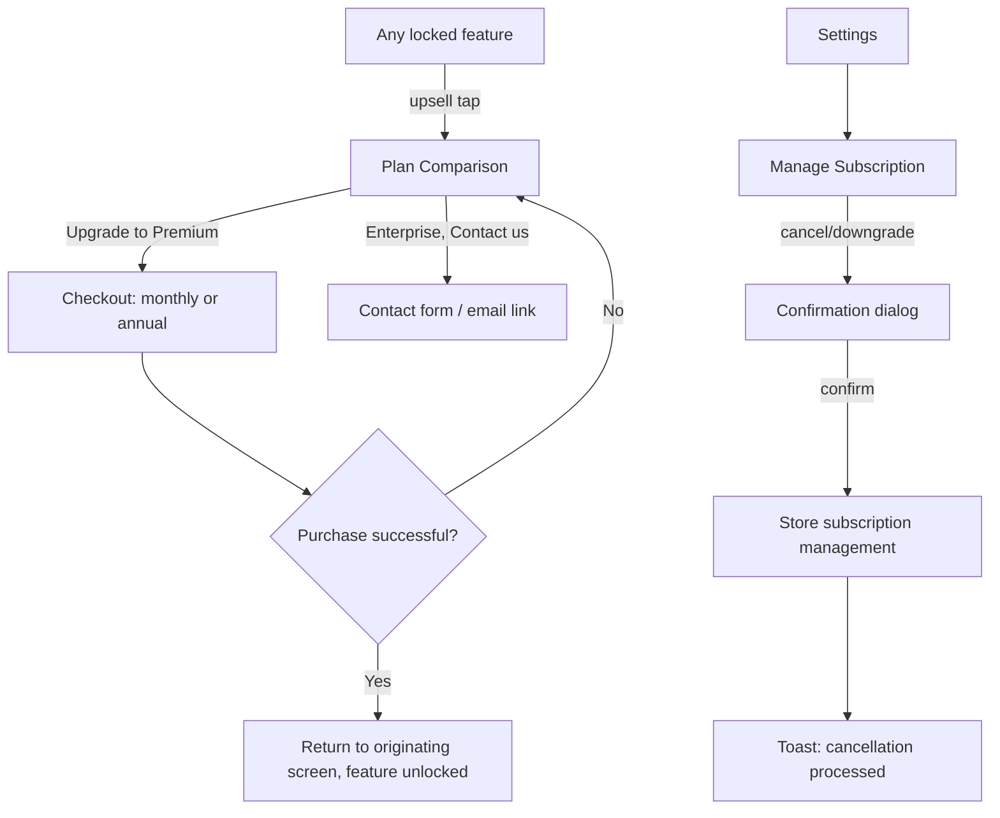

---

## 11. Enterprise (post-MVP, build last)

| Screen | Tier | Contains |
|---|---|---|
| Organization dashboard | Enterprise | Organization name and branding, member count, shortcuts to team settings, admin tools, analytics, branding, and API keys |
| Team management | Enterprise | Member roster with roles and seat status, invitation flow, member removal, permission adjustments |
| Admin controls | Enterprise | Organization feature flags, moderation queue for internal posts, device management |
| Organization analytics | Enterprise | Team-wide activity metrics: active seats, journal volume, AI requests |
| Branding settings | Enterprise | Logo customization, color palette selection, custom domain setup |
| API access and key management | Enterprise | Active API credentials, permission scopes, key creation and revocation, audit logs |

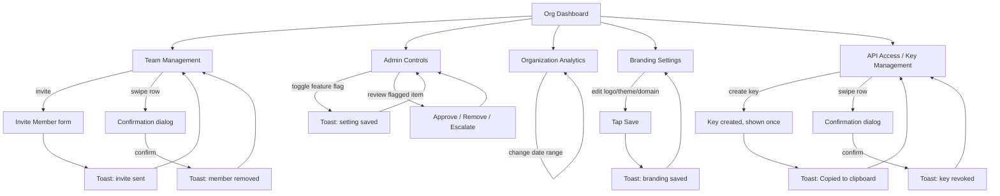

The data models for Enterprise (`organizations`, `organization_members`, `api_keys`) will be specified prior to developing this module.

---

## 12. Screen count summary
- Auth and profile: 7 screens
- Trading journal: 3 screens
- Strategy notes and analyzer: 6 screens
- Watchlists: 4 screens
- Portfolio dashboard: 2 screens
- Community: 5 screens (one shared with profile)
- Direct messages: 3 screens
- AI trading assistant: 7 screens
- Notifications: 2 screens
- Subscriptions: 3 screens
- Enterprise (post-MVP): 6 screens

**MVP total (sections 1 through 10, excluding Enterprise): approximately 42 screens.** Enterprise adds 6 additional screens. Cross-module patterns (section 0.1 state flow and section 0.2 moderation flow) are documented centrally. See [UI_FLOW_DIAGRAMS.md](./UI_FLOW_DIAGRAMS.md) for individual screen state diagrams.
