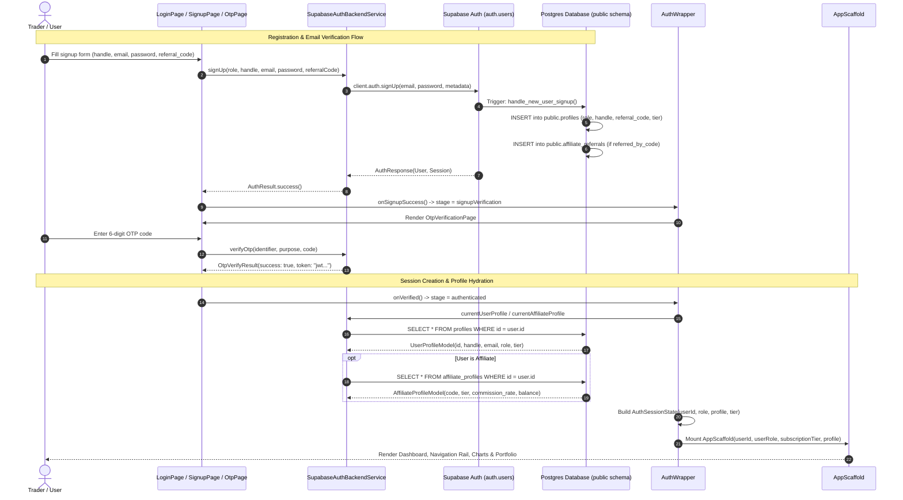

# TradeX authentication architecture, flowcharts, and database schema

Source: Generated from the frontend authentication pages (`AuthWrapper`, `LoginPage`, `SignupPage`, `OtpVerificationPage`, `ForgotPasswordPage`, `GetStartedPage`, `AffiliateApplicationPage`, and `SupabaseAuthBackendService`) and database migrations.

---

## 1. End-to-end auth state machine and navigation flowchart

This diagram outlines navigation routing, role handling, multi-step flows, OTP verification, and session creation.

```mermaid
flowchart TD
    %% Global Entry
    Start([App Launch or Deep Link]) --> SplashPage["1. SplashScreen<br/>(Logo Animation & Loading Spinner)"]
    
    SplashPage -->|onFinish Timer| GetStarted["2. GetStartedPage (Onboarding)<br/>• Hero & Feature Showcase<br/>• Institutional Community & AI Assistant<br/>• Live Market Scanner Preview"]
    
    %% Onboarding Choice
    GetStarted -->|Tap Get Started| SignupChoice["Set UserRole = Customer"] --> SignupPage
    GetStarted -->|Tap Sign In| LoginPage

    %% ----------------------------------------------------
    %% LOGIN PAGE & FLOW
    %% ----------------------------------------------------
    subgraph LoginFlow ["Login Page & Authentication"]
        LoginPage["3. LoginPage<br/>• Responsive Split Card (Desktop/Mobile)<br/>• RoleSelectorTab: Customer / Affiliate / User Admin<br/>• Fields: Email/Handle, Password, Admin Key (Admin only)<br/>• Social: Google Auth Button"]
        
        LoginPage -->|Switch Role| RoleTabLogin{"Selected Role"}
        RoleTabLogin -->|Customer or Affiliate| StandardLoginForm["Inputs: Email/Handle + Password"]
        RoleTabLogin -->|User Admin| AdminLoginForm["Inputs: Email/Handle + Password + Admin Security Key"]
        
        StandardLoginForm -->|Tap Login| ValidateLogin{"Client Validation"}
        AdminLoginForm -->|Tap Login| ValidateLogin
        
        ValidateLogin -->|Empty or Invalid| LoginError["Show UiCallout(danger):<br/>'Please enter valid credentials'"]
        LoginError --> LoginPage
        
        ValidateLogin -->|Valid Input| SubmitSignIn["SupabaseAuthBackendService.signIn()<br/>1. Resolve handle -> email if '@...'<br/>2. client.auth.signInWithPassword()<br/>3. Query 'profiles' by user.id<br/>4. Verify Role & Clearance"]
        
        SubmitSignIn -->|Auth Fails| LoginFailed["Show UiCallout(danger):<br/>Invalid credentials / Access Denied"] --> LoginPage
        SubmitSignIn -->|Role Mismatch| RoleDenied["Show Error: 'Account lacks User Admin clearance'<br/>or 'Affiliate application pending approval'"] --> LoginPage
        SubmitSignIn -->|Success| CreateSession["Create AuthSessionState & Toast<br/>• userId, displayName, email, role<br/>• subscriptionTier, profile, affiliateProfile"]
        
        LoginPage -->|Forgot Password Link| ForgotPasswordWizard
        LoginPage -->|Navigate to Signup| SignupPage
        LoginPage -->|Back Button| GetStarted
    end

    %% ----------------------------------------------------
    %% SIGNUP PAGE & FLOW
    %% ----------------------------------------------------
    subgraph SignupFlow ["Signup Page & Registration"]
        SignupPage["4. SignupPage<br/>• RoleSelectorTab: Customer / Affiliate (Admin disallowed)<br/>• Fields: Handler ID (@handle), Email, Password, Confirm Password<br/>• Affiliate: Optional Partner Referral Code (REF-...)<br/>• Social: Sign up with Google"]
        
        SignupPage -->|Switch Role| RoleTabSignup{"Selected Role"}
        RoleTabSignup -->|Customer| CustSignupForm["Inputs: Handle, Email, Password, Confirm Password"]
        RoleTabSignup -->|Affiliate| AffSignupForm["Inputs: Handle, Email, Password, Confirm Password, Referral Code"]
        
        CustSignupForm -->|Tap Create Account| ValidateSignup{"Client Validation"}
        AffSignupForm -->|Tap Create Account| ValidateSignup
        
        ValidateSignup -->|Validation Error| SignupError["Show UiCallout(danger): Error message"] --> SignupPage
        
        ValidateSignup -->|Valid Input| SubmitSignUp["SupabaseAuthBackendService.signUp()<br/>1. client.auth.signUp(email, password)<br/>2. Pass metadata: handle, role, referral_code<br/>3. Postgres trigger 'handle_new_user_signup'<br/>   creates public.profiles & affiliate_referrals"]
        
        SubmitSignUp -->|Signup Failed| SignupFail["Show UiCallout: Email taken / network error"] --> SignupPage
        SubmitSignUp -->|Signup Succeeded| RouteToOtp["Navigate to AuthStage.signupVerification"]
        
        SignupPage -->|Navigate to Login| LoginPage
        SignupPage -->|Back Button| GetStarted
    end

    %% ----------------------------------------------------
    %% OTP VERIFICATION SCREEN
    %% ----------------------------------------------------
    subgraph OtpFlow ["OTP Verification Page"]
        RouteToOtp --> OtpPage["5. OtpVerificationPage<br/>• Purpose: OtpPurpose.signupVerification<br/>• Title: 'Verify your email'<br/>• Subtitle: Sent 6-digit code to email<br/>• 6-digit UiOtpField with auto-focus & auto-submit<br/>• 60s Resend Timer Cooldown"]
        
        OtpPage -->|Enter 6-digit code| VerifyOtp{"AuthOtpRepository.verifyOtp"}
        VerifyOtp -->|Invalid or Test Code 000000| OtpError["Show UiCallout: 'Invalid or expired code'<br/>Clear OTP field"] --> OtpPage
        OtpPage -->|Resend Code after Cooldown| ResendOtp["AuthOtpRepository.resendOtp()<br/>Restart 60s timer + Toast"] --> OtpPage
        
        VerifyOtp -->|Valid Code - Token Issued| OtpSuccess{"Check User Role"}
        OtpPage -->|Back to Signup| SignupPage
        
        OtpSuccess -->|Customer Role| SubPricingPage["6. SubscriptionPricingPage (INR Plans)<br/>• 3 Pricing Tier Cards (Free / Pro / Enterprise)<br/>• Monthly vs Annual (Save 20%) Toggle<br/>• Feature Comparison Matrix<br/>• Categorized FAQ Accordions<br/>• 'Continue with Free' or 'Upgrade'"]
        OtpSuccess -->|Affiliate Role| AffAppWizard["7. AffiliateApplicationPage<br/>(Onboarding Wizard)"]
    end

    %% ----------------------------------------------------
    %% AFFILIATE APPLICATION 4-STEP WIZARD
    %% ----------------------------------------------------
    subgraph AffiliateApplicationFlow ["Affiliate Application Wizard"]
        AffAppWizard --> Step0["Step 0: Personal Identity<br/>• Full Name, Email, Phone + Verification<br/>• City, State, DOB (Age >= 18), Gender"]
        Step0 -->|Next Step| Step1["Step 1: Social & Audience Reach<br/>• Platforms (YouTube, IG, X, Discord, etc.)<br/>• Primary Platform, Channel Handle<br/>• Audience Reach tier & Content Niches<br/>• Sample Content Link"]
        Step1 -->|Next Step| Step2["Step 2: Payout & Tax Banking<br/>• Account Holder, Bank Name, Account Number<br/>• IFSC Code Validation (regex: ^[A-Z]{4}0[A-Z0-9]{6}$)<br/>• Account Type, PAN Card (regex: ^[A-Z]{5}[0-9]{4}[A-Z]$)<br/>• Optional UPI ID"]
        Step2 -->|Next Step| Step3["Step 3: Agreement & Review<br/>• Summary Review Card<br/>• Terms of Service & Compliance Checkbox"]
        Step3 -->|Submit Application| SubmitAffApp["Save to 'affiliate_applications'<br/>status = 'pending_review'<br/>Toast: Application Submitted"]
        
        SubmitAffApp -->|Route to Subscription| SubPricingPage
        AffAppWizard -->|Cancel or Skip| SubPricingPage
    end

    %% ----------------------------------------------------
    %% SUBSCRIPTION & PRICING
    %% ----------------------------------------------------
    subgraph SubscriptionFlow ["Subscription & Plan Chooser"]
        SubPricingPage -->|Select Plan / Skip| CreateSession
    end

    %% ----------------------------------------------------
    %% FORGOT PASSWORD 4-STEP WIZARD
    %% ----------------------------------------------------
    subgraph ForgotPasswordFlow ["Forgot Password Multi-Step Flow"]
        ForgotPasswordWizard["8. ForgotPasswordPage (Single-Column Security Card)<br/>Header: Step Indicator & Back to Sign in"]
        
        ForgotPasswordWizard --> FPStep0["Step 0: Request Reset<br/>• Enter registered email<br/>• Tap 'Send Reset Code'"]
        FPStep0 -->|Submit Email| SendResetReq["AuthRepository.resetPassword()<br/>+ AuthOtpRepository.sendOtp(reset)"]
        SendResetReq -->|Code Dispatched| FPStep1["Step 1: Verify OTP<br/>• 6-digit UiOtpField<br/>• 60s Resend Cooldown<br/>• Verify OTP -> receive _resetToken"]
        
        FPStep1 -->|Code Verified| FPStep2["Step 2: Set New Password<br/>• New Password (>= 8 chars)<br/>• Confirm New Password<br/>• Tap 'Update Password'"]
        FPStep2 -->|Update Password| FPStep3["Step 3: Password Updated Confirmation<br/>• Success check icon<br/>• 'Password Updated!' message<br/>• Tap 'Sign In Now'"]
        
        FPStep3 -->|Sign In Now| LoginPage
        ForgotPasswordWizard -->|Back to Sign in| LoginPage
    end

    %% ----------------------------------------------------
    %% AUTHENTICATED SESSION SHELL
    %% ----------------------------------------------------
    subgraph AuthenticatedShell ["Authenticated AppShell"]
        CreateSession --> AppScaffoldView["8. AppScaffold Shell<br/>• Hydrated UserProfile (id, handle, email, role, tier)<br/>• Active AffiliateProfile (if affiliate)<br/>• NavigationRail & Dashboard/Market/Journal/AI Blocks"]
        
        AppScaffoldView -->|Switch Role| RoleSwitch["AuthWrapper._handleSwitchRole()<br/>Update active session role"] --> AppScaffoldView
        AppScaffoldView -->|Sign Out Action| LogoutAction["AuthRepository.signOut()<br/>1. client.auth.signOut()<br/>2. Clear local cache & memory profiles<br/>3. Reset to AuthStage.login"] --> LoginPage
    end

    %% Styling
    classDef pageStyle fill:#1e293b,stroke:#3b82f6,stroke-width:2px,color:#f8fafc;
    classDef processStyle fill:#0f172a,stroke:#64748b,stroke-width:1px,color:#e2e8f0;
    classDef successStyle fill:#064e3b,stroke:#10b981,stroke-width:2px,color:#ecfdf5;
    classDef errorStyle fill:#7f1d1d,stroke:#ef4444,stroke-width:1px,color:#fee2e2;

    class SplashPage,GetStarted,LoginPage,SignupPage,OtpPage,AffAppWizard,SubPricingPage,ForgotPasswordWizard,AppScaffoldView pageStyle;
    class SubmitSignIn,SubmitSignUp,SubmitAffApp,SendResetReq,LogoutAction processStyle;
    class CreateSession,FPStep3 successStyle;
    class LoginError,SignupError,OtpError,LoginFailed,RoleDenied errorStyle;
```

---

## 2. Session creation, trigger, and token exchange lifecycle

---

## 3. Database schema and tables created for authentication

```mermaid
erDiagram
    %% Auth Users
    AUTH_USERS {
        uuid id PK "Supabase Auth UID"
        text email "User email address"
        text encrypted_password "Bcrypt / Argon2 hash"
        jsonb raw_user_meta_data "Metadata: handle, role, referral"
        timestamptz email_confirmed_at "Email confirmation timestamp"
        timestamptz created_at
        timestamptz updated_at
    }

    %% Public Profiles
    PROFILES {
        uuid id PK "FK -> auth.users.id (ON DELETE CASCADE)"
        citext handle UK "Unique handler ID (@username)"
        citext email UK "Unique lowercase email"
        text display_name "Display name"
        text role "customer | affiliate | user_admin"
        text status "active | suspended | pending_approval"
        text admin_key "Master admin security clearance key"
        text referral_code UK "Generated referral code"
        text referred_by_code "Referral code of inviter"
        text bio "User biography"
        text avatar_url "Avatar image URL"
        text experience_level "Beginner | Intermediate | Advanced"
        text trading_style "Intraday | Swing | Scalp"
        boolean public_journals "Share trading journal publicly"
        text subscription_tier "free | pro | enterprise"
        timestamptz created_at
        timestamptz updated_at
    }

    %% Affiliate Profiles
    AFFILIATE_PROFILES {
        uuid id PK "FK -> profiles.id (ON DELETE CASCADE)"
        text affiliate_code UK "Unique affiliate referral code"
        text tier "standard | silver | gold | platinum"
        numeric commission_rate "Default 0.15 (15%)"
        integer total_referrals "Total referred traders"
        integer active_referrals "Active trading referrals"
        numeric total_earnings "Lifetime earned commission"
        numeric unpaid_balance "Available balance for payout"
        numeric paid_earnings "Total settled payouts"
        text payout_method "bank_transfer | paypal | stripe | crypto"
        jsonb payout_details "Bank / UPI / Tax information"
        text status "pending | active | suspended"
        timestamptz created_at
        timestamptz updated_at
    }

    %% Affiliate Applications
    AFFILIATE_APPLICATIONS {
        uuid id PK "gen_random_uuid()"
        uuid user_id FK "FK -> profiles.id (ON DELETE CASCADE)"
        text full_name "Applicant full name"
        text email "Contact email"
        text phone "Verified phone number"
        text city "City"
        text state "State"
        date date_of_birth "DOB (Age >= 18)"
        text gender "Gender"
        text[] platforms "Social platforms array"
        text primary_platform "Primary channel"
        text channel_handle "Social handle (@...)"
        text audience_reach "Follower bracket"
        text[] niches "Content niches"
        text sample_link "Sample content URL"
        text account_holder "Bank account holder name"
        text bank_name "Bank name"
        text account_number "Bank account number"
        text ifsc "IFSC code"
        text account_type "Savings | Current"
        text pan "Indian Income Tax PAN"
        text upi_id "Optional UPI ID"
        text status "draft | pending | approved | rejected | suspended"
        text review_notes "Admin audit remarks"
        timestamptz submitted_at
        timestamptz reviewed_at
    }

    %% Affiliate Referrals
    AFFILIATE_REFERRALS {
        uuid id PK "gen_random_uuid()"
        uuid affiliate_id FK "FK -> profiles.id"
        uuid referred_user_id UK "FK -> profiles.id (One conversion per user)"
        text referral_code "Used referral code"
        text status "pending | converted | churned"
        numeric bonus_awarded "Fixed signup bonus (e.g. $50.00)"
        timestamptz created_at
        timestamptz updated_at
    }

    %% Affiliate Payouts
    AFFILIATE_PAYOUTS {
        uuid id PK "gen_random_uuid()"
        uuid affiliate_id FK "FK -> profiles.id"
        numeric amount "Payout withdrawal amount"
        text currency "Default USD / INR"
        text status "pending | processing | paid | failed | cancelled"
        text payout_method "bank_transfer | upi | crypto"
        text transaction_reference "UTR / Bank reference number"
        text notes "Admin / Audit remarks"
        timestamptz processed_at
        timestamptz created_at
        timestamptz updated_at
    }

    %% OTP Verification Codes
    OTP_CODES {
        uuid id PK "gen_random_uuid()"
        text identifier "Email or Phone number"
        text purpose "signup | reset | login"
        text code_hash "Bcrypt hash of 6-digit code"
        text token "Continuation or session token"
        integer attempt_count "Failed attempt counter"
        timestamptz expires_at "5-10 min expiry timestamp"
        timestamptz consumed_at "Timestamp when code was used"
        timestamptz created_at
    }

    %% Subscriptions
    SUBSCRIPTIONS {
        uuid user_id PK "FK -> profiles.id (ON DELETE CASCADE)"
        text tier "free | pro | enterprise"
        text status "active | canceled | past_due"
        text revenuecat_id UK "RevenueCat customer ID"
        text billing_cycle "monthly | annual"
        timestamptz renewed_at
        timestamptz expires_at
        timestamptz created_at
        timestamptz updated_at
    }

    %% Device Tokens
    DEVICE_TOKENS {
        uuid id PK "gen_random_uuid()"
        uuid user_id FK "FK -> profiles.id (ON DELETE CASCADE)"
        text token "FCM / APNs device push token"
        text platform "ios | android | web | macos"
        timestamptz created_at
        timestamptz updated_at
    }

    %% Relationships
    AUTH_USERS ||--|| PROFILES : "1:1 cascades to public.profiles"
    PROFILES ||--o| AFFILIATE_PROFILES : "1:0..1 profile is affiliate"
    PROFILES ||--o{ AFFILIATE_APPLICATIONS : "1:N applications submitted"
    PROFILES ||--o{ AFFILIATE_REFERRALS : "1:N referred traders"
    PROFILES ||--o{ AFFILIATE_PAYOUTS : "1:N payout withdrawals"
    PROFILES ||--|| SUBSCRIPTIONS : "1:1 subscription state"
    PROFILES ||--o{ DEVICE_TOKENS : "1:N registered devices"
```

---

## 4. Frontend page to database entity mapping matrix

| Page component | User actions and triggers | Service and repository methods | Backing database tables | App state transition |
| :--- | :--- | :--- | :--- | :--- |
| [`SplashScreen`](file:///Users/nitishkumar/Downloads/Projects/nk2552003/TradeX/lib/features/auth/presentation/pages/splash_screen.dart) | Initial app launch | None | None | `AuthStage.onboarding` |
| [`GetStartedPage`](file:///Users/nitishkumar/Downloads/Projects/nk2552003/TradeX/lib/features/auth/presentation/pages/get_started_page.dart) | "Get Started" / "Sign In" | None | None | `AuthStage.signup` / `AuthStage.login` |
| [`LoginPage`](file:///Users/nitishkumar/Downloads/Projects/nk2552003/TradeX/lib/features/auth/presentation/pages/login_page.dart) | Submit Email/Handle + Password (+ Admin Key if User Admin) | `SupabaseAuthBackendService.signIn()` | `auth.users`, `public.profiles`, `public.affiliate_profiles`, `public.affiliate_applications` | `AuthStage.authenticated` (`AppScaffold`) |
| [`SignupPage`](file:///Users/nitishkumar/Downloads/Projects/nk2552003/TradeX/lib/features/auth/presentation/pages/signup_page.dart) | Submit Handle + Email + Password (+ Referral Code if Affiliate) | `SupabaseAuthBackendService.signUp()` | `auth.users`, `public.profiles`, `public.affiliate_referrals` (via trigger) | `AuthStage.signupVerification` (`OtpVerificationPage`) |
| [`OtpVerificationPage`](file:///Users/nitishkumar/Downloads/Projects/nk2552003/TradeX/lib/features/auth/presentation/pages/otp_verification_page.dart) | Enter 6-digit OTP code / Resend | `AuthOtpRepository.verifyOtp()` and `resendOtp()` | `public.otp_codes`, `auth.users` | If Customer: `AuthStage.subscription` If Affiliate: `AuthStage.affiliateApplication` |
| [`AffiliateApplicationPage`](file:///Users/nitishkumar/Downloads/Projects/nk2552003/TradeX/lib/features/affiliate_program/presentation/pages/affiliate_application_page.dart) | 4-step wizard (Personal to Social to Banking to Review) | `AffiliateApplicationRepository.submit()` | `public.affiliate_applications` (`status: pending_review`) | `AuthStage.subscription` (Review plans before dashboard) |
| [`SubscriptionPricingPage`](file:///Users/nitishkumar/Downloads/Projects/nk2552003/TradeX/lib/features/auth/presentation/pages/subscription_pricing_page.dart) | Choose Plan / Billed Annual Toggle / Continue Free | `SubscriptionPricingRepository.selectPlan()` | `public.subscriptions`, `public.profiles` | `AuthStage.authenticated` (`AppScaffold`) |
| [`ForgotPasswordPage`](file:///Users/nitishkumar/Downloads/Projects/nk2552003/TradeX/lib/features/auth/presentation/pages/forgot_password_page.dart) | 4-step inline wizard (Request to OTP to New Password to Confirm) | `AuthRepository.resetPassword()` and `AuthOtpRepository.verifyOtp()` | `auth.users`, `public.otp_codes` | `AuthStage.login` |
| [`AppScaffold`](file:///Users/nitishkumar/Downloads/Projects/nk2552003/TradeX/lib/core/widgets/app_scaffold.dart) | Sign Out | `SupabaseAuthBackendService.signOut()` | `auth.users` (Revokes session) | `AuthStage.login` |
